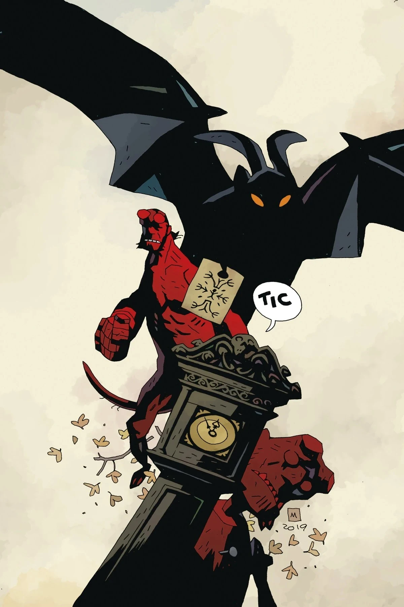

***《她的致命时刻》*** 是一篇短篇故事，与 *[《送行》](/entry/The_Sending)* 一同刊登在一期单行本中，两篇均由 [Mike Mignola](/entry/Mike_Mignola) 编剧、[Tiernen Trevallion](/entry/Tiernen_Trevallion) 作画。《她的致命时刻》让 *[《瓦尔古之兽》](/entry/The_Beast_of_Vargu)* 与 *[《罗姆人的秘密之神》](/entry/The_Secret_God_of_the_Roma)* 中的罗姆人角色再度登场。

## 出版历史

该期原定于 5 月发行，后因新冠疫情暴发而延期。

## 剧情简介

在地狱男爵与瓦尔古之兽那场厄运缠身的纠葛过去多年之后，曾帮助过他的罗姆女人要他偿还这份人情债。年轻的女子在一段误入歧途的恋情中被恶魔缠上，她借助一只熟悉的旧木偶的力量向地狱男爵求助，一场充满魔法与混乱的超自然对决随即展开！

## 画廊

*《地狱男爵与超自然调查防御署：  
她的致命时刻与送行》*  
[Tiernen Trevallion](/entry/Tiernen_Trevallion) 封面

*《地狱男爵与超自然调查防御署：  
她的致命时刻与送行》*  
[Mike Mignola](/entry/Mike_Mignola) 变体封面

《地狱男爵与超自然调查防御署》出版顺序

&#10;
前作
《七任妻子俱乐部》
《她的致命时刻》

后续
《送行》

|Hellboy and the B.P.R.D.: Her Fatal Hour and The Sending Mike Mignola variant cover
