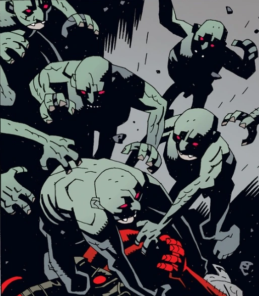

**何蒙库鲁兹（homunculus，人造人）**是用血液与草药制成、再置于粪肥中煨制而成的人造人类。

## 已知的何蒙库鲁兹

### [罗杰](/entry/Roger)

罗杰是地狱男爵系列中最知名的何蒙库鲁兹，他首次登场于 *[《唤醒恶魔》](/entry/Wake_the_Devil)*（Wake the Devil）故事线，一队 [超自然调查防御署](/entry/Bureau_for_Paranormal_Research_and_Defense) 探员在罗马尼亚发现了他。探员之一丽兹·舍曼将自己的念火能量注入这个造物体内，使他获得了生命。罗杰随即杀死了 [巴德·沃勒](/entry/Bud_Waller)（Bud Waller）并逃走。之后罗杰见到了他的“兄弟”，后者告知了他自己的诞生经过以及创造者的事。罗杰的兄弟随后计划用人体脂肪造出一具巨大的身躯，供他们俩居住。然而这一计划被 [地狱男爵](/entry/Hellboy) 和凯特·考瑞根阻止。地狱男爵随后为罗杰取了名字，罗杰则把丽兹·舍曼的念火能量重新输回她体内，让已经死去的舍曼复活。

此后罗杰继续担任超自然调查防御署探员多年，直至去世。

### [邪恶兄弟](/entry/Roger's_brother)

*参见 [《近乎巨神》](/entry/Almost_Colossus)（Almost Colossus）*

罗杰的邪恶兄弟诞生于五百年前，由一位炼金术士所造，但炼金术士为追求其他研究项目而抛弃了他。这位兄弟一直秘密存活，直到听说自己的创造者被宗教裁判所囚禁。他于是闯入创造者的牢房，从其腹中扯出一把钥匙，钥匙能打开一个装有创造者全部配方与秘密基地信息的盒子。这位兄弟随后寻求罗杰的帮助，想用人体部件造出一具巨型身躯。但罗杰背叛了他的兄弟，摧毁了那具巨型身躯。

### 邪恶兄弟的爪牙

多年来，罗杰的兄弟制造了一批粗陋的何蒙库鲁兹，协助他实施阴谋。
