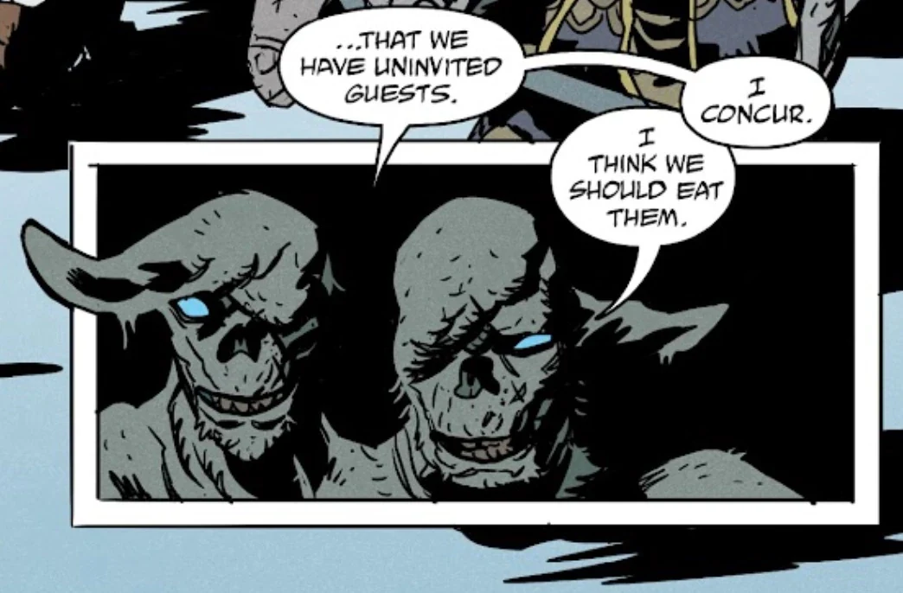

**赫拉斯维尔格尔**是北欧神话中一头长着两个脑袋的恐怖霜巨人。

## 历史

在巨人之王索列姆复活之后，赫拉斯维尔格尔是那些以腐烂形态重新现身的、孔武的北欧怪物与巨人之一。在已修复的[乌特加德](/entry/Utgard)——即巨人的城堡——里，他和其他几个巨人正在吞食被俘获的人类。赫拉斯维尔格尔和巨人们被[地狱男爵](/entry/Hellboy_(character))、[亚伯·塞皮恩](/entry/Abe_Sapien)、[佩妮拉·艾克曼](/entry/Pernilla_Aickman)以及几名[矮人](/entry/Dwarf)发现，双方随即爆发了一场战斗。

他和大多数巨人都被地狱男爵所杀，后者手持[雷神托尔](/entry/Thor)的神锤[妙尔尼尔](/entry/Mjollnir)，并被雷霆之神的诸灵附身。赫拉斯维尔格尔在第一击后侥幸未死，却已受了致命伤，他问地狱男爵/托尔，他们所经历的这一切究竟是不是真实的。这位恶魔之子/神祇回答说是的，随即将巨人击倒。

## 神话

待补充

## 登场

- [《巨人之骨》](/entry/The_Bones_of_Giants_(comic_miniseries))
