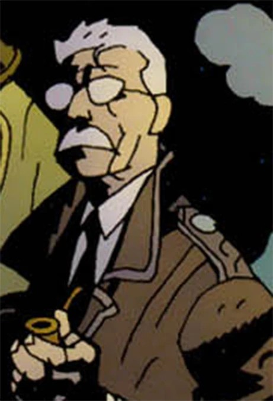
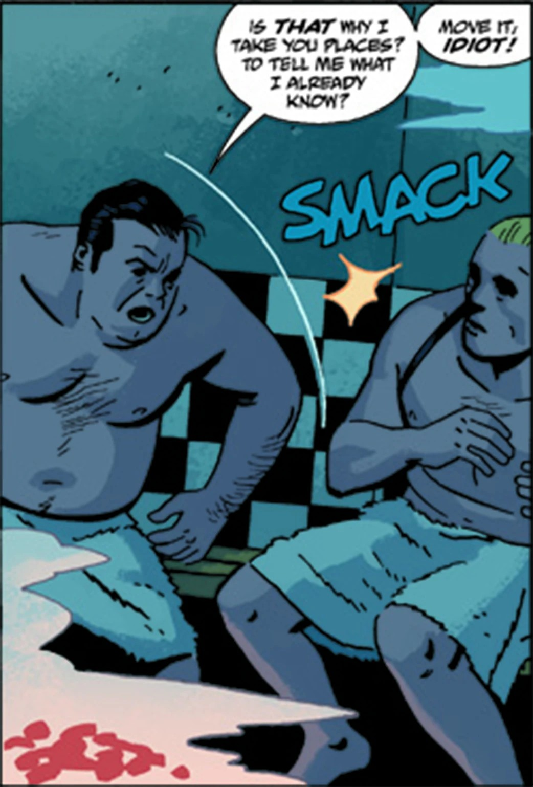

**人类**(*Homo sapiens*)或称**凡人**，是地狱男爵宇宙中地球上的寻常众生。大多数人终其一生都对形形色色、处心积虑要让他们的生活苦不堪言的超自然威胁浑然不觉，倒也活得安稳。

那些确实接触到神秘事物的人，通常的下场无非是死亡、变异、发疯，或者加入[超自然调查防御署](/entry/B.P.R.D.)。

## 历史

人类是第二代人。早在第一代人——[极北族人](/entry/Hyperboreans)——陨落很久之后，人类才兴盛起来。不过，极北族人与早期人类之间曾有过一些接触。极北族祭司挑选了少数人类，教他们如何召唤并运用[维利](/entry/Vril)。这些人——例如[尚钦](/entry/Shonchin)(Shonchin)——曾率领早期人类的群落对抗史前世界中的怪物。早期人类不得不应对诸如[寒族](/entry/Vampire_(creature))(Cold People)以及开始悄然渗回这个世界的[奥格德鲁·赫姆](/entry/Ogdru_Hem)邪灵之类的威胁。[加尔·丹纳尔](/entry/Gall_Dennar)(Gall Dennar)曾手持一柄断裂后改造成武器的极北族之刃，率领一个早期人类部落作战。

由奥格德鲁·赫姆所创造的[青蛙怪物](/entry/Frog_monster)——例如[萨杜-赫姆](/entry/Sadu-Hem)(Sadu-Hem)与[征服者蠕虫](/entry/Conqueror_Worm)——被称为第三代人。虽然它们似乎已被全部消灭，但青蛙怪物曾积极地试图将奥格德鲁·赫姆召唤到这个世界。它们曾成功召唤出名为[卡萨-赫姆](/entry/Katha-Hem)(Katha-Hem)的奥格德鲁·赫姆，它的降临被认为预示着世界将迎来巨变。

近期发生的种种事件让普通民众越来越难以对自己世界的真面目视而不见。[超自然调查防御署](/entry/B.P.R.D.)中的人类成员通常落得当炮灰的下场，但偶尔，即便是毫无超能力的普通民众也能战胜某些怪物。

## [人间地狱](/entry/Hell_on_Earth_(story_cycle))

最近，丽兹·舍曼在雅戈泰下方的地底世界对黑焰及残余青蛙怪物施加的毁灭性打击，导致数只奥格德鲁·赫姆在世界各地回归。[黑焰](/entry/The_Black_Flame_(character))被[津科公司](/entry/Zinco_Corporation)(Zinco Corporation)复活之后，更多奥格德鲁生物苏醒，带来了更进一步的破坏。奥格德鲁·赫姆已给世界造成了巨大的破坏。许多城市都遭到了狂暴的奥格德鲁·赫姆与奥格德鲁生物的攻击，这些城市包括西雅图、纽约、巴黎、莫斯科、北京、首尔、符拉迪沃斯托克、里斯本、圣保罗、布宜诺斯艾利斯、博伊西、芝加哥、坦帕、罗利以及兰帕耶季克。一只巨大的奥格德鲁·赫姆正在加利福尼亚州的索尔顿湖游荡并产卵。全球各地都出现了火山活动。得克萨斯州休斯敦有一座火山破土喷发。一系列地震与海啸给印度尼西亚及东南太平洋地区造成了巨大破坏。婆罗洲与苏拉威西岛已不复存在。

在《魔鬼旧相识》(The Devil You Know)的事件之后，人类转入地下躲藏，地表被一个[生物种族](/entry/Bonji)所取代——它们与[亚伯拉罕·塞皮恩](/entry/Abraham_Sapien)同类，那才是真正的第三代人。

## 总体能力

总体而言，人类并不具备仙灵、女巫、恶魔等种族所拥有的诸多能力，唯一擅长的便是"无知的力量"。该物种中确有一些成员拥有或逐渐发展出一般意义上的特殊能力，例如心灵感应能力、作为灵媒引导灵魂，或是以女巫/巫师等的学徒身份修习魔法。

极少数人拥有或发展出了真正惊人的能力，例如丽兹·舍曼的控火术、[西德尼·利奇](/entry/Sidney_Leach)(Sidney Leach)的金属探测与操控能力，以及菲尼克斯的预知能力，等等。

## 画廊

|

|

|

|
