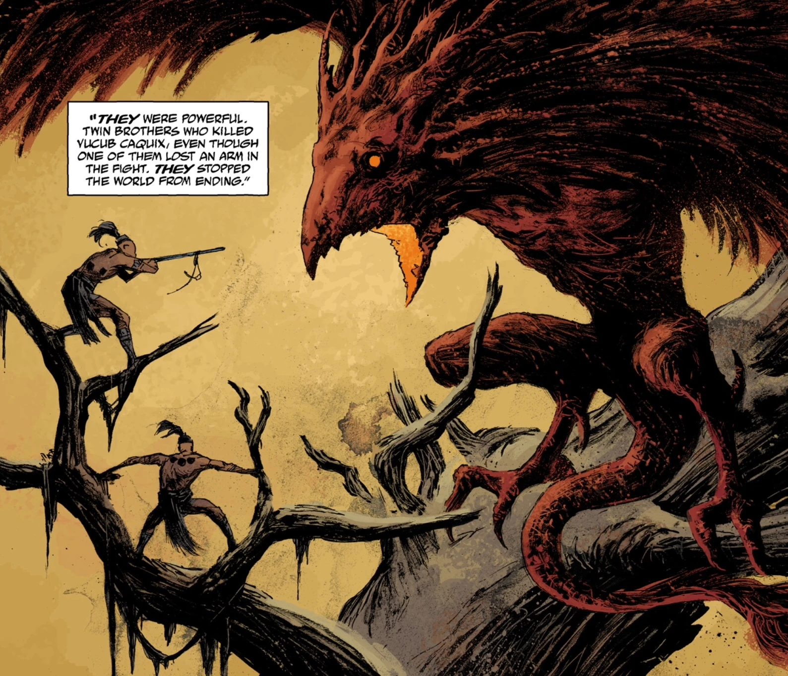

***乌纳普与斯巴兰克（Hunahpu and Xbalanque）***（又称 *玛雅双子*）是玛雅民间传说中的英雄。他们被恶魔之鸟 [乌库布·卡奎克斯（Vucub Caquix）](/entry/Vucub_Caquix) 击败，而后者实际上是一只 [奥格德鲁·赫姆](/entry/Ogdru_Hem)。

## 登场

- [《未来之事的雏形》](/entry/The_Shape_of_Things_to_Come)

## 画廊

与奥格德鲁·赫姆的邪灵 **乌库布·卡奎克斯（Vucub Caquix）** 交战

|Battled, and though the Ogdru Hem spirit Vucub Caquix
