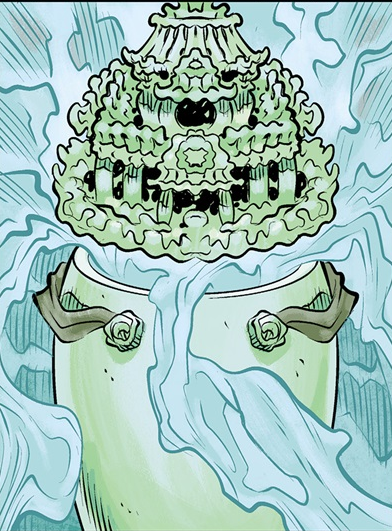

 **魂瓶（hunping）**是一种中国容器，死者的灵魂在被判定有资格免受来世惩罚之后，便寄居于其中。

## 描述

[金鹤会](/entry/Golden_Crane_Society)拥有一只千年魂瓶，用以对抗中国境内的超自然危险。金鹤会用它来囚禁在乡野间肆虐的恶魔与鬼怪。

## 历史

1953 年，为避免魂瓶落入共产党之手，金鹤会委派会中一名成员[鲍志（Bao Zhi）](/entry/Bao_Zhi)将它护送到九龙城寨。他要在那里与[特别情报局](/entry/Special_Intelligence_Directorate)的两名代表接头，由对方确保魂瓶安全运出境外。然而，其中一名探员[托马斯·莱姆斯（Thomas Rhymes）](/entry/Thomas_Rhymes)叛变，想把这件神器据为己有。他打伤了搭档 Margery，又俘虏了鲍志，想从他口中弄清楚魂瓶的秘密。

[辛西娅·伊登-琼斯夫人](/entry/Lady_Cynthia_Eden-Jones)是[特雷佛·布鲁姆教授](/entry/Trevor_Bruttenholm)的老朋友，也是 S.I.D. 的高层成员；她联系并说服布鲁姆，以替她取回一件珍贵神器为借口，派出一支 [B.P.R.D.](/entry/Bureau_for_Paranormal_Research_and_Defense) 小队。B.P.R.D. 派出一支由[地狱男爵](/entry/Hellboy)、[伍德罗·法里尔（Woodrow Farrier）](/entry/Woodrow_Farrier)和[苏珊·项](/entry/Susan_Xiang)组成的探员队伍，他们与伊登-琼斯夫人的联络人[罗兰·查尔德（Roland Childe）](/entry/Roland_Childe)会合，合力追踪这件神器。

在九龙城寨，托马斯利用魂瓶窃取前来参加鬼月节的死者亡灵，连同城中居民的灵魂也一并盗走。地狱的恶魔[牛头马面](/entry/Ox-Head_and_Horse-Face)察觉到这场灵界骚动，进入人间，但由于强大的结界把它们挡在外面，它们无法取回被莱姆斯偷走的灵魂。双方人马狭路相逢，随即打作一团。苏珊在奄奄一息的鲍志帮助下，设法夺回了魂瓶，并命令地狱男爵将它毁掉。容器被毁，牛头马面得以把众亡灵送回各自应在之处。

## 能力

与普通魂瓶不同，这一只不仅能容纳一个灵魂，而是能容纳无数灵魂。落入恶人手中时，它还能囚禁活人的灵魂；只要汲取足够的灵能，它便可转化为一具灵能电池，使人成神。
