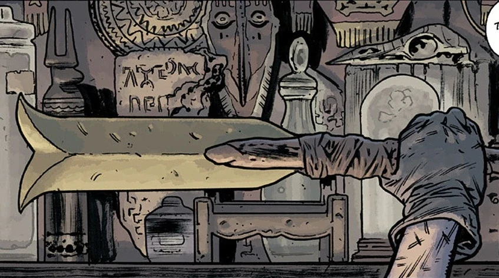

**海伯利亚之剑（Hyperborean Sword）**是一件拥有悠久而传奇历史的武器，其渊源远不止于它在人类第一种族手中的起源。它最著名的持有者是[超自然调查防御署](/entry/Bureau_for_Paranormal_Research_and_Defense)探员[泰德·霍华德](/entry/Ted_Howards)：他一握住这柄剑刃，便因与一位同样曾挥舞此剑的史前人类——[加尔·登纳（Gall Dennar）](/entry/Gall_Dennar)——之间的神秘联系而发生了改变。尽管霍华德的人格如今已被加尔·登纳的经历与记忆所覆盖，他仍以凶悍凌厉的剑法，用这柄剑斩杀着在末日地球上横行的各路敌对势力。

## 历史

### 史前时代

此剑最初由一位强大的海伯利亚战士所挥舞，他在他们的一座城市中战死，剑刃也断成两截。断剑在那里沉睡了无数岁月，直到一个深入废墟城市探险的流浪人类重新发现了它。他见剑刃依旧锋利，便带着它走出城市，一路上被在废墟中游荡的凶残[穴居人](/entry/Servants_of_the_Left_Hand)紧追不舍。他把剑刃绑在一根木棍上，打造成一柄新剑；随后剑的前任主人的灵魂造访了他，呼唤他挺身而战。剑刃亮起耀眼的光芒，吓退了那些生物。不久之后，这人娶妻成家，建立了一个新的部落，并把剑传给儿子，儿子又传给他们的儿子：加尔·登纳。

加尔·登纳的父亲在与[寒族（Cold People）](/entry/Vampire_(creature))——一种原始形态的吸血鬼——作战时战死。部落长老从一名敌人的头骨中拔出剑刃，交到加尔·登纳手中；他随即沉睡了片刻，与剑刃那位身处 21 世纪的主人泰德·霍华德建立了联系。从此二人以共生共存的方式生活着，在各自的日常中透过彼此的眼睛看到对方的人生。在击败了更多寒族以及多个奥格德鲁崇拜者部落后，加尔·登纳启程北上，去寻找此剑最初被寻获的那座城市。在那里，他遇到了一只神秘的狼灵，狼灵领他来到海伯利亚城市乌拉桑（Urrasan）的废墟。他又遭遇了一名奥格德鲁邪教徒及其主人梅拉-赫姆（Mera-Hem）。加尔·登纳最终战死于此，此剑也随之湮没于岁月。

### 20 世纪

此剑最终于 1871 年重见天日：惠灵顿勋爵率领一支探险队发现了乌拉桑的废墟。剑被寻回并带回英国，猎巫人[爱德华·格雷爵士](/entry/Edward_Grey)曾用它对抗一只自探险归来后便纠缠惠灵顿的不死生物。

[赫利奥皮克拉神兄弟会（Heliopic Brotherhood of Ra）](/entry/Heliopic_Brotherhood_of_Ra)很快没收了惠灵顿的文物，海伯利亚之剑也在其中，并离开英国前往欧洲大陆。此剑一直为他们所有，收藏在比利时埃弗勒（Evere）附近的一座庄园里。1916 年，他们抓获了格拉夫·林·德·哥达女爵（Graf Ling de Gotha），揭露她是一个沃尔斯卡克（Volskak，罕见的吸血鬼—狼人混血），并企图将她奴役为听命于他们的私人刺客。此剑与兄弟会手中的一块维利水晶相结合，使变身之后的格拉夫挣脱了束缚。海伯利亚之魂再次显现，催促她让剑和水晶远离兄弟会。她杀出绑架者的重围，偷走了他们的齐柏林飞艇，却被德军击落。格拉夫坠入北海身亡，但她的任务已经完成，此剑也失落于深海。

然而兄弟会仍设法夺回此剑。1940 年 7 月，他们雇佣（随后又威胁）深海潜水员维克多·奥尔森（Victor Olssen）去打捞他们坠毁的齐柏林飞艇，以取回水晶。奥尔森只找到了剑，他们的船就被一艘德国 U 型潜艇发现并用鱼雷击沉。氧气即将耗尽，又被一群奇怪的蜥蜴人包围，奥尔森举起了剑。他陷入幻象：一位身披铠甲的海伯利亚美人鱼（手中握着失落的维利水晶）呼唤他用此剑对抗爬行类——她称之为纳格-温拉（Nag-Unra）——保卫她的城市[亚特兰蒂斯](/entry/Atlantis)。奥尔森应允并与那些生物战斗。等他回过神来，发现自己安然无恙地躺在一片热带海滩上，手中握着剑和维利水晶。此后七年，奥尔森在那里隐居，开了一间酒吧，把剑和水晶挂在身后的架子上，直到它们在他睡梦中被一名兄弟会成员偷走。

此剑就这样被带到芝加哥，成为他们举行黑暗仪式的建筑里壁炉台上的摆设。1952 年，他们最新的一场仪式被一个云游的蓝调音乐家以利亚·伯恩（Elijah Bone）打断。赐予他音乐天赋的魔鬼之声指引他来到此地，他发现自己的爱人玛格丽特（Margaret）竟是兄弟会仪式的祭品。以利亚与他们搏斗，拾起从陈列架上掉落的剑掷向他们。剑击碎了维利水晶，杀死了聚集于此的兄弟会成员，而以利亚和玛格丽特毫发无伤。狼灵与海伯利亚战士的灵魂向他显现，吩咐他把剑放回陈列柜。以利亚从命离开，此剑便留在那里，在随后的六十年里积满灰尘。

### 21 世纪

在一场席卷全球的末日浩劫中，超自然调查防御署探员泰德·霍华德正与几个当地街头孩子一起调查，孩子们带他看了兄弟会废弃已久的密室。霍华德好奇地拾起剑，随即陷入一场无法醒来的沉睡，亲历了加尔·登纳的一生。他一直昏迷在那里，他周围的人则在与密室年迈的兄弟会看守人的枪战中丧生。

几周后，霍华德在约翰·克劳斯（Johann Kraus）率领的一次救援中苏醒。他们正遭到僵尸的攻击——这些僵尸被盘踞在上方城市中的一只奥格德鲁·赫姆释放的气体所感染。霍华德陷入狂暴的怒火，砍穿僵尸群，且不受气体影响，随后重新归队超自然调查防御署。从此剑一直留在他手中，他用它斩杀形形色色的敌人，从[锤头怪](/entry/Hammerheads)到[津科](/entry/Zinco_Corporation)的保安都不在话下。诸神黄昏来临时，霍华德与奥格德鲁·赫姆战斗至死，与此同时超自然调查防御署尽力护送尽可能多的人前往空心地球中的避难所。

尽管他已死去，此剑却留存到了下一个世界，落入人类第三种族之手。

## 海伯利亚之剑的持有者

剑的原主人之魂，曾向加尔·登纳的祖父显现

加尔·登纳

格拉夫·林·德·哥达

维克多·奥尔森

伊莱贾·伯恩

泰德·霍华德

人类第三种族的一员
