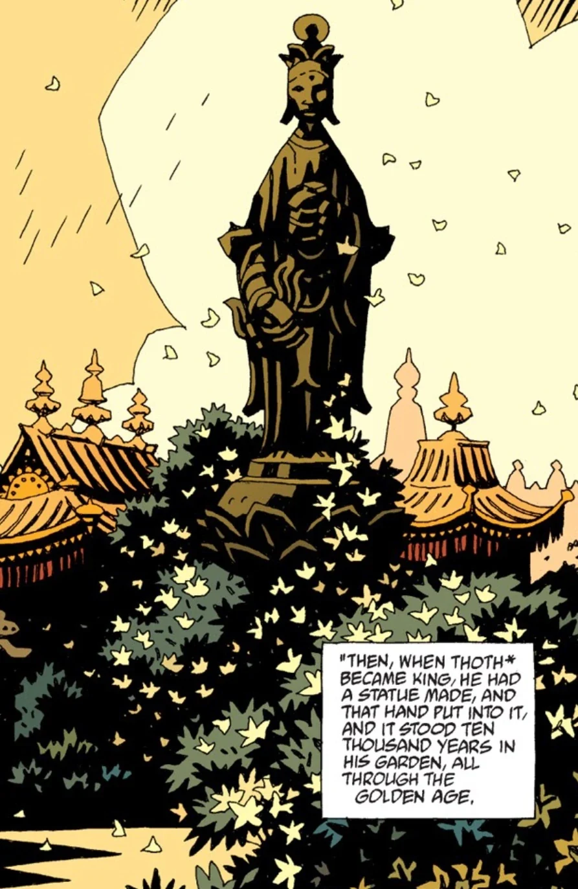

**海伯利亚的黄金之民（Golden People of Hyperborea）**是人类的第一个种族。

## 历史

[守望者](/entry/Watchers)与[奥格德鲁·赫姆](/entry/Ogdru_Hem)之间的大战结束后，许多较低级的灵被允许取得形体。他们成为海伯利亚的黄金之民，并在接下来的十万年中统治世界。他们以[维利（Vril）](/entry/Vril)为力量源泉，扩张自己的帝国，在世界各地建起城市，如撒德雷提斯（Thadrethes）、勒托（Leto）、希波斯（Hypos）、乌拉桑（Urrasan）以及[亚特兰蒂斯](/entry/Atlantis)。海伯利亚的首都是[戈里尼姆](/entry/Gorinium)，海伯利亚人最神圣的物品就保存在这座城市中。这件物品便是[阿努姆](/entry/Anum)的右手——阿努姆是那位创造了[奥古·桀哈](/entry/Ogdru_Jahad)、又用同一只手将它们囚禁起来的守望者。这只手被浸在琥珀中加以保存，安放在一只金碗里。这只手一直存放在那里，直到帝国的最后一万年。那是海伯利亚最伟大的国王[托特](/entry/Thoth)的时代。某个时候，托特命人建造了一尊雕像，把这只右手安放于雕像之内。

托特有一座秘密花园，园中关押着三位守望者。从这些灵那里，他得以通晓宇宙的一切运作，以及一切具有力量的词语、符号与器具。他命人把这些知识写入 42 卷书中，但只把其中两卷分享给自己的人民，其余的都留为己有。

## 覆灭

海伯利亚的覆灭始于[赫卡特](/entry/Hecate)来到戈里尼姆并诱惑托特。趁他熟睡之际，她潜入他的花园，杀死了三位守望者。她喝下他们的血，获得了他们的知识。随后她进入托特的神庙，把血全部吐出，用它将他们的全部知识书写在神庙的墙壁上。接着她召集托特的所有人民，把这些知识分享给他们，告诉他们可以随意使用。托特得知此事后将赫卡特驱逐并诅咒了她，但为时已晚。

前来托特神庙中学习知识的人最终成为海伯利亚帝国的国王和祭司。他们腐化堕落，犯下种种暴行，例如把孩童活活烧死在献给黑色女神内布-奥杰罗斯（Neb-ogeroth）的偶像中。他们荼毒大地与空气，招来地震、饥荒和瘟疫。戈里尼姆那尊封存着阿努姆右手的雕像目睹了这些人的暴行。看到托特的人民所做的一切，它流下了眼泪。雕像被一股可怕的怒火充满，杀死了戈里尼姆的人民，人们的鲜血把雕像染成红色。杀光戈里尼姆的所有人之后，它从城墙上纵身跃下，摔得粉碎。唯一留存下来的部分便是那只右手，它后来落入了[地狱男爵](/entry/Hellboy)手中。

## 垂死的帝国

尽管戈里尼姆被毁，其他许多城市仍然留存。撒德雷提斯、勒托、希波斯、乌拉桑和亚特兰蒂斯仍有人居住，使帝国得以苟延残喘。海伯利亚人分裂为两派：右手之民仍然恪守托特的教诲、崇拜右手；左手之民则崇拜黑色女神。大多数右手之民的信徒离开了地球，在群星之中建立了海伯鲁姆（Hyperberum）王国。他们的力量如此强大，以至于仅凭祈祷便能将奥古·桀哈镇压在牢狱之中，尽管地球上的各种黑色邪教一直在向其输送力量。

到了这个时候，奥格德鲁·赫姆的灵开始逐渐漂回世间，尽管海伯利亚人曾无比强大，也无法永远阻止它们。一些海伯利亚祭司主动承担起责任，确保人类的第二种族——[人类](/entry/Human)——能有机会对抗奥格德鲁的灵。他们向极少数精选出来的人传授如何召唤和运用[维利](/entry/Vril)的力量。[尚钦（Shonchin）](/entry/Shonchin)便是少数几位师从海伯利亚祭司的人类之一。使命完成之后，他们便离开这个世界，前往海伯鲁姆与同胞会合。

左手之民选择下到内部世界。他们创造了一个奴隶种族——[左手仆从](/entry/Servants_of_the_Left_Hand)，让他们建造和维护巨大的战争机器。他们希望有朝一日重返地表世界，夺回旧日的权能。然而他们的奴隶反叛了左手之民，将他们屠戮殆尽。

## 注释

有一个粉丝理论认为，右手之民最终进化成了 [*《地狱男爵：毁灭之芽》*](/entry/Seed_of_Destruction) 和 [*《地狱男爵：征服之虫》*](/entry/Conqueror_Worm_(story)) 中出现的外星人。
