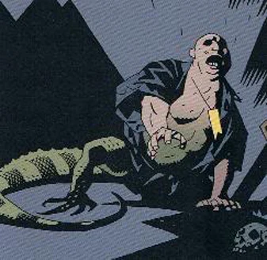

**伊戈尔·布罗姆黑德（Igor Bromhead）**（又名 **伊戈尔·韦尔登·布罗姆黑德（Igor Weldon Bromhead）**）算得上是一名黑暗秘术师：他与黑暗势力打交道，为那些眼光"独到"（实则上当）的主顾提供黑暗服务。他与[地狱男爵](/entry/Hellboy)和[超自然调查防御署（B.P.R.D.）](/entry/B.P.R.D.)有过三次交锋，每一次都没有好下场。

## 历史

布罗姆黑德原名伊戈尔·韦尔登·布罗姆黑德，1947 年出生于名门望族；十七岁时他逃离了特权生活，一头扎进 1960 年代旧金山迷幻文化的经历之中。然而他并没有融入那个圈子，而是很快利用嬉皮士运动起家，成了一名毒贩，在湾区闯出了名号。布罗姆黑德自身的上流社会背景以及弄到新奇货色的能力引起了秘术界的注意；他也从中牟利。起初，布罗姆黑德对秘术与超自然的存在嗤之以鼻，直到遇见"教授"William Whitcomb，才让他意识到世界上存在着真实而危险的魔法。

布罗姆黑德继续诈骗富人和好奇者。到 1975 年，他已成为一个全球性走私网络的中间人，贩卖从陵墓和神庙中盗来的秘术器物。他的生意引起了 B.P.R.D. 的注意，调查防御署一直在监视他卷入的秘术走私网络。地狱男爵不止一次撞见过布罗姆黑德。

1983 年 2 月，布罗姆黑德策划盗取了一件强大的魔法物品——伊丽莎白时代著名魔法师约翰·迪伊左手的戒指指骨。布罗姆黑德是在一座教堂的圣物匣中偷走这枚戒指的，而地狱男爵当时正在调查那座教堂，随后逮住了布罗姆黑德，揭发了一连串盗窃与诈骗勾当，使这个骗子被判十五年监禁。狱中生涯苦不堪言，驱使他转向黑术寻求庇护；他孜孜不倦地研习魔法，直到 1998 年获释。此后，布罗姆黑德决定干完最后一票、攒够养老钱，就退出走私行当。

他在黑市上的关系让他得以从苏格兰的 Guarino 伯爵夫妇身上榨取钱财，布罗姆黑德把这对夫妇视为自己通往财富的门票。Guarino 夫妇是虔诚的撒旦信徒，在布罗姆黑德身上挥霍重金，只求有生之年得见魔鬼。布罗姆黑德接连骗了他们好几个月，直到他明白必须真的召唤出一只恶魔才能安抚 Guarino 夫妇。他想起走私年代听过的一则传闻：有一个低阶恶魔被圣邓斯坦囚禁在一只铁盒里。布罗姆黑德搞到了那只盒子，并为了自保，学会了那个恶魔的真名——[乌拉刻](/entry/Ualac)。

布罗姆黑德告诉 Guarino 夫妇盒子里装的就是撒旦本人，夫妇二人便迫不及待地用剩余的全部财产换走了盒子，相信释放这个恶魔会让自己得到奖赏。然而布罗姆黑德亲眼看到伯爵夫人成了乌拉刻的容器，伯爵则被变成了一只猴子。他靠一枚圣邓斯坦护符保住自己，没被变成蜥蜴。此后，布罗姆黑德用恶魔的真名和圣邓斯坦本人用过的铁钳制住乌拉刻，好为自己谋得巨额财富与力量。恶魔回答说，布罗姆黑德名下那栋房子的地下室里藏着一批宝藏；如果他想要真正的力量，就帮恶魔困住地狱男爵——乌拉刻想从地狱男爵头上夺取天启之冠。

 乌拉刻获释后不久，布罗姆黑德把地狱男爵及其同伴[亚伯·塞皮恩](/entry/Abraham_Sapien)诱到 Guarino 宅邸。他用地狱男爵的秘名——由乌拉刻提供——取得了压制地狱男爵的力量，同时用一道乌拉刻教他的咒语让地狱男爵隐藏的冠冕显形。乌拉刻夺下冠冕后，布罗姆黑德企图向地狱男爵报仇，却被乌拉刻拦下，因为它还要夺取毁灭右手。地狱男爵最终挣脱束缚，布罗姆黑德试图逃跑，却发现亚伯在后面追赶。他把自己锁在门内躲开亚伯，呼唤[阿斯塔罗斯](/entry/Astaroth)求助。但布罗姆黑德发现得太晚了：与亚伯的扭打使他那枚圣邓斯坦护符的下半截断裂。失去护符的完整保护后，召唤阿斯塔罗斯的举动令乌拉刻当初试图施加给他的诅咒部分生效，这个骗子的下半身变成了蜥蜴之躯。已经畸形的布罗姆黑德最终靠躲进 Guarino 宅邸地下藏满宝藏的秘密通道才逃过被捕；他带走了 Guarino 夫妇足够多的财宝养老，同时一心想获得力量，向这个他怪罪为自身不幸之源的世界展开报复。

通过秘术圈和黑市中的人脉，布罗姆黑德得知了[弗拉基米尔·朱雷斯库](/entry/Vladimir_Giurescu)的遗骸——它几年前在罗马尼亚一座机场被盗。1999 年，布罗姆黑德花掉大笔家产买下这具遗骸，把它运到自己秘密居住的意大利卢卡附近的地下墓穴中。由于在死灵术上没什么练习，布罗姆黑德花了好几年才联系上朱雷斯库的灵魂，并把那道灵魂召回骸骨之中。鬼魂向布罗姆黑德讲述了 1997 年朱雷斯库城堡里发生的一切：[伊尔莎·豪普斯坦](/entry/Ilsa_Haupstein)的死亡，以及她那具封在铁处女中的躯体如今已被[赫卡特](/entry/Hecate)占据。

2006 年 3 月，布罗姆黑德用血祭杀死自己的仆人，召唤出赫卡特，随后用伊尔莎·豪普斯坦的名字困住这位女神，企图夺走她的力量，成为统治世间女巫的王者。然而赫卡特的力量压垮了布罗姆黑德，使他进一步突变成一个拉长的、月黄色的人蜥混合怪物。布罗姆黑德一直藏匿在卢卡附近，直到地狱男爵终于追踪到他。布罗姆黑德恳求地狱男爵杀了他、结束他的痛苦，地狱男爵照做了。临死之际，布罗姆黑德描述了一幅[地狱](/entry/Hell)的幻象——地狱男爵跨坐在一条龙上，率领着一支大军——并说自己会在地狱与地狱男爵再见，这表明他仍未放弃向地狱男爵复仇的执念。

## 能力

伊戈尔布罗姆黑德精通秘术，曾宣誓为[阿斯塔罗斯](/entry/Astaroth)效力。他的力量足以打造诸如[荣光之手](/entry/Hand_of_Glory)之类的器物，能靠低阶恶魔的真名号令它，还能召唤重生的赫卡特并剥夺她的力量。然而，他始终无法治愈自己被诅咒的畸形之躯，也无法享受到自己苦心经营的果实。

## 趣闻

- 据迈克·米格诺拉所说，伊戈尔布罗姆黑德的造型受到演员彼得·洛的影响。
