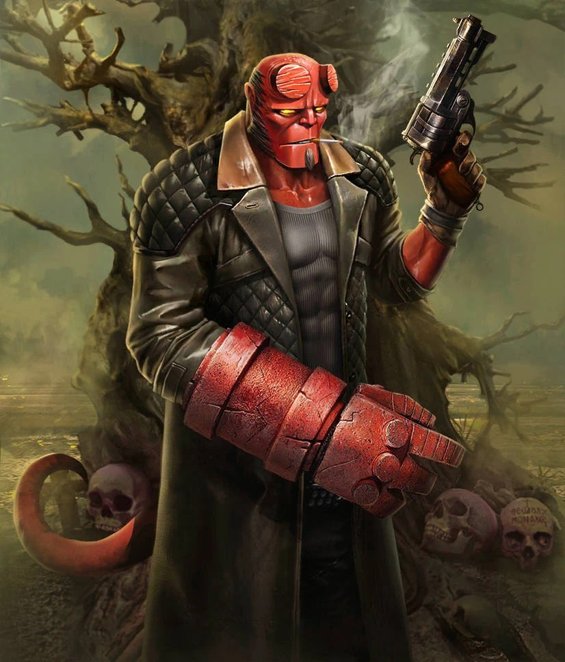
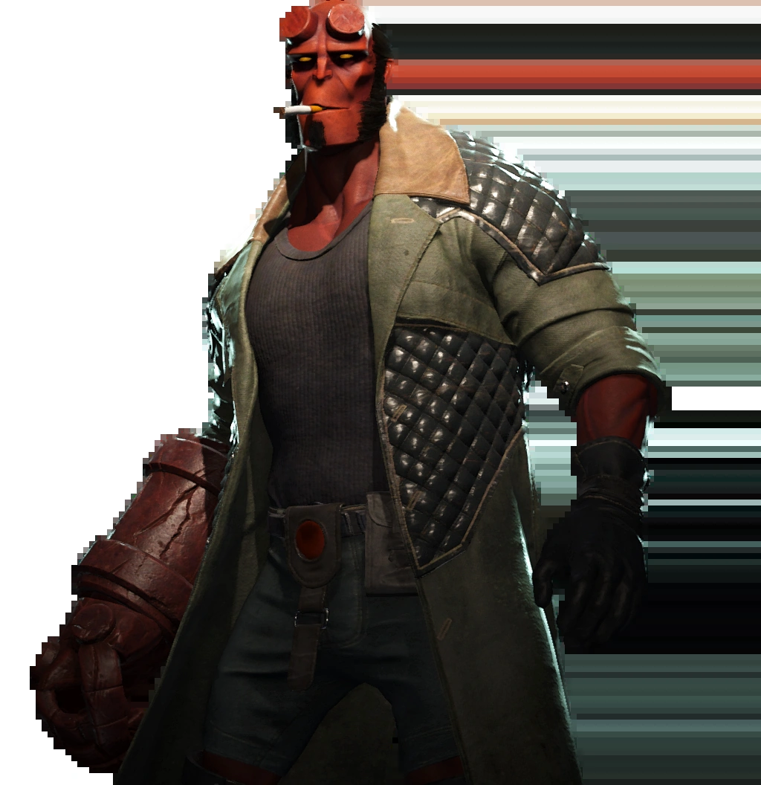
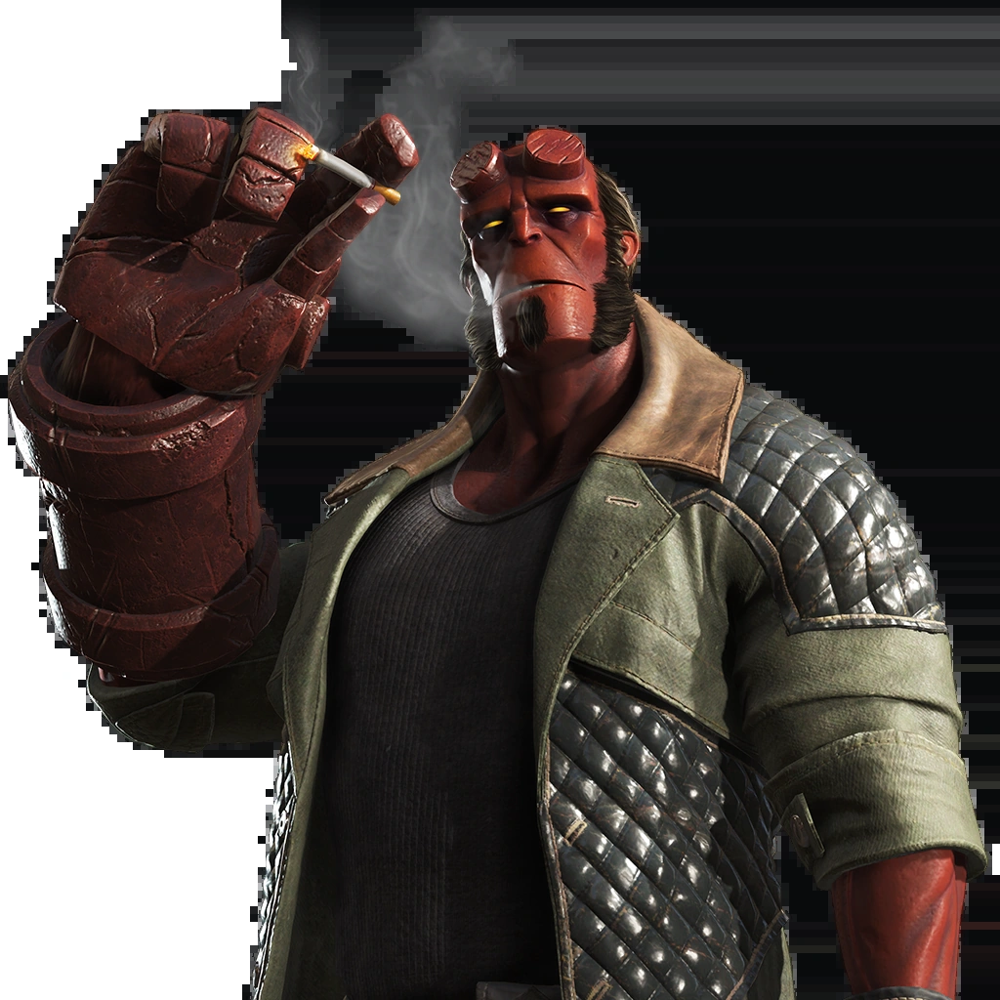

***《不义联盟2》（Injustice 2）***是 NetherRealm Studios 开发、华纳兄弟互动娱乐发行的一款 2017 年格斗电子游戏。它是 2013 年《不义联盟：人间之神》（Injustice: Gods Among Us）的续作。

[地狱男爵](/entry/Hellboy_(Injustice))是《不义联盟2》中的一名可操作客串角色。他作为“格斗家包 2”（Fighter Pack 2）的可下载内容（DLC）推出，于 2017 年 11 月 14 日加入游戏；所有 DLC 均已收录在 2018 年 3 月 27 日发行的游戏《传奇版》（Legendary Edition）中。

## 地狱男爵的招式

*见[地狱男爵（不义联盟）#能力](/entry/Hellboy_(Injustice)#Powers_and_Abilities)*

战斗中，地狱男爵会使用他的左轮手枪，以及多种特制手雷和魔法遗物，但他的大部分攻击都以那只巨大的、石头般的[毁灭之右手](/entry/Right_Hand_of_Doom)为基础。

## 趣闻

- 这是自 2004 年以来，地狱男爵首次由 [Ron Perlman](/entry/Ron_Perlman) 以外的演员配音；Perlman 曾首次[饰演地狱男爵](/entry/Hellboy_(2004%E2%80%932008_film_character))，那是在 [2004 年改编电影](/entry/Hellboy_(2004_film))中。
- 地狱男爵在《不义联盟2》中的结局采用了与游戏其余部分不同的美术风格。其设计旨在模仿《地狱男爵》创作者 [迈克·米格诺拉](/entry/Mike_Mignola) 独特的画风，由 [Peter Bergting](/entry/Peter_Bergting) 绘制，并由米格诺拉本人亲自监修。

## 画廊

地狱男爵

《不义联盟2 手游版》中的地狱男爵

地狱男爵在格斗家选择界面中的形象

地狱男爵

|Hellboy from Injustice 2 Mobile

|Hellboy, as he appears on the fighter selection screen

|Hellboy
## 外部链接

- 不义联盟维基（Injustice Wiki）
