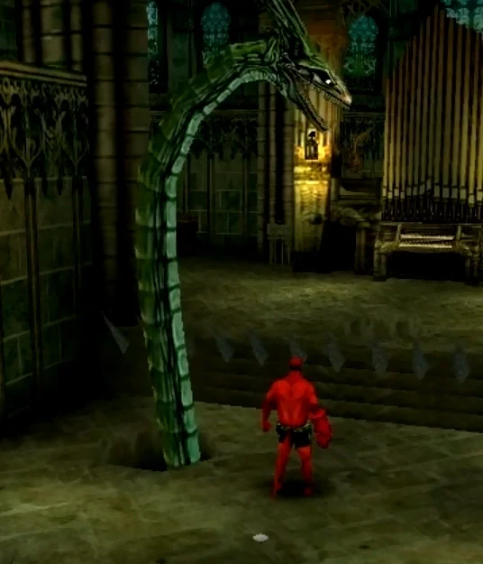

**宗教审判官**（Inquisitor）是游戏 *[《地狱男爵：夜之犬》](/entry/Hellboy__Dogs_of_the_Night)* 中的虚构角色。

## 历史

### 夜之犬

作为修道院的一位客人，宗教审判官大部分时间都独来独往。有传言说，对于那些需要帮助的人而言，他是一位强大的盟友，但他也很容易被未受启蒙者所冒犯。

遇见[地狱男爵](/entry/Hellboy_(character))时，宗教审判官告诉他，他在这里不受欢迎，应当去死，随后他变身为一条巨蛇向地狱男爵发起攻击，但最终被击败。

## 盟友与敌人

### 盟友

- 修道院的**僧侣们**

### 敌人

- **[地狱男爵](/entry/Hellboy_(character))**

## 画廊

宗教审判官的怪物形态。

|The Inquisitor's monster form.
