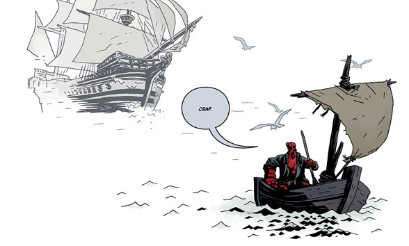

《**驶入寂静之海**》（Into the Silent Sea）是第三部《地狱男爵》原创图像小说。它于2016年8月正式公布，2017年4月出版。

## 出版历史

Mignola 特意把这个故事留给 Gary Gianni：他在[《地狱男爵：山雨欲来》第1期](/entry/The_Storm)中画了一格，画中地狱男爵提到了一个尚未讲述的故事。

Gianni 获得了想做什么就做什么的自由。他和 Mignola 通过反复碰撞想法共同编写故事，直到情节敲定，然后由 Gianni 撰写剧本，Mignola 修订剧本以使地狱男爵的对白准确无误。[1]

[Gary Gianni](/entry/Gary_Gianni) 凭借在该书上的作品获得2018年[艾斯纳奖](https://www.comic-con.org/awards/eisner-awards-current-info)最佳铅笔稿师/墨线师或铅笔稿/墨线团队提名。

## 剧情简介

地狱男爵从一座荒岛的残骸上扬帆起航，却与一艘幽灵船狭路相逢。幽灵船员打算把他卖给马戏团，将他俘虏；一位为追捕一头强大海怪不惜一切代价的船长拖着他同行。紧接[《地狱男爵：岛屿》](/entry/The_Island)的事件之后，Gary Gianni 在一部全新的图像小说中绘制地狱男爵。

## Flesk 工作室版

2017年9月13日，[Flesk Publications](https://www.fleskpublications.com/) 在 Kickstarter 上为一本超大开本的[《地狱男爵：驶入寂静之海》工作室版](https://www.kickstarter.com/projects/481703930/hellboy-into-the-silent-sea-by-mike-mignola-and-ga/description)发起众筹。这本书的理念是尽可能接近由 Gary Gianni 亲自带你参观他的工作室。书中收录了 Gianni 的缩略草图、铅笔稿初稿以及贯穿始终配有点评的最终画稿。本书还包含三十页聚焦 Gianni 自创系列[《The MonsterMen》](/entry/Gary_Gianni)的素材。另有仅限一百册的豪华函套版。

## 内容

### 角色

- [地狱男爵](/entry/Hellboy)
- 丽贝卡号（Rebecca）船员
  - “船长”
  - William
  - Kip 师傅（狗）
  - 其他船员
- 三位[人鱼](/entry/Merfolk)姐妹（闪回）
- “老西班牙人”（前神父）（闪回）
- [赫利奥皮克·拉兄弟会](/entry/Heliopic_Brotherhood_of_Ra)
  - “女士”
  - 其他成员（闪回）
- [希柏里尔人](/entry/Hyperboreans)
  - 会说话的木乃伊（闪回）
  - 其他居民（闪回）
- [女巫](/entry/Witches)
  - [赫卡忒](/entry/Hecate)
- 海怪

### 地点

- 大西洋
  - 葡萄牙海岸外的岛屿
    - 城堡（闪回）
  - 丽贝卡号
- 非洲（闪回）
- 失落之城 Tunungar（美洲某处）（闪回）
- 若干未命名地点（闪回）

## 画廊

作者 Gary Gianni

## 参考资料

[1] <http://www.multiversitycomics.com/interviews/mignolaversity2017_6/>
