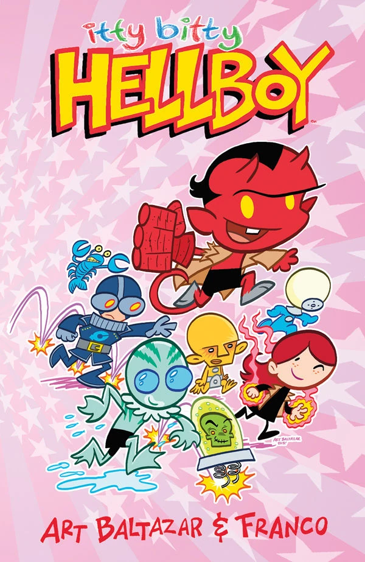
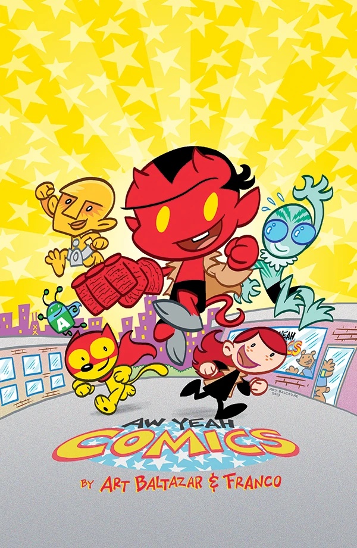
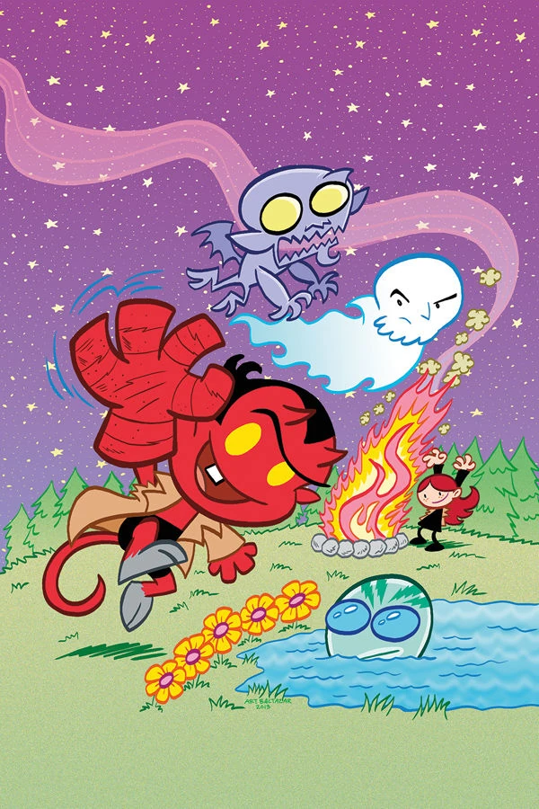
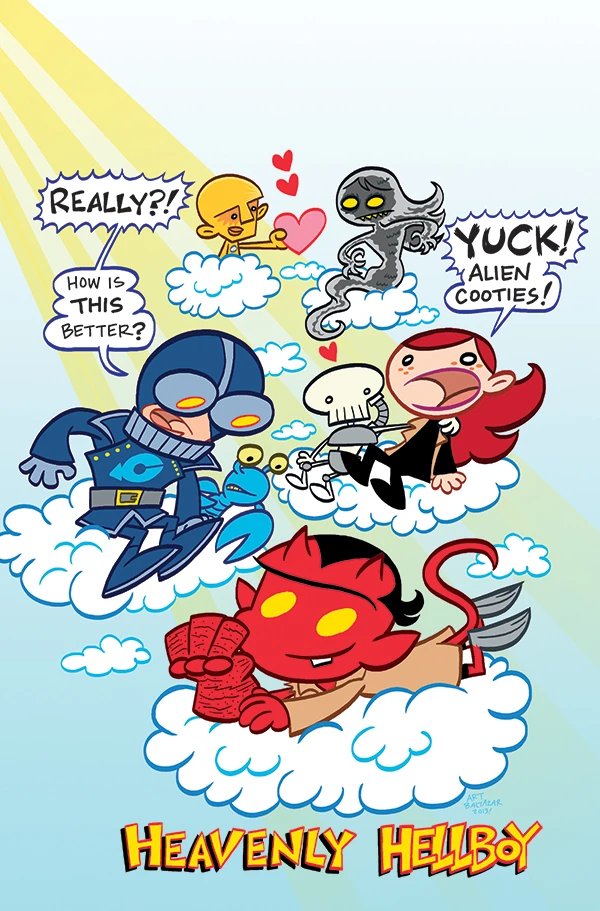
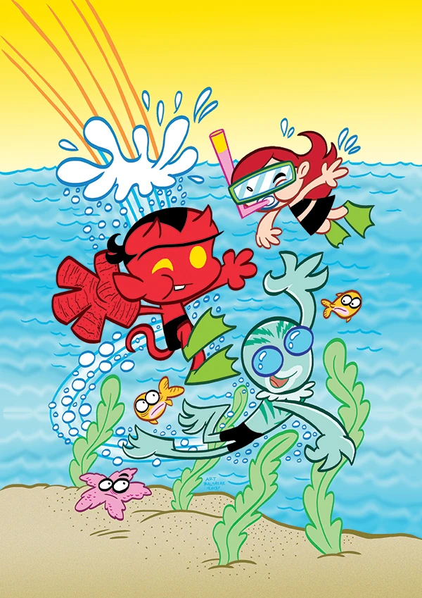
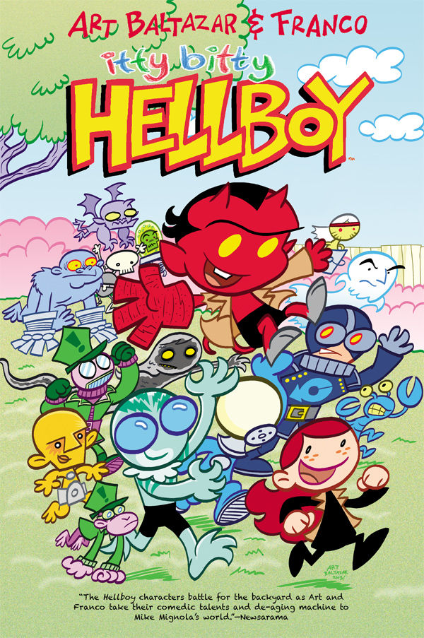
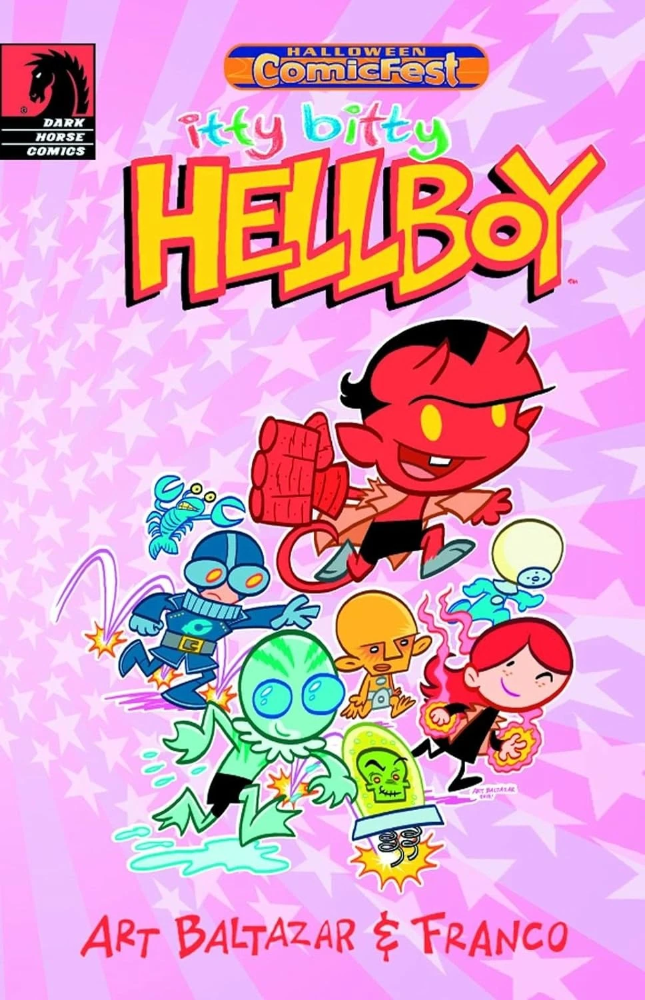
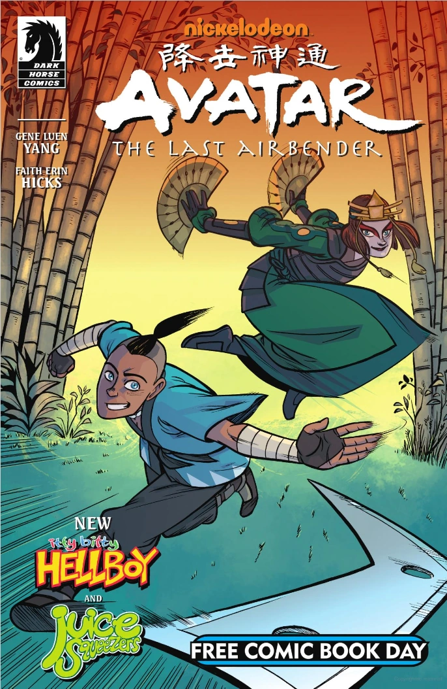

《**小小地狱男爵**》（Itty Bitty Hellboy）是一部由 [Art Baltazar](/entry/Art_Baltazar) 和 [Franco Aureliani](/entry/Franco_Aureliani) 创作的、独立于主线连续性之外的儿童漫画衍生作品。

## 出版历史

2013年4月，在 C2E2 漫展上，[Dark Horse](/entry/Dark_Horse) 公布了由创作者 Art Baltazar 和 Franco Aureliani 联手打造的《小小地狱男爵》，两人此前曾合作过《Aw Yeah Comics》和《Tiny Titans》。该系列五期中的第一期于同年8月发行。各期基本按期推出，最后一期于2013年12月上架。

作为一年一度的万圣节漫画节庆祝活动的一部分，第一期的十二页被重印成口袋本大小的《Halloween ComicFest Itty Bitty Hellboy》单行本，于2013年10月面世，在2013年万圣节当天及前后发放。

五期内容于2014年4月集结为平装合集[《小小地狱男爵》](/entry/Trade_Paperback_Collections)。

2014年5月，一则新的《小小地狱男爵》故事《The Chained Coughin'》被收录进 Dark Horse 的免费漫画日刊物 *[免费漫画日2014：全年龄](/entry/Free_Comic_Book_Day_2014%3A_All_Ages)*。

续作系列 *[小小地狱男爵：寻找狼人豹！](/entry/Itty_Bitty_Hellboy%3A_The_Search_for_the_Were-Jaguar%21)* 的第一期于2015年11月发行。

## 剧情简介

### 第一期

一个名叫拉斯普廷的鬼魂被人发现了！地狱男爵和 B.P.R.D. 要去查清楚他在搞什么鬼。

话说地狱男爵到底是谁？他为什么长着一只那么大的手，那只手又是干什么用的？谁更古怪，是他还是他的朋友们？B.P.R.D. 又是什么？而这一切和**鸡汤**有什么关系？这些问题以及更多问题都将在创刊号中揭晓，在这一期里，小小地狱男爵身上将发生大事！

### 第二期

龙虾·约翰逊正在追踪一只大脚怪！

他的搜寻把他带到了密林深处，地狱男爵和 B.P.R.D. 将用他们所知的最好方式来帮助他！没错——这是一次露营之旅！有一件事是肯定的：有莉斯在身边，你永远不需要手电筒，但你可能得自带棉花糖！

### 第三期

该发生的终于发生了！因为你们强烈要求！地狱男爵和伙伴们来到了地狱的火焰深渊！话说他们到底是怎么到那儿的？另外，我们的 B.P.R.D. 英雄们对大脚怪的搜寻仍在继续！但这一切和拉斯普廷有什么关系？哦哦哦！他只是想吓唬我们吗？你一定会在这激动人心的一期中找到答案！！！

### 第四期

下去的东西必须得上来！一路升上天堂！没错！在罗杰试图和芭芭·雅嘎交朋友之后，小小地狱男爵和他伙伴们的日子可能再也不一样了！怎么？她不喜欢花吗？也许她只是觉得罗杰烦人。在这个故事之后，罗杰可能要尝到分离焦虑的滋味了！准备好迎接迄今为止最毛绒绒、最多云、最有天堂感的一期吧！

### 第五期

该发生的还是发生了。这是不可避免的。迟早，我们都会去到那里。没错！是时候去拜访我们住在水下的朋友了！我们去找亚伯·赛皮恩玩吧！地狱男爵和他的伙伴们是自愿下水的？还是有什么更邪恶的东西把他们送进了寒冷、满是潟湖的深渊？有一件事我们可以肯定：亚伯不介意有人作伴！那这次拜访期间龙虾·约翰逊又在哪里呢？当一切尘埃落定，有时候海滩派对是最好的收场方式……哪怕你恰好身在沼泽里。

### 《The Chained Coughin'》

地狱男爵帮助拉斯普廷的鬼魂成为一个更有说服力的鬼。

## 画廊

第1期变体封面

第4期

第5期

