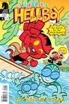
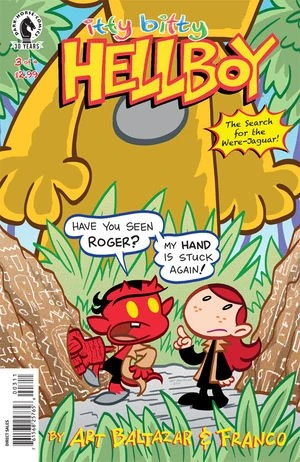
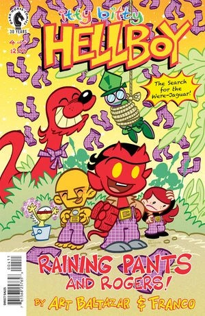

***《小小地狱男爵：寻找豹人！》（Itty Bitty Hellboy: The Search for the Were-Jaguar!）***是由 Art Baltazar 和 Franco Aureliani 创作的一部脱离正典连续性的儿童漫画衍生作品。它是二人此前系列 *[《小小地狱男爵》](/entry/Itty_Bitty_Hellboy)*（Itty Bitty Hellboy）的续作。

## 出版商简介

Art Baltazar 与 Franco 回归《小小地狱男爵》！地狱男爵、亚伯、丽兹和伙伴们踏上了一段旅程……要把内衣送到罗杰岛（Island of Rogers）！但他们的任务因发现神秘怪兽“豹人”（were-jaguar）而中断！收录《小小地狱男爵：寻找豹人！》第 \#1–#4 期！

## 剧情简介

### 第一期

哇哦耶！Art Baltazar 与 Franco 回归《小小地狱男爵》！这一次，地狱男爵、亚伯、丽兹和伙伴们踏上了一段非常特别的旅程……要把内衣送到罗杰岛！但他们的任务突然因发现那只奇异神秘、名为“豹人”的怪兽而中断！

### 第二期

豹人的发现，让地狱男爵和伙伴们分了心，无法继续向岛上居民解释“末日右手”（Right Hand of Doom）！罗杰胸口那颗按钮是什么？豹人为什么这么友好？邪恶的卡尔和拉斯普廷又想从这头怪兽身上得到什么？

### 第三期

巨型罗杰接管了整座岛！地狱男爵和伙伴们该怎么办？这对豹人又意味着什么？大螯虾强生为什么卡在那棵树上？超自然调查防御署这下可有得忙了！

### 第四期

雅加婆婆和赫卡特带着满满一袋裤子来到罗杰岛。本会不会把这一切搅成一桩神秘莫测、隐遁难寻的隐秘动物学（cryptozoic）乱局？你那些迫切想知道答案的地狱男爵疑问，都将由艾斯纳奖获奖创作者 Art Baltazar 与 Franco 在此揭晓！

## 画廊

第 \#1 期

第 \#2 期

第 \#3 期

第 \#4 期

平装合订本

|第 #1 期

|第 #2 期

|第 #3 期

|第 #4 期
