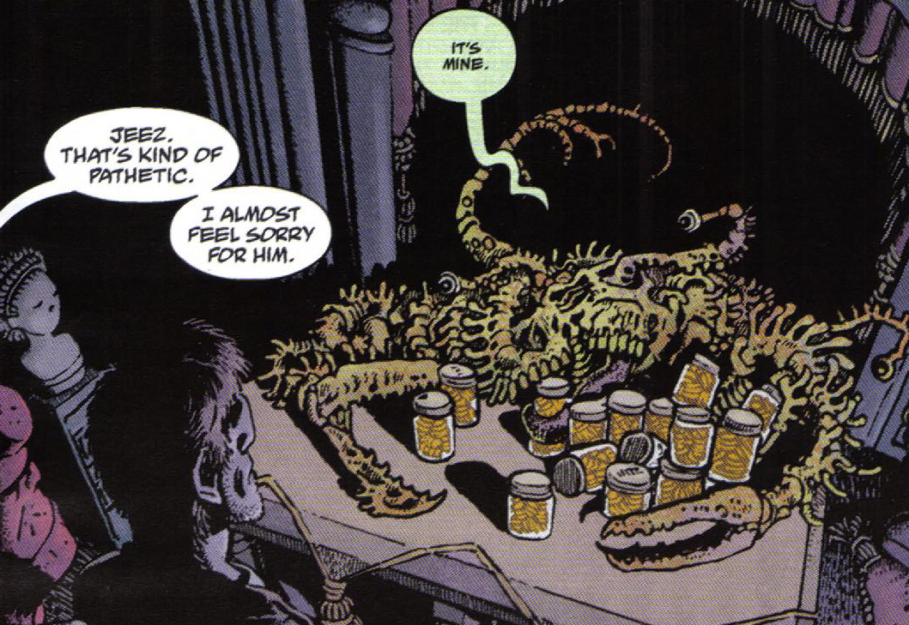
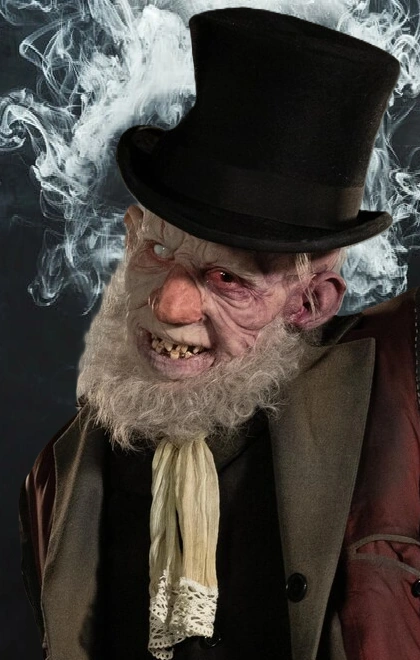

**杰里迈亚·威特金斯（Jeremiah Witkins）**，又称"**佝偻人**"（the Crooked Man），是[同名《地狱男爵》故事](/entry/The_Crooked_Man_%28comic_story%29)的主要反派。

## 历史

根据当地传说，杰里迈亚·威特金斯是弗吉尼亚州阿巴拉契亚山区最早的定居者之一。他在一个名叫[飓风镇](/entry/The_Hurricane)的地方建起了自己的宅邸。他也是他那个时代最恶劣的人之一，靠他人的苦难聚敛财富。他在定居者同伴与原住民部落之间挑起冲突，在美国独立战争和南北战争期间向双方兜售烈酒和枪支。威特金斯最终因其罪行被处以绞刑，他的财产四散无踪，但他的名字和事迹在当地人中间成了诅咒。然而，由于他罪孽深重得令人叹为观止，"[魔鬼](/entry/Satan)"将威特金斯送回了凡人世界，让他成为一名恶魔般的收魂者。

如今人称佝偻人的威特金斯招募女巫[埃菲·科尔布](/entry/Effie_Kolb)作为自己的左膀右臂，同时趁当地女子处于人生低谷时落井下石，把她们变成女巫。他把灵魂收在玻璃罐里，这些灵魂在罐中呈现为金币的模样。

[汤姆·费雷尔](/entry/Tom_Ferrell)还是个男孩时，被埃菲·科尔布勾引，她说服他用一场撒旦仪式制作一根[幸运猫骨](/entry/Lucky_cat_bone)。然而，完成仪式回家的路上，汤姆看见佝偻人在树林里注视着自己，他惊恐地跑回家，发誓永不使用猫骨的力量。

1958 年，汤姆和[地狱男爵](/entry/Hellboy_%28character%29)在前往一座乡村教堂安葬他父亲遗体的路上，遭到威特金斯爪牙的袭击；他们击退了敌人，这让汤姆确信自己在无意之中动用了猫骨，从而坐实了自己的堕落。

他们与[沃茨牧师](/entry/Reverend_Watts)在教堂中避难时，佝偻人带着科尔布和一群女巫在教堂外徘徊，要求汤姆履行交易中属于他的那部分。沃茨牧师告诉汤姆，他从未使用过那根猫骨；尽管年轻时做过蠢事，他仍是个好人，魔鬼对他没有任何索取权。沃茨随即向威特金斯叫阵，让他亲自来"抓"汤姆——他知道威特金斯之流无法跨过教堂的门槛。天亮后，沃茨牧师为猫骨祝圣，把它变成一件圣物，又同样为一把铁锹祝圣；地狱男爵用这把铁锹砸碎了佝偻人的人形躯壳，科尔布和其他女巫纷纷逃走。

随后地狱男爵和费雷尔前往飓风镇的威特金斯宅邸，发现了他真正的恶魔形态：一个扭曲的螃蟹状怪物，佝偻在他那些装满金子的罐子上方，喃喃自语："是我的……全都是我的……"汤姆把幸运猫骨朝他掷去，这个恶魔随即消失。汤姆不确定自己是释放了威特金斯其他受害者的灵魂，还是让它们随他一起下了地狱，但无论如何，佝偻人已经完蛋了。

## 外貌

 生前，杰里迈亚·威特金斯是一个高个子白人男性，留着长长的鬓角，一只眼睛失明，挂着一抹毫无善意的狞笑，他扭曲的本性也刻在了外表上。死后与魔鬼订约后，威特金斯变成了一个畸形的螃蟹状怪物，长着多只眼睛，并能投射出自己原本形象的幻影——那个幻影更加佝偻，脑袋歪向一侧，下巴松弛，缺了好几颗牙，肤色死一般苍白，鬓角也更像一团绒毛。

## 能力

正如生前一样，杰里迈亚·威特金斯在死后仍擅长利用他人的苦难、逼迫对方签下苛刻的交易，并把他人腐蚀到与自己同流合污。他在死后获得了向他人传授巫术、至少让一名[女子](/entry/Effie_Kolb)永葆青春、心灵致动、制造幻象，以及将葬在教堂墓地里的部分罪人复活为不死者的能力。他很可能还直接参与打造了诸如[汤姆的幸运猫骨](/entry/Lucky_cat_bone)、[马嚼子](/entry/Magic_horse%27s_bit)和[女巫球](/entry/Witchball)之类的魔法物品。

## 趣闻

Mr. Onselm，即佝偻人，由 Martin Bassindale 饰演。

- 吝啬鬼威特金斯的形象至少有一部分源自古老的英国童谣《从前有个扭曲人》。

- 有一格描绘他生前的画面中，他（面带微笑）把一支枪和一瓶酒递给一名美洲原住民。这是对某些无耻之徒直到 19 世纪末仍在干的勾当的刻板描绘。

- 在电影[《Hellboy: The Crooked Man》](/entry/Hellboy__The_Crooked_Man_%28film%29)中，他由[Martin Bassindale](/entry/Martin_Bassindale)饰演。他的原名从"杰里迈亚·威特金斯"改成了"Mr. Onselm"。
