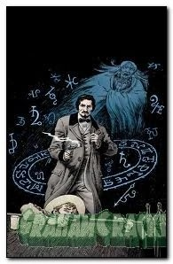

**John Severin**（1921 年 12 月 26 日－2012 年 2 月 12 日）是美国漫画画师。在他去世之前，原定由他绘制 [《重锤 44》（Sledgehammer 44）](/entry/Sledgehammer_44_%28series%29)。

## 内页画师

- [《B.P.R.D.：蛙族之战》 #2](/entry/War_on_Frogs)
- [《迷失远去》（Lost and Gone Forever）](/entry/Lost_and_Gone_Forever)

## 封面画师

## 画廊

|Lost and Gone Forever #1 Variant
