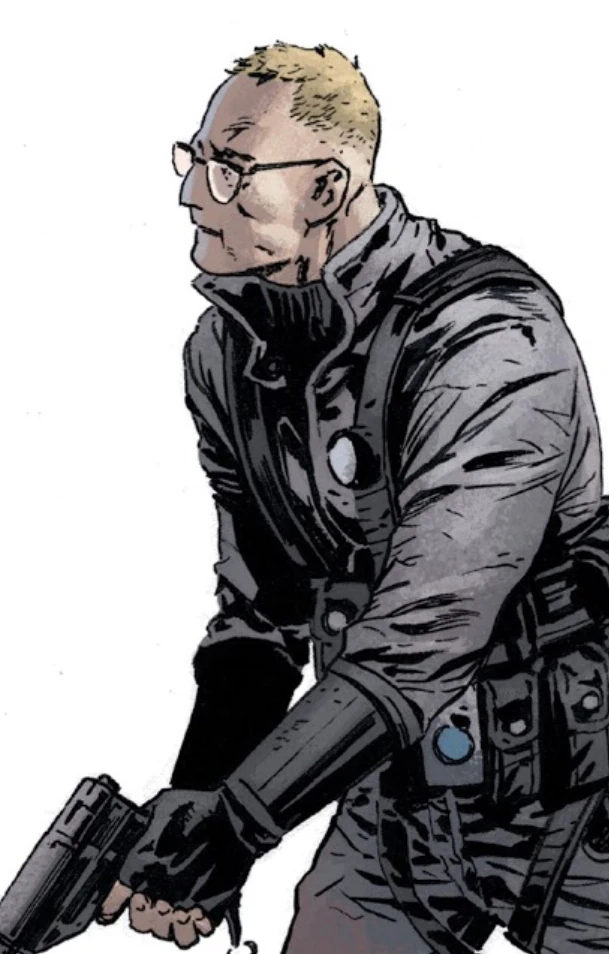

**约瑟夫·沃恩（Joseph Vaughn）** 是[超自然调查防御署（Bureau for Paranormal Research and Defense）](/entry/Bureau_for_Paranormal_Research_and_Defense)的一名外勤探员。

## 历史

沃恩至少从 1981 年起就在防御署工作，只与[地狱男爵](/entry/Hellboy)共事过一次。1983 年，沃恩和一名无名女探员陪同地狱男爵前往加拿大新不伦瑞克，寻找并杀死一只湖怪。这次任务与其说是惊险冒险，不如说更像一场露营，他们连怪物的影子都没见到。

1981 年，在调查有关[狼人](/entry/werewolf)袭击的传言时，沃恩探员正与 B.P.R.D. 探员[亚伯·塞皮恩](/entry/Abraham_Sapien)和[丽兹·舍曼](/entry/Elizabeth_Sherman)一起行动。亚伯开始检查一座看似废弃的小屋内部，沃恩不顾亚伯让他退后的叮嘱，试图从门口向里张望。一只狼人随即跳出来袭击了这名人类探员。沃恩被撞昏，但没有被怪物咬伤或抓伤。丽兹和亚伯杀死狼人后，扶沃恩起身离开。[1]

此时的沃恩已是经验丰富得多的探员，他带领新手探员 [Kris Peters](/entry/Kris_Peters) 调查南卡罗来纳州皮肯斯县出现的怪雾。两名探员了解到，这场雾与当地开始生长的一种奇异发光真菌存在某种关联。尽管他们穿着防护服，怪雾仍对两人产生了一些影响。

进一步探查雾气和真菌时，探员们遭到雾中黑影的袭击。Peters 探员遭到物理攻击，防护服被撕破，腿部暴露在外。不过，[Ethan Thomas](/entry/Ethan_Thomas) 教授的到来救了两人——他是一位[吸血鬼](/entry/Vampire_%28creature%29)史学家，当时正住在该地区研究当地的一个吸血鬼家族。Thomas 教授解释说，雾气是在真菌出现后不久涌来的。雾中传来尖叫，还能看到与袭击沃恩和 Peters 的黑影相似的形影在雾中游荡。不过教授还解释说，十字架和火都能驱散雾气。沃恩恢复期间，教授向他讲述了自己的研究和一些吸血鬼历史。

在另一个房间休息时，Peters 探员的腿上出现了可怕的感染，并慢慢扩散到全身。她似乎变成了某种不死生物，试图攻击沃恩和 Thomas，但两人借助一个十字架暂时将她逼退。随后 Peters 完全溶解成某种黏液怪物，在房间里飞窜着袭击两个男人。沃恩和 Thomas 再次用十字架将她逼退，表明 Peters 的状况本质上是吸血鬼化。Peters 最后一次发起攻击，杀死了 Thomas，之后沃恩放火烧掉整间小屋，烧死了已化作真菌吸血鬼形态的 Peters，以及此时也被感染的 Thomas。

沃恩穿上防护服、紧握一个大十字架，在雾中穿行，天亮时跌跌撞撞来到当地吸血鬼氏族的旧宅。他发现大多数吸血鬼都已死去，尸体被真菌感染。只剩一个名叫 Cole 的男孩吸血鬼。Cole 独自坐着，也被真菌感染，惊恐而无法动弹。沃恩看到 Cole 皮肤下那颗如今发着绿光的心脏还在跳动，便问吸血鬼他们都做了什么。随后沃恩用木桩钉死 Cole，烧毁吸血鬼的房子和周围大片森林，然后离去。[2]

沃恩探员出现在连载的《亚伯·塞皮恩》系列中。在第一个故事弧中，沃恩受命带领几名探员搜寻亚伯，但他对亚伯是否有罪、是否在世界末日中扮演某种角色心存犹豫。第一个故事弧结尾，沃恩终于见到亚伯，却被一个变异人类从背后一刀刺穿胸膛。沃恩探员因这一伤口当场身亡。[3]

然而，沃恩被术士 [古斯塔夫·施特罗布尔](/entry/Gustav_Strobl) 复活。施特罗布尔一心想找到亚伯，他告诉沃恩，只要帮他做到这件事，他或许就能让沃恩完全复活。[4]

当这位神秘学者追踪亚伯到康涅狄格州时，受第二次生命诱惑的沃恩向施特罗布尔屈服，告诉了他能找到塞皮恩的确切地点——特雷佛·布鲁姆教授的旧居。施特罗布尔开始布下神秘陷阱时，沃恩充当诱饵，让塞皮恩放松警惕。但在道德挣扎中，沃恩向朋友发出了关于这位神秘学者计划的警告。见此情景，施特罗布尔杀死了他，终结了他的生命。

## 参考资料

[1] *[《伤亡》（Casualties）](/entry/Casualties)*

[2] [《皮肯斯县恐怖事件》（The Pickens County Horror）](/entry/The_Pickens_County_Horror)

[3] *[《黑暗而可怖》（Dark and Terrible）](/entry/Dark_and_Terrible_%28story%29)*

[4] *[《人类新种族》（The New Race of Man）](/entry/The_New_Race_of_Man)*
