**Julián Totino Tedesco** 是一位漫画画师。2014 年 6 月，他以 *[《女巫猎手：昂兰之谜》（Witchfinder: The Mysteries of Unland）](/entry/The_Mysteries_of_Unland)* 单行本各期封面画师的身份首次亮相地狱男爵宇宙。

## 内页美术

- *[《B.P.R.D.：人间地狱——现代普罗米修斯》（B.P.R.D.: Hell on Earth—Modern Prometheus）](/entry/Modern_Prometheus)*

## 封面美术

## 外部链接

- [**Comic Book DB：**Julián Totino Tedesco](http://comicbookdb.com/creator.php?ID=21137)

## 画廊

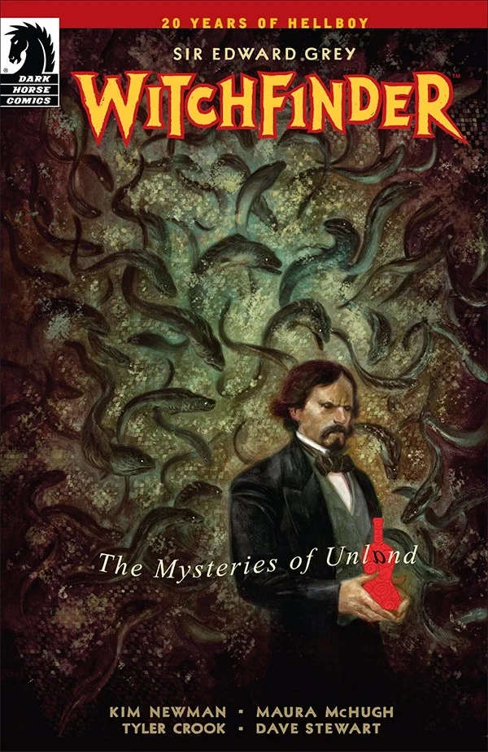

|Witchfinder: The Mysteries of Unland #1

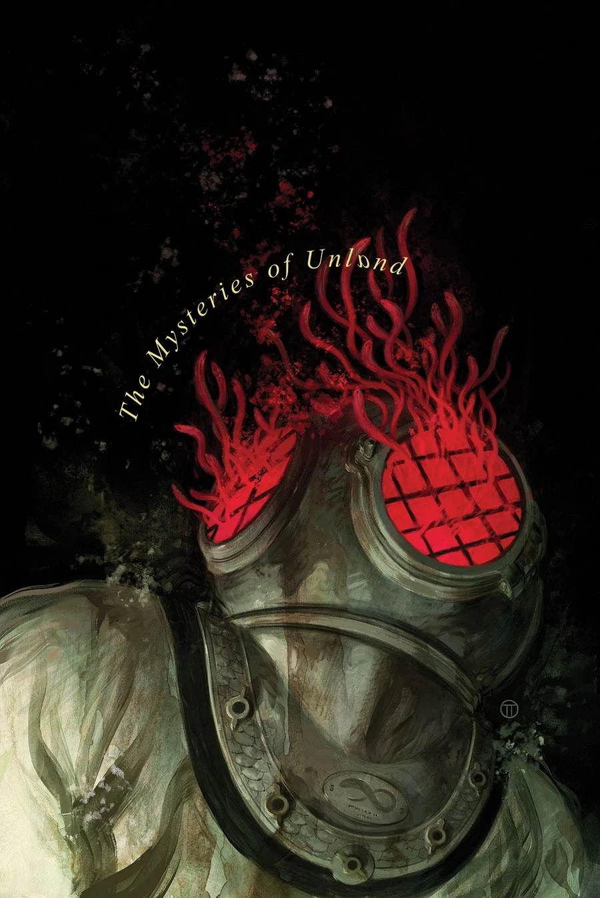

|Witchfinder: The Mysteries of Unland #2

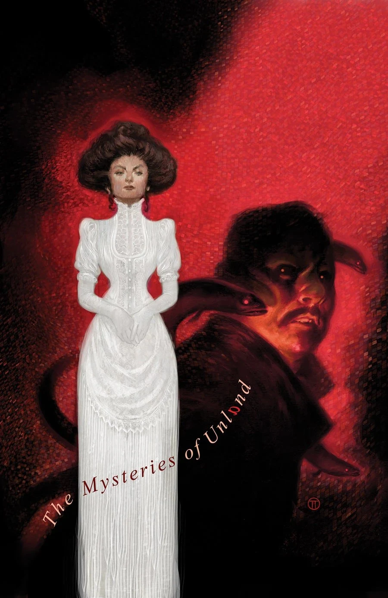

|Witchfinder: The Mysteries of Unland #3

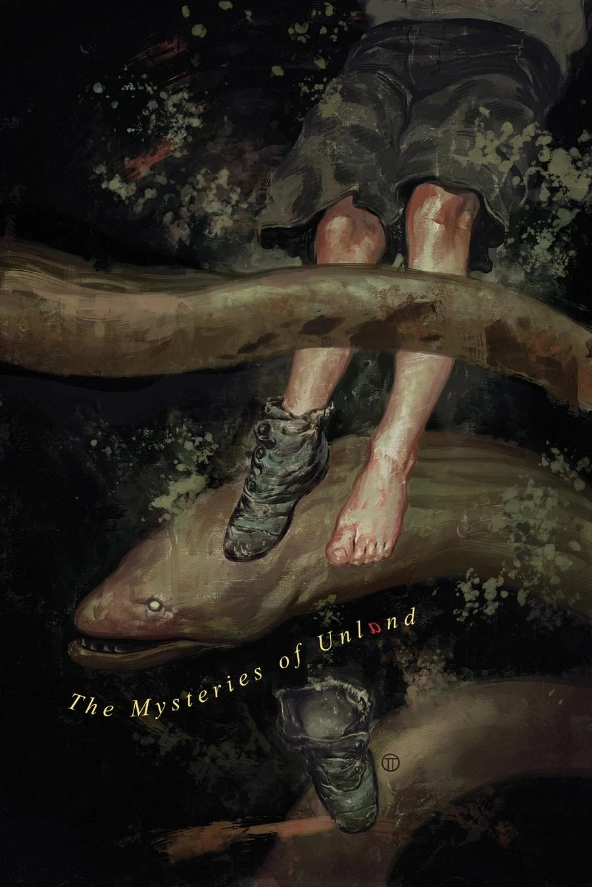

|Witchfinder: The Mysteries of Unland #4

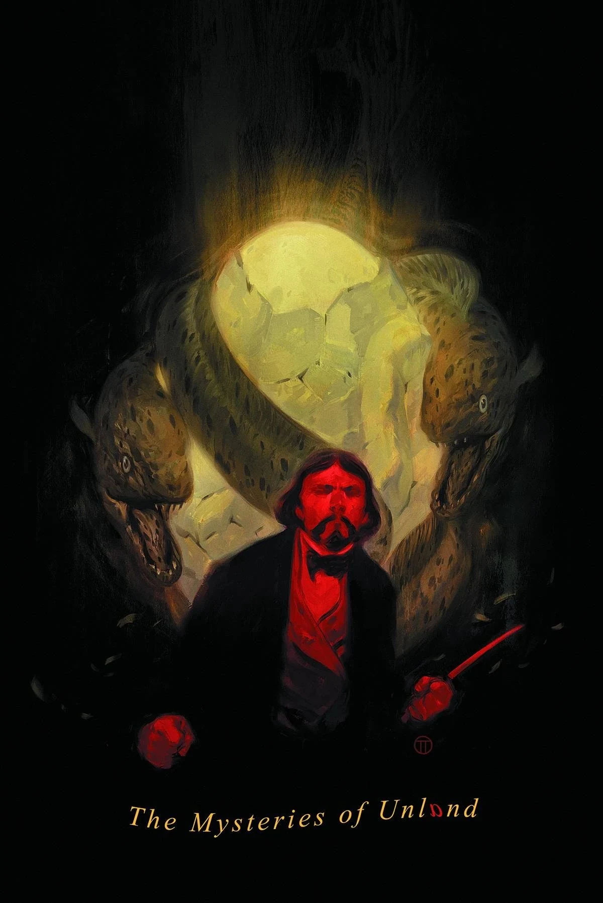

|Witchfinder: The Mysteries of Unland #5

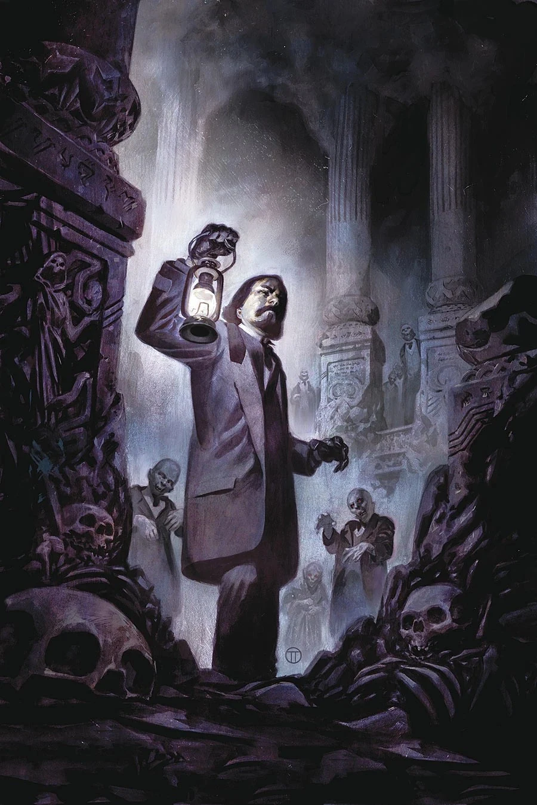

|Witchfinder: City of the Dead #1

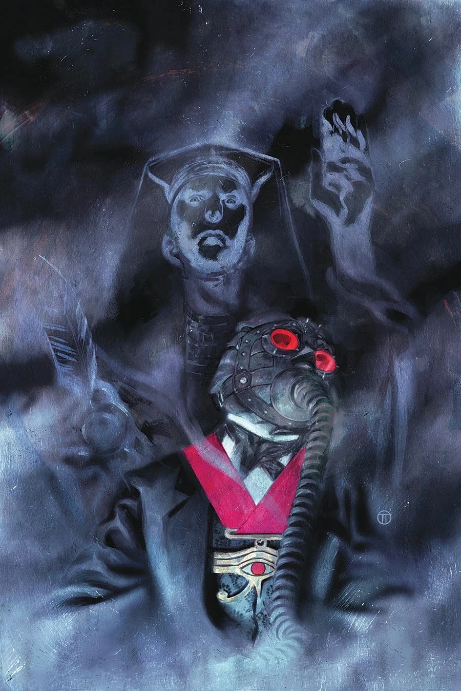

|Witchfinder: City of the Dead #2

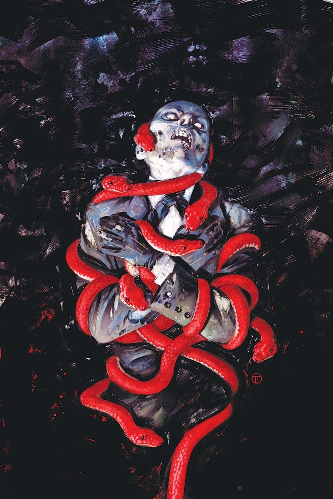

|Witchfinder: City of the Dead #3

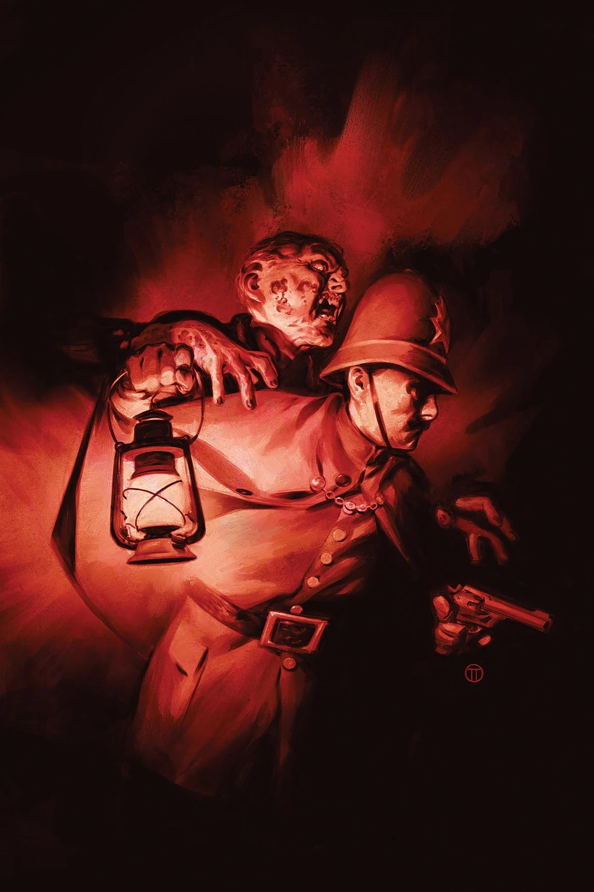

|Witchfinder: City of the Dead #4

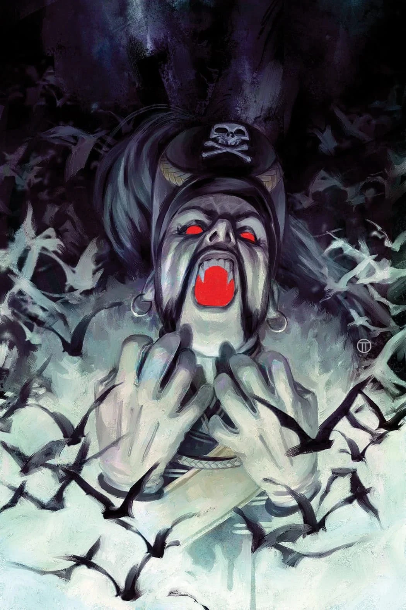

|Witchfinder: City of the Dead #5

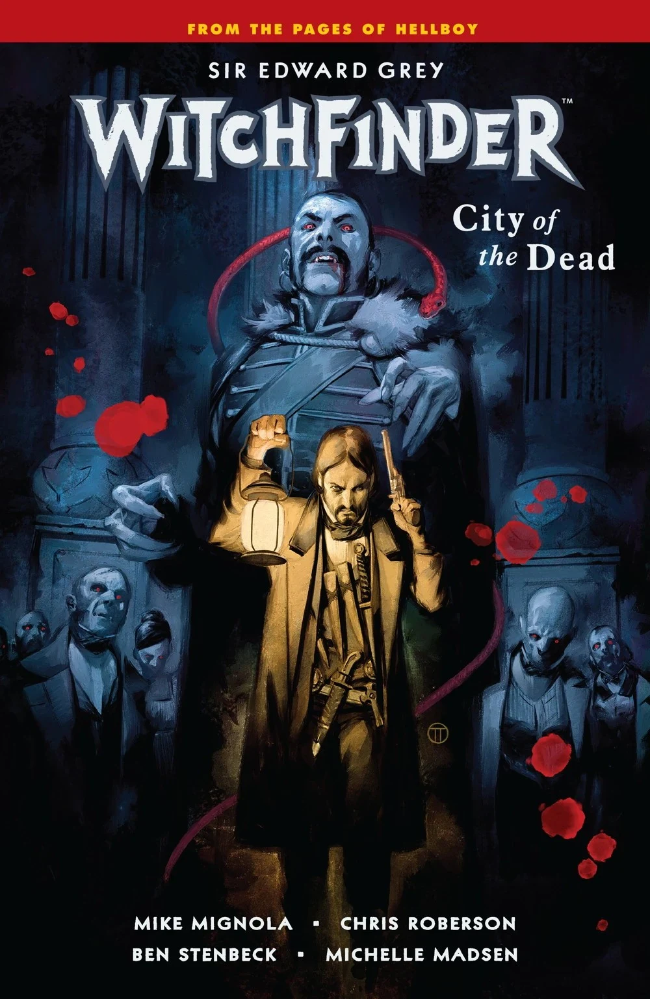

|Witchfinder – Volume 4: City of the Dead

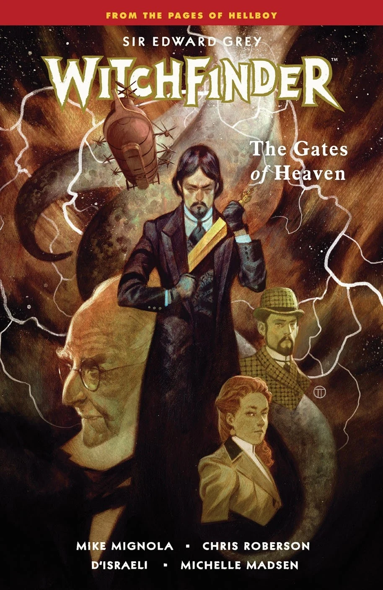

|Witchfinder – Volume 5: The Gates of Heaven
