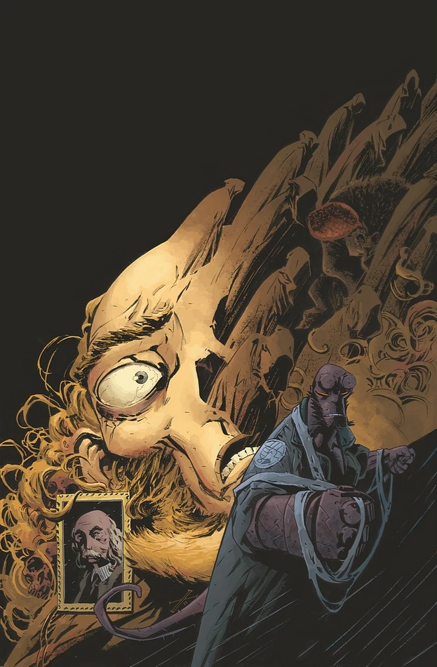

《**J·H·奥唐纳教授的转变**》（The Transformation of J.H. O'Donnell）是一部单篇完结故事，于 2012 年 5 月出版。

## 出版历史

《The Transformation of J.H. O'Donnell》属于[《人间地狱》故事环](/entry/BPRD%3F%E4%BA%BA%E9%97%B4%E5%9C%B0%E7%8B%B1)，但它是一则支线故事，主要聚焦于闪回事件。故事封面由 [Max Fiumara](/entry/Max_Fiumara) 绘制，另有一版「[怪兽之年](/entry/Year_of_Monsters)」变体封面，由 [Mike Mignola](/entry/Mike_Mignola) 创作。

## 剧情简介

二十四年前，地狱男爵带着性情温和的[J·H·奥唐纳教授](/entry/J%C2%B7H%C2%B7%E5%A5%A5%E5%94%90%E7%BA%B3%E6%95%99%E6%8E%88)，进入一位新近去世的死灵法师的秘密藏书馆。从那天起，奥唐纳便成了调查局研究那些意图终结人类纪元的远古强大力量的专家。在这场超自然惊险之旅中，看看奥唐纳究竟看到了什么。

## 画廊

 \#1

 \#1 变体封面
