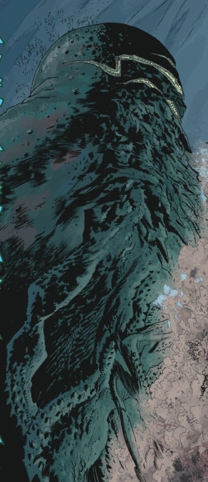

**卡塔-赫姆（Katha-Hem）**是 369 个[奥古·桀哈](/entry/Ogdru_Hem)之一——[奥古·桀哈德](/entry/Ogdru_Jahad)的子嗣，也是《B.P.R.D》漫画中的主要反派。它极为强大，是已知唯一一个能用吐息改变无生命物体的奥古·桀哈，甚至比侍奉第三位[黑焰](/entry/The_Black_Flame)的那七个奥古·桀哈还要庞大。

## 经历

卡塔-赫姆是第四个被释放到世间的奥古·桀哈，也是迄今为止最强大的一个。[萨杜-赫姆](/entry/Sadu-Hem)被预言将带来蛙怪瘟疫，而卡塔-赫姆的降临则标志着世界将开始剧变。

卡塔-赫姆由[蛙怪](/entry/frog_monster)们与[津科公司](/entry/Zinco_Corporation)首席执行官[兰迪斯·波普](/entry/Landis_Pope)（即[黑焰](/entry/The_Black_Flame_%28character%29)）以神秘仪式从大地中召唤而出，它与此前遭遇的奥古·桀哈不同——它不是用周围物质为自己塑造新形体的灵体，而是被囚禁在地下的奥古·桀哈之一，因此是以全部的真正力量现身。起初它形似一条蛞蝓般的生物，长着绿色的裂缝状嘴，在大地上翻滚冲撞，随后一口气摧毁了一座城镇。军用武器完全无法阻挡这个东西，人们只能无助地看着这只幼虫般的怪物以三条蜘蛛般的腿站立，继续推进。此时卡塔-赫姆形如一棵扭曲的、长满触手的树，树冠是地狱般蓝色火焰的火海，树干上布满了长着绿色牙齿的巨口。

美军炮火无法在这庞然大物身上留下一丝痕迹，而任何靠得太近的人类都会被它口中喷出的奇怪绿色气体变成头顶着火的怪物；这「千年之变」同时也摧毁了建筑物。就在美国总统即将动用核打击之际，[B.P.R.D.](/entry/Bureau_for_Paranormal_Research_and_Defense)探员[丽兹·舍曼](/entry/Liz_Sherman)借助一件[古老神器](/entry/Spiked_Cylinder)——它神秘地将她的力量放大了一千倍——成功将卡塔-赫姆烧成灰烬。

卡塔-赫姆的覆灭（以及蛙怪表面上的集体自杀）似乎为蛙怪瘟疫画上了句号。然而表象可能具有欺骗性：蛙怪不过是退入地下，数月后又卷土重来。

## 外形

与大多数奥古·桀哈一样，卡塔-赫姆的外形类似于克苏鲁神话中的旧日支配者。这个实体如山一般高耸，以三条蜘蛛般的腿站立。它的顶部长满触手，树干上排列着无数长着绿色牙齿的巨口。

## 花絮

- 它的外形与《敦威治恐怖事件》有相似之处。

## 链接

- [卡塔-赫姆](https://villains.fandom.com/wiki/Katha-Hem) - [反派维基](https://villains.fandom.com/)
- [卡塔-赫姆](https://darkhorse.fandom.com/wiki/Katha-Hem) - [Dark Horse Database](https://darkhorse.fandom.com/)
- [卡塔-赫姆](https://lovecraft.fandom.com/wiki/Katha-Hem) - [H.P. 洛夫克拉夫特维基](https://lovecraft.fandom.com/)

## 画廊

Katha-Hem.png

|
