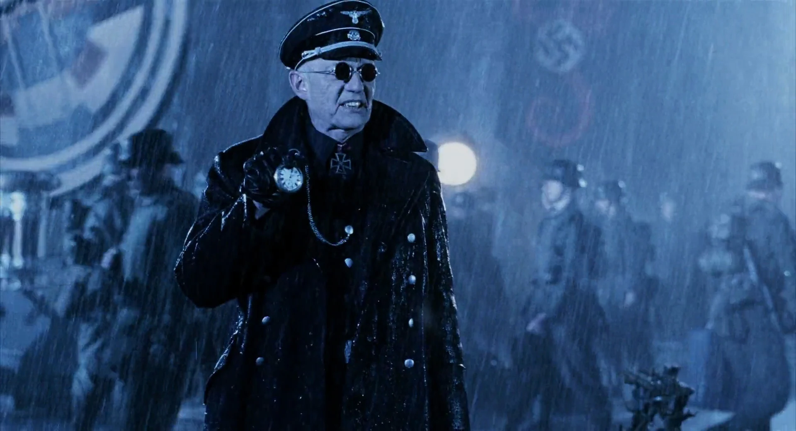

**克劳斯·维尔纳·冯·克虏伯（Klaus Werner von Krupt）**将军是第二次世界大战末期[诸神黄昏计划](/entry/Project_Ragna_Rok)的部门负责人之一。

## 历史

克劳斯·维尔纳·冯·克虏伯将军是[诸神黄昏计划](/entry/Project_Ragna_Rok)的核心成员之一，该计划是[阿道夫·希特勒](/entry/Adolf_Hitler)的末日计划之一，唯一目的就是为第三帝国赢得第二次世界大战。冯·克虏伯亲历了“[地狱男爵事件](/entry/Seed_of_Destruction)”，并对术士[格里高利·拉斯普廷](/entry/Grigori_Rasputin)关于为第三帝国创造奇迹的承诺深表怀疑。由于看不到成果，冯·克虏伯宣布计划失败；他不知道的是，术士的仪式已将类人恶魔[地狱男爵](/entry/Hellboy_%28character%29)带到了人间。战后，冯·克虏伯被关进一家精神病院，数月后死亡，人们发现他的尸体里滋生着未知种类、不明来源的甲虫。

## 其他媒体/登场

- 在电影 *[《地狱男爵》](/entry/Hellboy_%28film%29)* 中，冯·克虏伯由 William Hoyland 饰演，他出席了拉斯普廷的仪式。在剧本中，他被突入仪式现场的美国士兵杀死。电影里冯·克虏伯戴的是一副墨镜而非单片眼镜，且两块镜片上都没有像单片眼镜那样印着卐字标记。
- 在 Stephen R. Bissette 创作的短篇故事《Jigsaw》（收录于 *[《地狱男爵：零工》](/entry/Hellboy__Odd_Jobs)*）中，[凯特·考瑞根](/entry/%E5%87%AF%E7%89%B9%C2%B7%E8%80%83%E7%91%9E%E6%A0%B9))提到，诸神黄昏计划的数名成员，包括冯·克虏伯、[利奥波德·克茨](/entry/Leopold_Kurtz)和 [伊尔莎·豪普斯坦](/entry/Ilsa_Haupstein)，曾在巴黎集会，试图拼合 [Moro](/entry/Moro) 的头颅——这位邪恶炼金术士于 17 世纪被教会处死——但尚未得手就遭到法国抵抗组织的袭击而中断。
