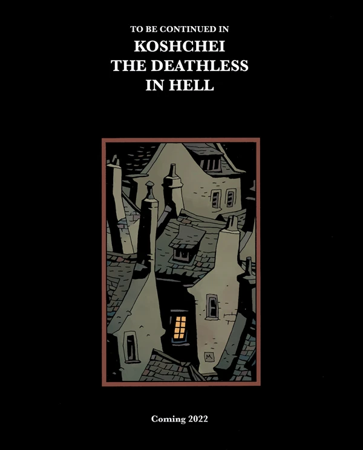

***《不死者科西切》***是围绕角色[不死者科西切](/entry/Koshchei_(character))展开的一系列漫画书，是*[《地狱男爵》](/entry/Hellboy_(series))*系列的衍生作品。

## 出版历史

*另见 **Koshchei** 故事列表*

*《不死者科西切》*最初[以一部六期满篇连载的形式推出](/entry/Koshchei_the_Deathless_(story))，由 Mike Mignola 编剧，Ben Stenbeck 作画。该作于 2017 年圣迭戈国际动漫展（San Diego Comic-Con）上公布，首期于 2018 年 1 月出版。

2021 年 12 月，*[《爱德华·格雷爵士：阿刻戎》](/entry/Acheron_(story))*预告了第二部 *Koshchei* 满篇连载将于 2022 年推出，即*[《科西切在地狱》](/entry/Koshchei_in_Hell)*。

## 合订本

### 平装合订本

*另见《不死者科西切》平装合订本*

所有属于正史连续性的 *Koshchei* 故事最终都会被收入平装合订本。合订本中包含一个速写本章节。
