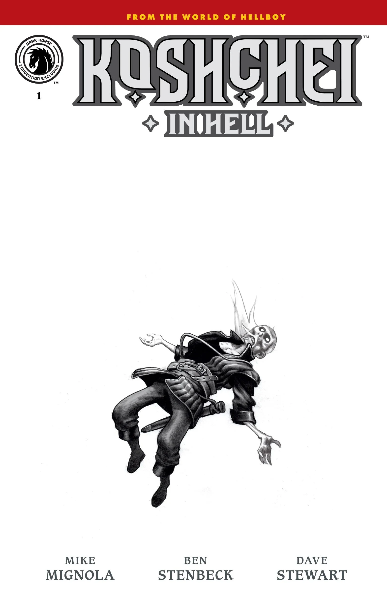
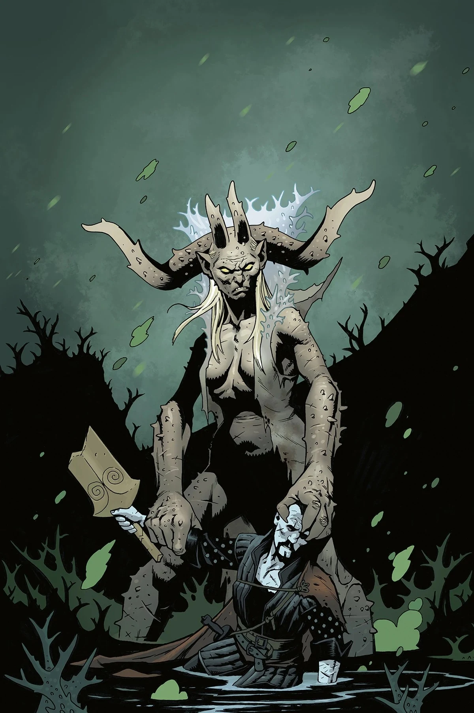
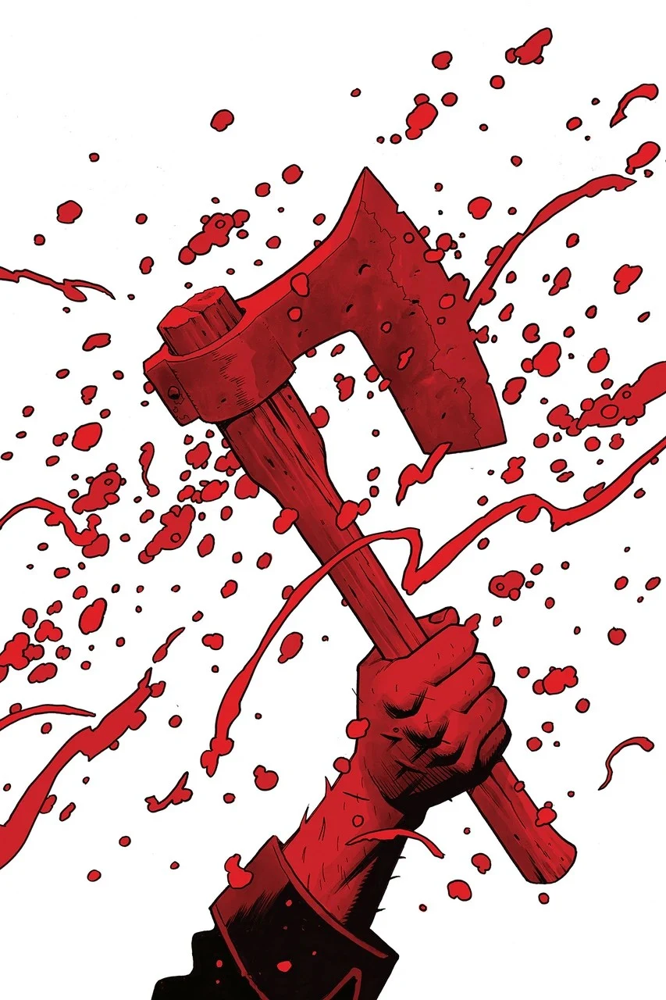
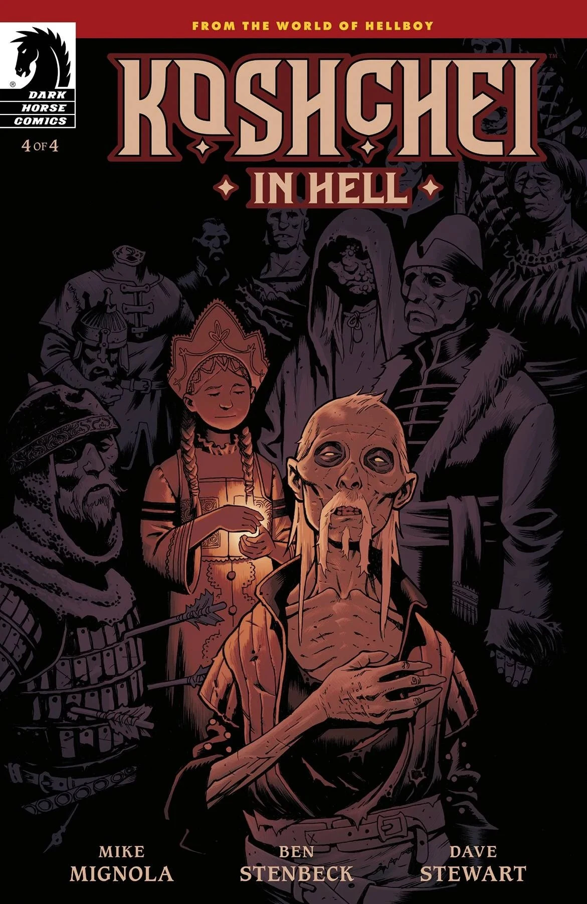

***《科西切在地狱》（Koshchei in Hell）*** 是 [*《Koshchei》系列*](/entry/Koshchei_(series))的第二个四期故事弧，情节接续 *[《爱德华·格雷爵士：阿刻戎》](/entry/Acheron_(story))* 中的事件。由迈克·米格诺拉编剧，Ben Stenbeck 作画。

## 剧情简介

### 第一部分

地上的世界或许已经终结，地狱男爵也随之而去，但科西切仍在地狱里，满足于美酒与书籍——直到一张[旧日面孔](/entry/Edward_Grey)到来，给科西切带来一项关键任务。一位[古老而强大的敌人](/entry/Pluto)卷土重来，科西切必须拿起长剑，守护城市免遭毁灭。

### 第二部分

抵达万魔殿废墟之后，不死者科西切与来自地狱男爵过去的[某个人](/entry/Gamori)正面相遇。当对方亮出他们对这片废墟之境的计划时，希望变得愈发渺茫；科西切发现自己再次投入了一场生死之战——或者说，是死与生之战，视情况而定。

### 第三部分

科西切揭露了一个计划：有人企图释放一个潜伏已久、妄图统治地狱的邪恶存在。一个意想不到的同伴——可能是[地狱里最后的恶魔](/entry/The_last_Demon_in_Hell)——既可能是朋友，也可能是敌人。

### 第四部分

科西切的地狱之行愈演愈烈！在被地狱最后的恶魔背叛之后，筋疲力尽的科西切准备放弃……但一个来自他遥远过去的人现身，帮助他为自己犯下的罪作出交代，并借此让他为下一阶段的存在做好准备。

## 内容

### 角色

#### 人类

- [科西切](/entry/Koshchei_(character))
- 詹克斯先生与迪恩先生（Mister Jenks and Mister Dean）
- [雅加婆婆](/entry/Baba_Yaga_(character))（闪回）
- [瓦西丽莎（Vasilisa）](/entry/Vasilisa)（闪回）

#### 地狱的其他居民

- [蛇](/entry/The_Snake)
- 无名会说话的蜗牛
- 无名会说话的渡鸦
- 地狱男爵之妻

#### 地狱诸河

- [爱德华·格雷](/entry/Edward_Grey)爵士/[阿刻戎](/entry/Acheron_(river))
- [斯堤克斯](/entry/Styx)
- [佛勒革同](/entry/Phlegethon)
- [科库托斯](/entry/Cocytus)
- [勒忒](/entry/Lethe)

#### [恶魔](/entry/Demon)

- [加莫里（Gamori）](/entry/Gamori)
- [撒旦](/entry/Satan)（闪回）
- [毁灭天使](/entry/Angels_of_Destruction)

### 地点

- [地狱](/entry/Hell)
  - [万魔殿](/entry/Pandemonium_(location))

## 画廊

封面由 Ben Stenbeck 绘制。

出自 [*《爱德华·格雷爵士：阿刻戎》*](/entry/Acheron_(story))的预告画面  
迈克·米格诺拉创作

*《科西切在地狱》* \#1

*《科西切在地狱》* \#1  
（2023 SDCC 变体封面）

*《科西切在地狱》* \#2

*《科西切在地狱》* \#3

*《科西切在地狱》* \#4

|Koshchei in Hell #1 (SDCC 2023 variant)

|Koshchei in Hell #2

|Koshchei in Hell #3

|Koshchei in Hell #4
