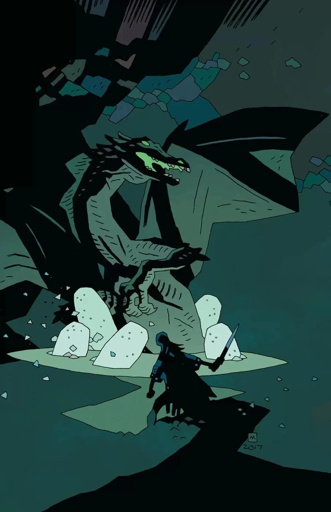
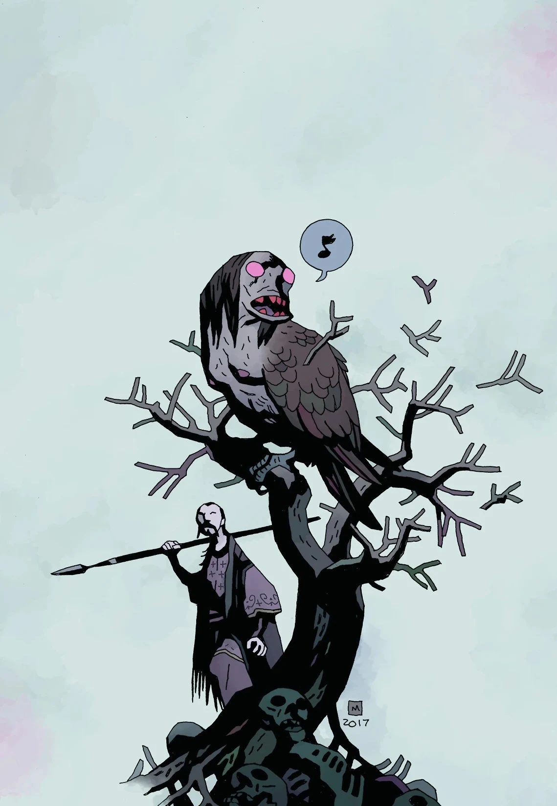
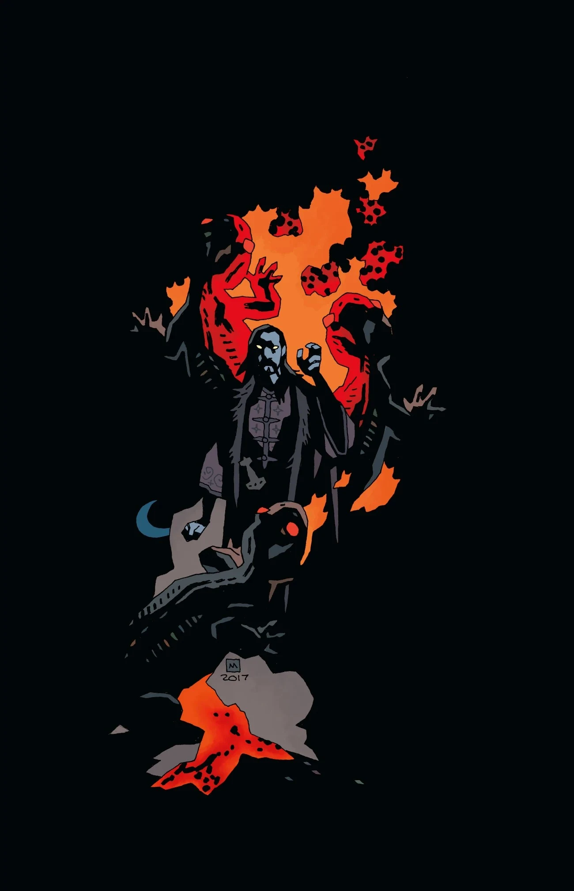
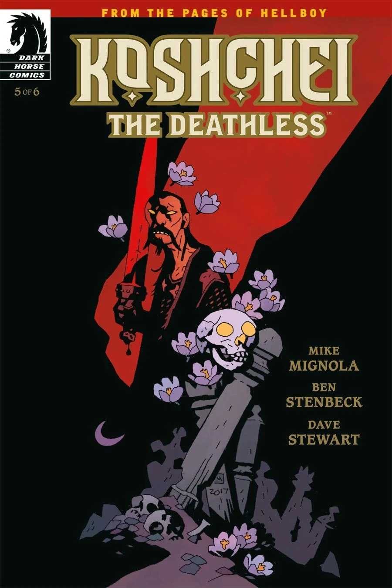
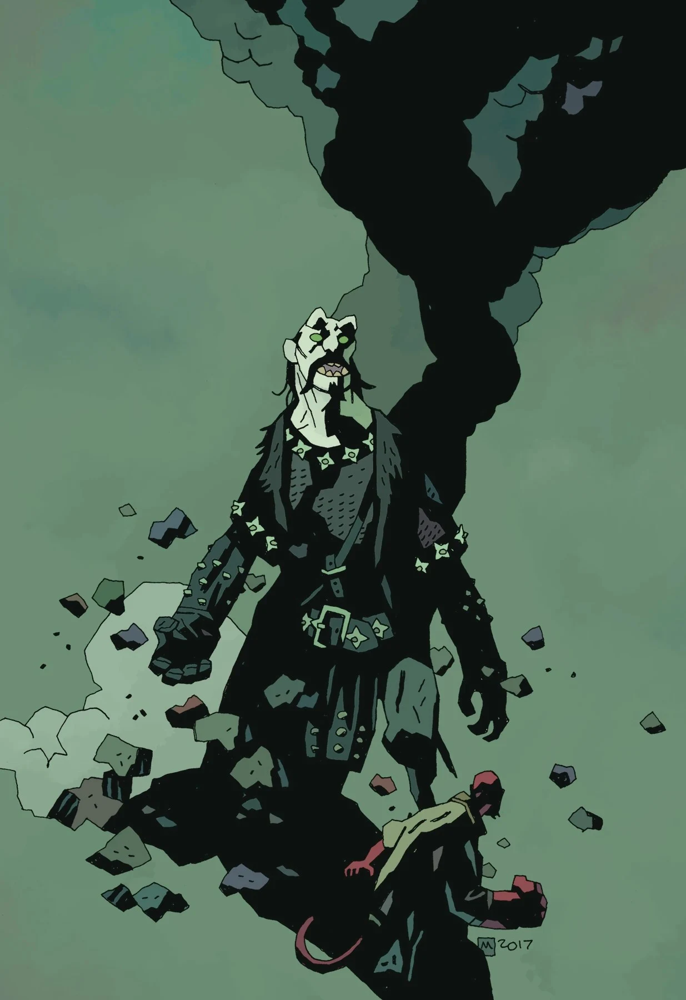

***《不死者柯希伊》***（Koshchei the Deathless）是一部六期限定迷你系列，编剧：迈克·米格诺拉，作画：本·斯滕贝克。

## 剧情简介

### 第一部分

柯希伊在《[黑暗召唤](/entry/Darkness_Calls)》（Darkness Calls）中受芭芭雅嘎派遣去杀地狱男爵，他当时曾暗示，在被这个俄罗斯女巫奴役之前，自己度过了漫长而悲惨的一生。如今，柯希伊重温他走向不朽乃至更远处路上的每一桩可怕行径，而倾听者不是别人，正是地狱男爵本人——地点在地狱。

### 第二部分

柯希伊在《黑暗召唤》中受芭芭雅嘎派遣去杀地狱男爵，他曾暗示，在被这个俄罗斯女巫奴役之前，自己度过了漫长而悲惨的一生。

如今，在地狱某处的一家酒馆里，柯希伊向地狱男爵讲述了一次危险任务：女巫派他去猎杀最后一批龙，要在龙蛋孵化之前将它们消灭。

### 第三部分

柯希伊向地狱男爵讲述最后一条龙、一个被飞禽怪物恐吓的王国，以及他在为芭芭雅嘎效命时不得不做出的种种悲惨抉择。

### 第四部分

女巫安息日的一次遭遇把柯希伊引上了一条背叛之路，而在复仇之中，他与自己最意想不到的敌人正面相对。

### 第五部分

柯希伊试图反抗芭芭雅嘎，但此举付出了无法承受的代价。

### 第六部分

柯希伊重新讲述了他与芭芭雅嘎的最后几次交锋，随后他和地狱男爵各奔东西。

## 图集

|第 #2 期

|第 #3 期

|第 #4 期

|第 #5 期

|第 #6 期
