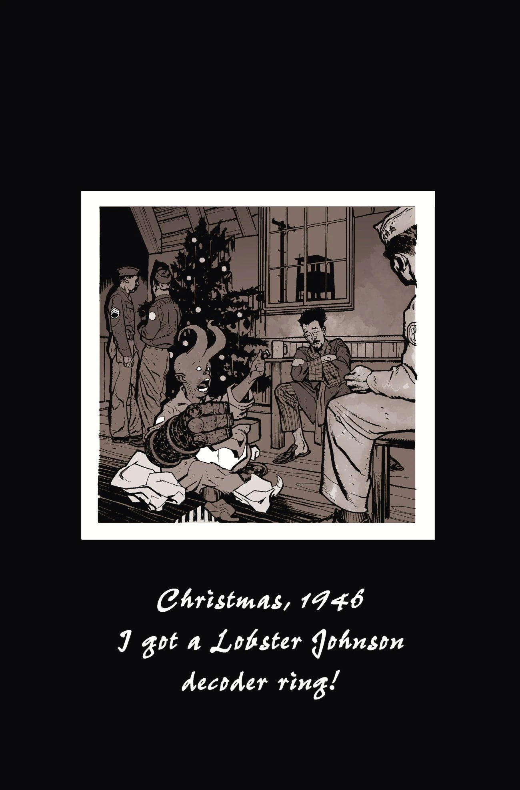
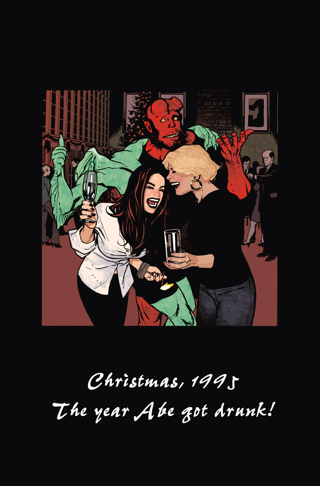
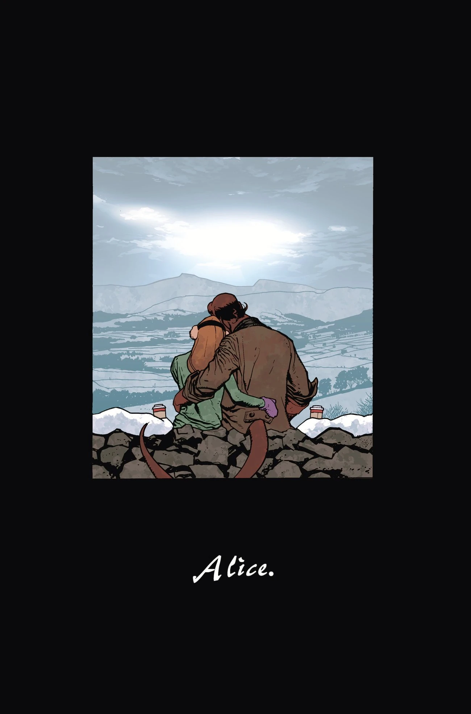
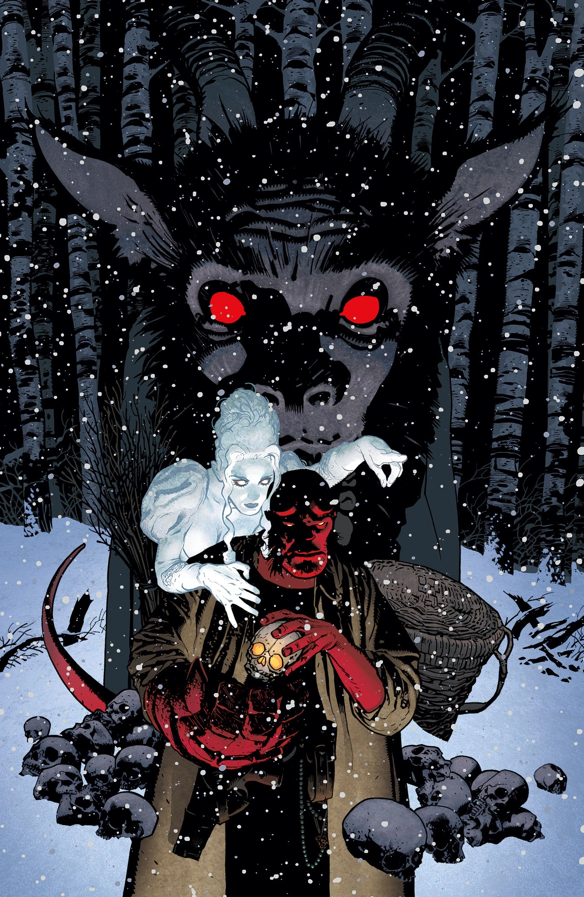
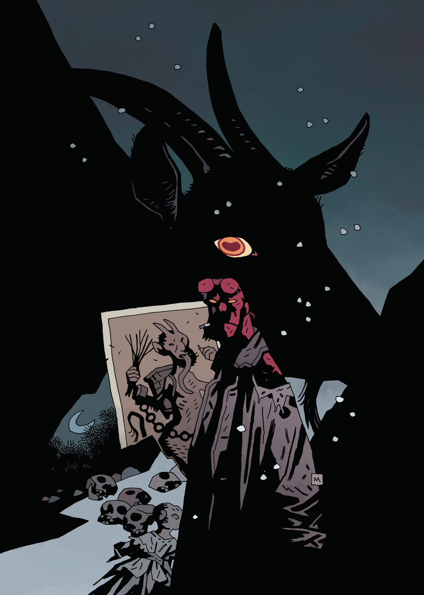
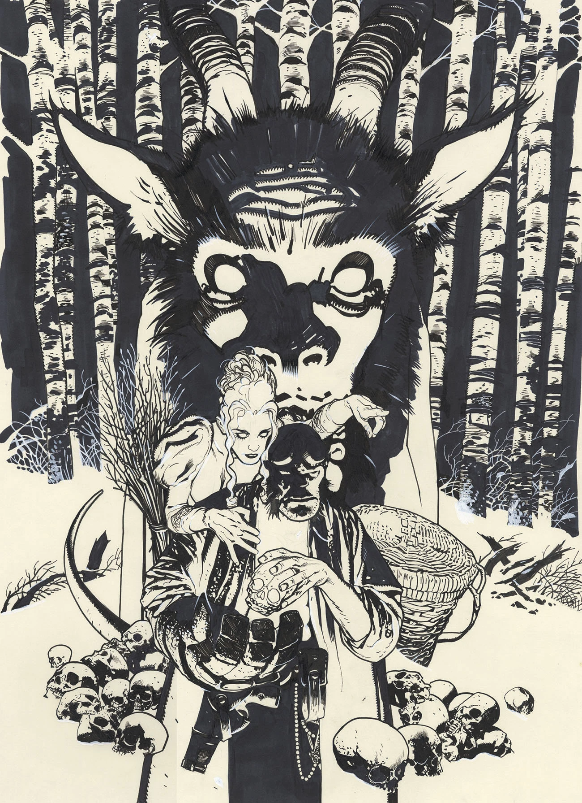

《**坎卜斯之夜**》（Krampusnacht）是[迈克·米格诺拉](/entry/Mike_Mignola)和[亚当·休斯](/entry/Adam_Hughes)于 2017 年创作的一部单期故事。它在 2018 年获得了[艾斯纳奖](https://www.comic-con.org/awards/eisner-awards-current-info)最佳单期/单期故事奖。

## 出版历史

《坎卜斯之夜》最初被公布为第三部 *[地狱男爵冬季特刊](/entry/Hellboy_Winter_Special)*。然而，最终成书出版时，没有任何标准的 *[地狱男爵冬季特刊](/entry/Hellboy_Winter_Special)* 装帧设计。

本期标志着[亚当·休斯](/entry/Adam_Hughes)首次参与地狱男爵宇宙漫画的创作。故事设定在 1975 年，与短篇故事 *[情绪波动](/entry/Mood_Swings)* 中的圣诞节是同一年。

## *《圣诞回忆》*

《地狱男爵：坎卜斯之夜》包含一个题为"圣诞回忆"的部分。其中收录了三幅以照片风格绘制的插画，仿佛是[地狱男爵](/entry/Hellboy_%28character%29)往昔圣诞节的照片。

"1946 年的圣诞节——我得到了一枚[龙虾约翰逊](/entry/Lobster_Johnson_%28character%29)解码器戒指！"

"1995 年的圣诞节——[亚伯](/entry/Abraham_Sapien)喝醉的那一年！"

"[爱丽丝](/entry/Alice_Monaghan)"

## 画廊

 休斯封面

 米格诺拉变体封面

 激励变体封面

## 外部链接

[BloodyDisgusting.com 上的"圣诞回忆"](http://bloody-disgusting.com/comics/3475363/exclusive-hellboy-shares-christmas-memories-hellboy-krampusnacht-images/)
