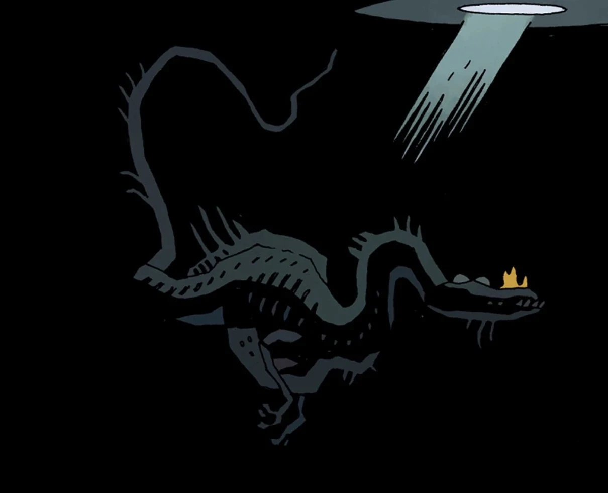

**利维坦（The Leviathan）**是一头恶魔巨兽，因一场不为人知的争端，与恶魔 [Astaroth](/entry/Astaroth) 结下了持续漫长岁月的仇怨。

## 历史

[地狱男爵](/entry/Hellboy_%28character%29)与他的叔叔以及两个兄弟——[Gamon](/entry/Gamon) 和 [Lusk](/entry/Lusk)——重聚时，利维坦突然出现，在任何事情继续之前就把 Astaroth 和他的两个侄子一同吞下，终结了这两个恶魔之间的仇怨。

恶魔等级体系中的大多数成员被一头长着地狱男爵模样的泰坦杀死后，利维坦从海中现身，与那个对手交战，但地狱男爵使用地狱火焰之力将它杀死。它死后不久，它的兄弟[比希摩斯（Behemoth）](/entry/Behemoth)也随之毙命。

## 其他作品

在 Brian Hodge 创作的非正史小说《[在人间如在地狱（On Earth as it is in Hell）](/entry/On_Earth_as_it_is_in_Hell)》中，利维坦短暂登场，与恶魔 [Moloch](/entry/Moloch) 勾结——Moloch 的爪牙在大西洋上一艘货轮的甲板上绑架了地狱男爵。利维坦把地狱男爵装在肚子里渡海，随后把他吐在他"出生"的那座苏格兰小岛的海岸上。

## 画廊

LeviathanUnderWater.jpeg

|
## 趣闻

- 利维坦的外形类似一种[棘龙科（Spinosaurid）](https://en.wikipedia.org/wiki/Spinosauridae)恐龙。
