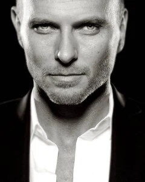

Luke-Goss-240x300.jpg

演员／制片人／编剧／音乐人

Luke Goss 在片中饰演「[弩阿达王子（Prince Nuada）](/entry/Prince_Nuada)」——这部影片即 [Hellboy II: The Golden Army](/entry/Hellboy_II__The_Golden_Army)，由 [Guillermo del Toro](/entry/Guillermo_del_Toro) 执导，是广受好评的 [Hellboy](/entry/Hellboy_%28film%29) 续集，于今年 7 月上映并一举登上美国票房榜首。这个角色为他赢得了两项 MTV Movie Award 提名。他最近刚完成科幻惊悚长片 *Tekken* 的主演工作，该片改编自大热的电子／街机游戏。此外，他已确定将在 Top Cow 漫画《Magdalena》的大银幕改编版中饰演「Kristoff」，该片由 Gale Anne Hurd 的 Valhalla Pictures、Platinum Studios 与 Top Cow 联合开发制作。

Goss 最近还完成了他在电视网的首个角色，出演 JJ Abrams 的剧集 *Fringe*（《危机边缘》）。

Goss 的演艺生涯始于伦敦西区热门音乐剧 *Grease*，他在剧中饰演「Danny Zuko」，随后又随该剧组在全英国巡回演出。

2002 年，他凭借两部风格迥异的长片在银幕上站稳脚跟：一部是 David Goyer 执导、与 John Leguizamo、Oliver Platt、Natasha Lyonne 及 Wesley Snipes 合作的独立剧情片 *ZigZag*；另一部是 Guillermo del Toro 执导、与 Snipes 及 Ron Perlman 合作的超自然动作片 *Blade II*。次年，他在广受好评的英国黑帮片 *Charlie* 中出演同名主角，并在由 Donald Sutherland 与 William Hurt 主演、赢得 Emmy Award 的 Hallmark 迷你剧 *Frankenstein* 中同样饰演同名主角。

2005 年，Goss 远赴印度，在与 Omar Sharif、Peter O'Toole 对戏的圣经史诗片 *One Night With The King* 中出演主角。他近期的电影作品还包括与 Samuel L. Jackson、Eugene Levy 合作的 *The Man*；与 Steven Seagal 合作的 *Mercenary*；与 Lance Henriksen 合作的 *Bone Dry*；与 Emmanuelle Vaugier 合作的 *Unearthed*；与 Michael Madsen 合作的 *Deep Winter*；以及与 Bai Ling 合作的 *Shanghai Baby*。

20 世纪 80 年代末，Goss 曾与兄弟 Matt 及友人 Craig Logan 一同担任乐队 Bros 的成员。
