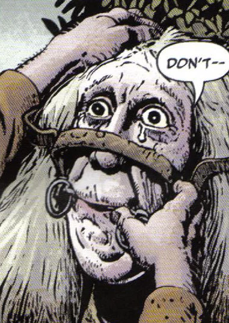

魔马的衔铁与缰绳是一件诅咒之物，[地狱男爵](/entry/Hellboy_%28character%29)和 [汤姆·费雷尔](/entry/Tom_Ferrell)在[《地狱男爵：扭曲人》](/entry/The_Crooked_Man_%28comic_story%29)中遇到了它。[埃菲·科尔布](/entry/Effie_Kolb_%28character%29)曾把它戴在汤姆的父亲身上，真的把他当马骑，一直骑到死。

不过汤姆留下了这副衔铁，等机会来临时，把它戴到了那个恶毒女人身上，作为对她罪行的惩罚。

## 能力与特性

只要把这件诅咒之物戴到某人身上，那人就会变成一匹马。受害者无法自行摘下，只能嚼草、被人骑乘，直到有人把它取下为止。它似乎还会把受害者的情绪爆发和说话的企图转化为相应的马的反应。
