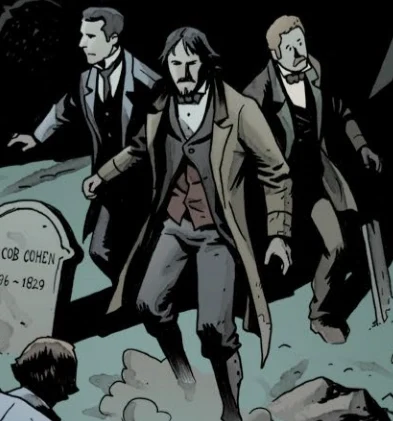

**曼利博士（Dr. Manley）**在整个19世纪80年代都任职于伦敦的圣十字若望警察医院（Saint John of the Cross Police Hospital）。他与[刘易斯博士](/entry/Lewis)经常向秘术侦探[爱德华·格雷爵士](/entry/Edward_Grey)伸出援手。两人主要为格雷担任医学与科学顾问，但也有几次不得不直面亡灵；不过在爱德华爵士的帮助下，他们从未受过严重的身体伤害。然而，一次与吸血鬼的遭遇给曼利博士留下了难以磨灭的影响，此后他便拒绝再协助爱德华爵士出外勤。
