**Matt Smith** 是一位美国漫画画师。请注意不要将他与另一位曾在 20 世纪 90 年代短暂参与地狱男爵宇宙创作的 [Matt Smith](/entry/Matthew_Dow_Smith) 相混淆。

## 内页画师

- *[《地狱男爵与 B.P.R.D.：戈洛斯基车站的漫漫长夜》（Hellboy and the B.P.R.D.: Long Night at Goloski Station）](/entry/Long_Night_at_Goloski_Station)*
- [《地狱男爵：巨人之骨》（*Hellboy: The Bones of Giants*）\#1–4](/entry/The_Bones_of_Giants_%28comic_miniseries%29)
- [《恋爱中的地狱男爵：哥布林之夜》（*Hellboy in Love: Goblin Night*）\#1–2](/entry/Goblin_Night)
- [《恋爱中的地狱男爵：影子剧场》（*Hellboy in Love: Shadow Theater*）\#1–2](/entry/Shadow_Theater)
- [《恋爱中的地狱男爵：通往一切的钥匙》（*Hellboy in Love: The Key to It All*）](/entry/The_Key_to_It_All)

## 封面美术

### 《地狱男爵》（*Hellboy*）各期

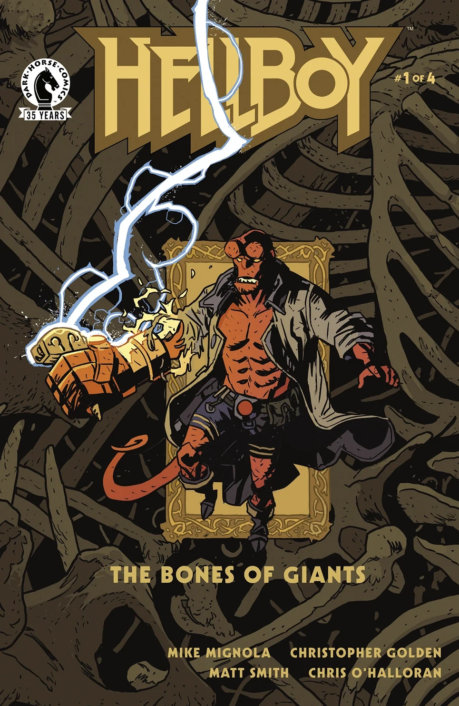

|《地狱男爵：
巨人之骨》（*Hellboy:
The Bones of Giants*）\#1

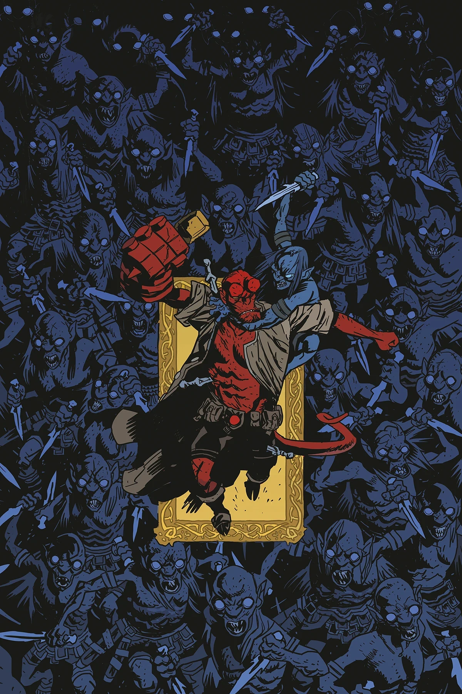

|《地狱男爵：
巨人之骨》（*Hellboy:
The Bones of Giants*）\#2

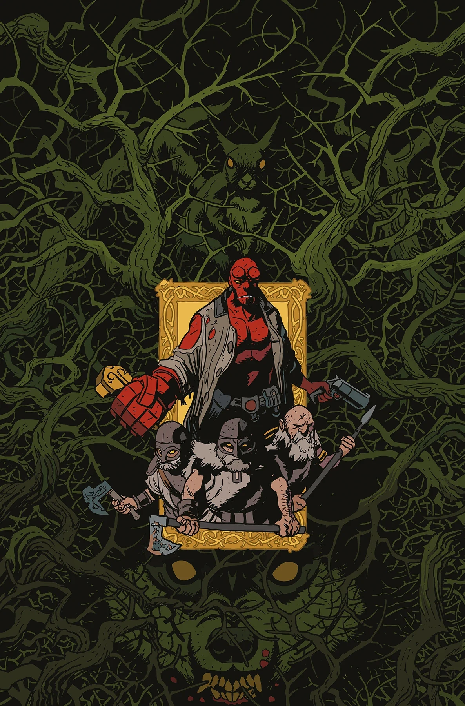

|《地狱男爵：
巨人之骨》（*Hellboy:
The Bones of Giants*）\#3

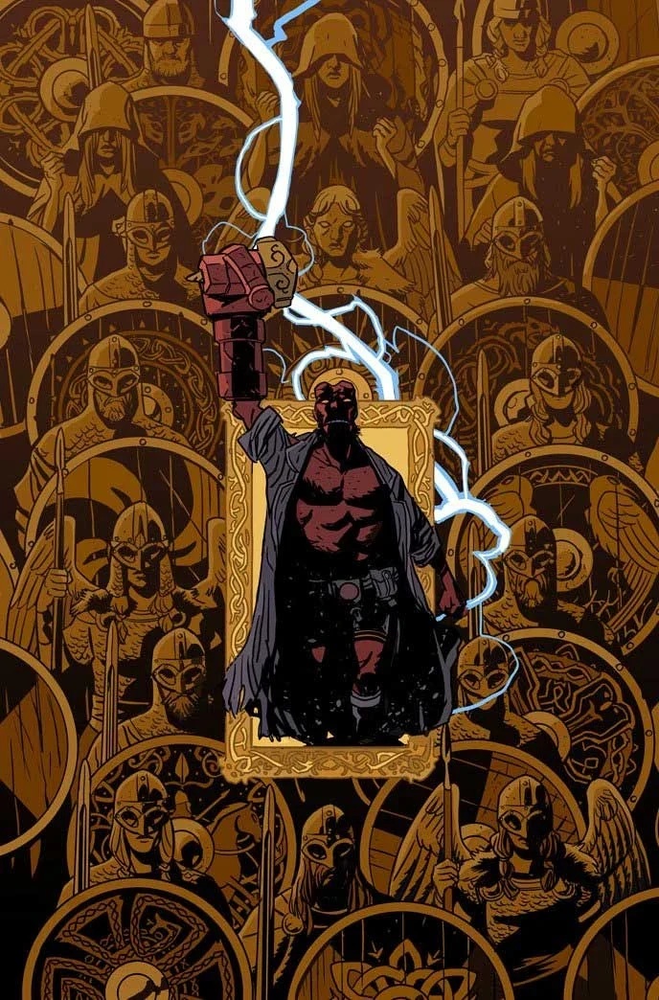

|《地狱男爵：
巨人之骨》（*Hellboy:
The Bones of Giants*）\#4

### 《少年地狱男爵》（*Young Hellboy*）各期

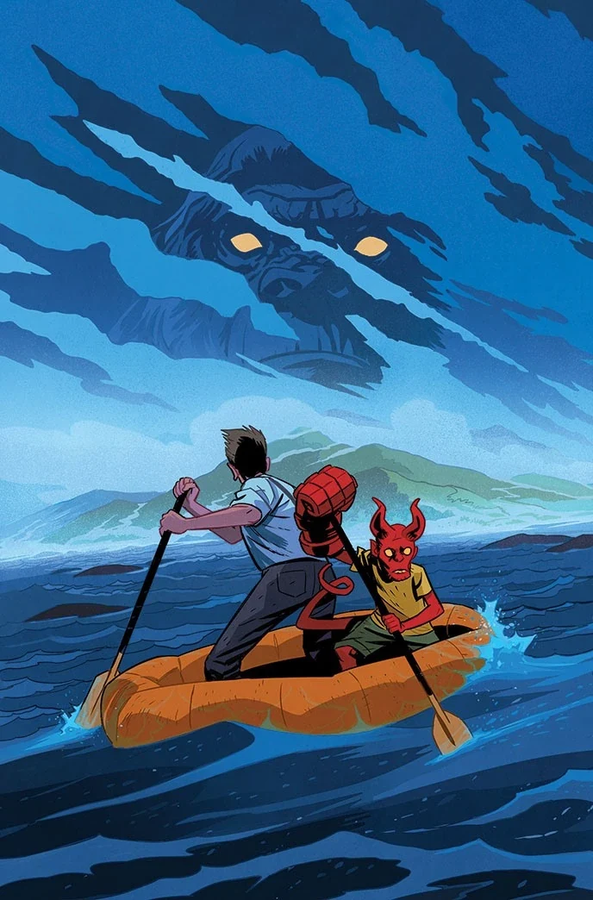

《隐秘之地》（The Hidden Land）* \#1

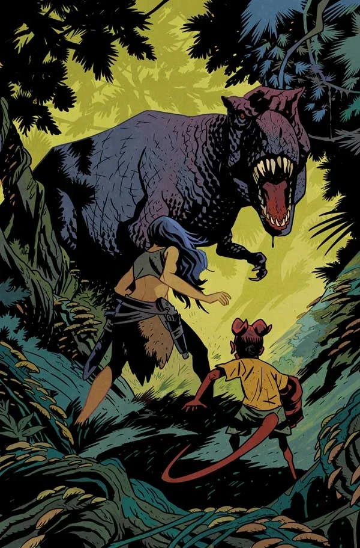

《隐秘之地》（The Hidden Land）* \#2

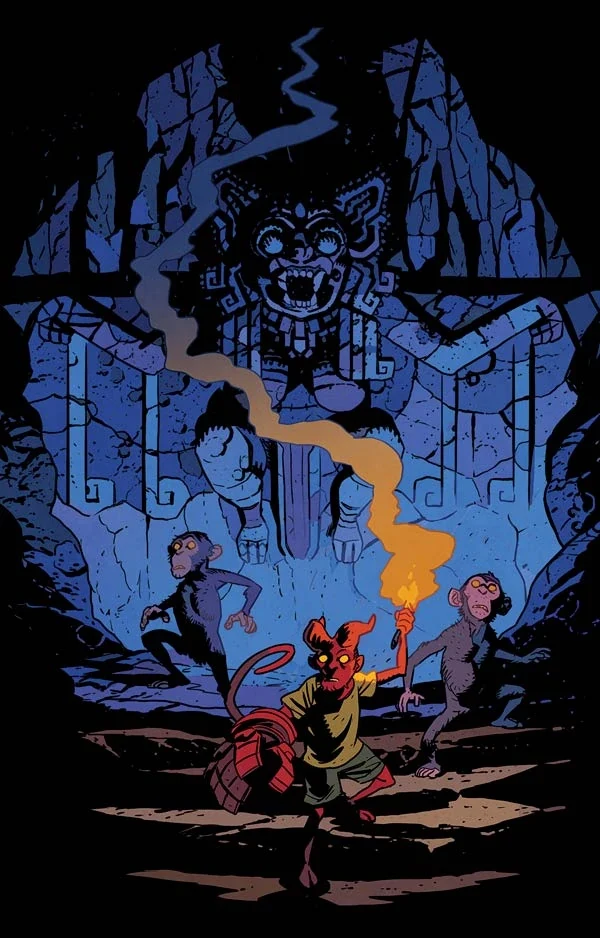

《隐秘之地》（The Hidden Land）* \#3

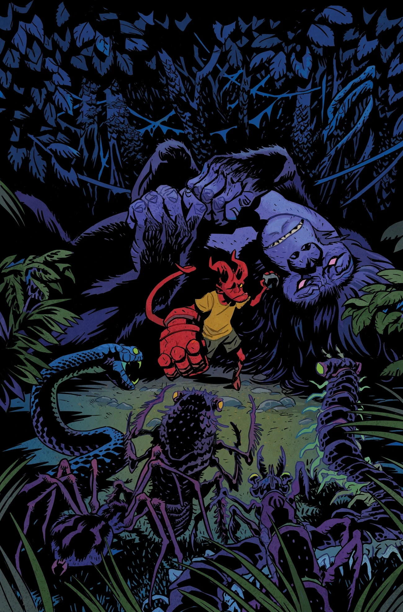

《隐秘之地》（The Hidden Land）* \#4

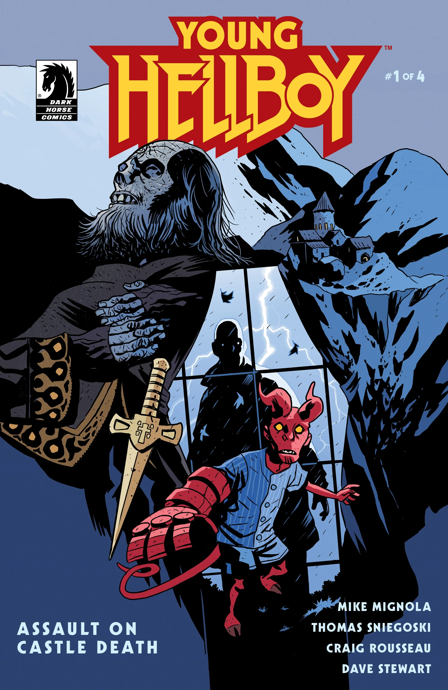

《突袭死亡城堡》（Assault on Castle Death）* \#1

《突袭死亡城堡》（Assault on Castle Death）* \#2

《突袭死亡城堡》（Assault on Castle Death）* \#3

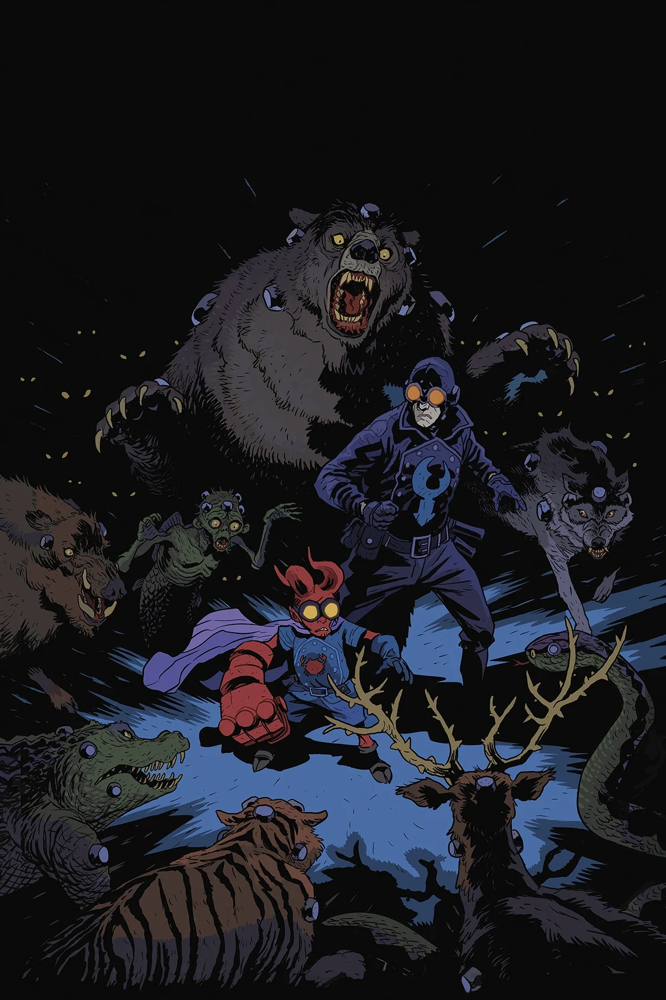

《突袭死亡城堡》（Assault on Castle Death）* \#4

### 《恋爱中的地狱男爵》（*Hellboy in Love*）各期

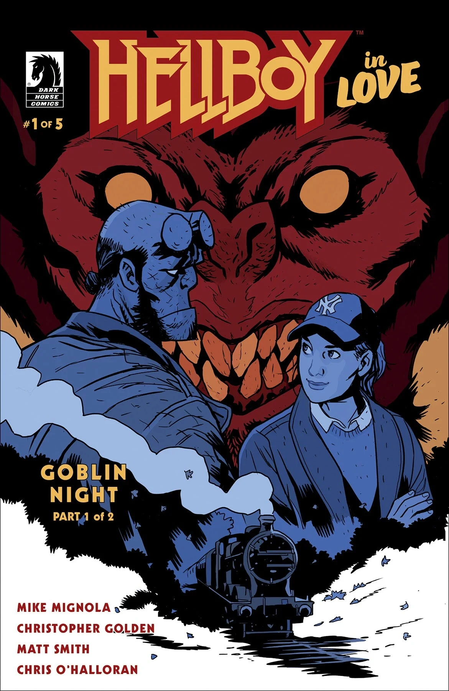

*《哥布林之夜》（Goblin Night）（第 1 部分）

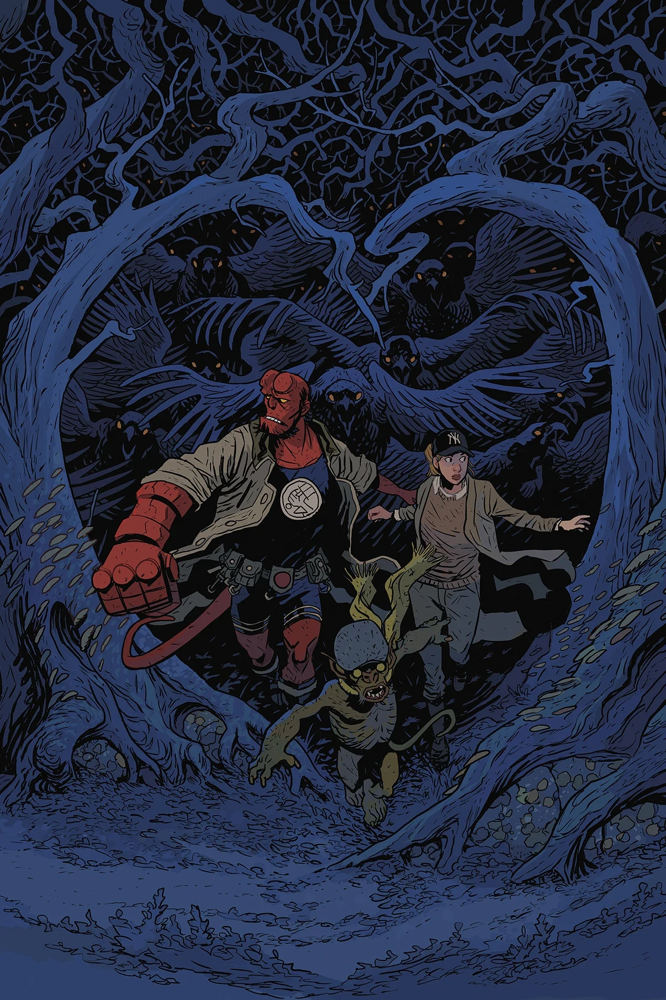

*《哥布林之夜》（Goblin Night）（第 2 部分）

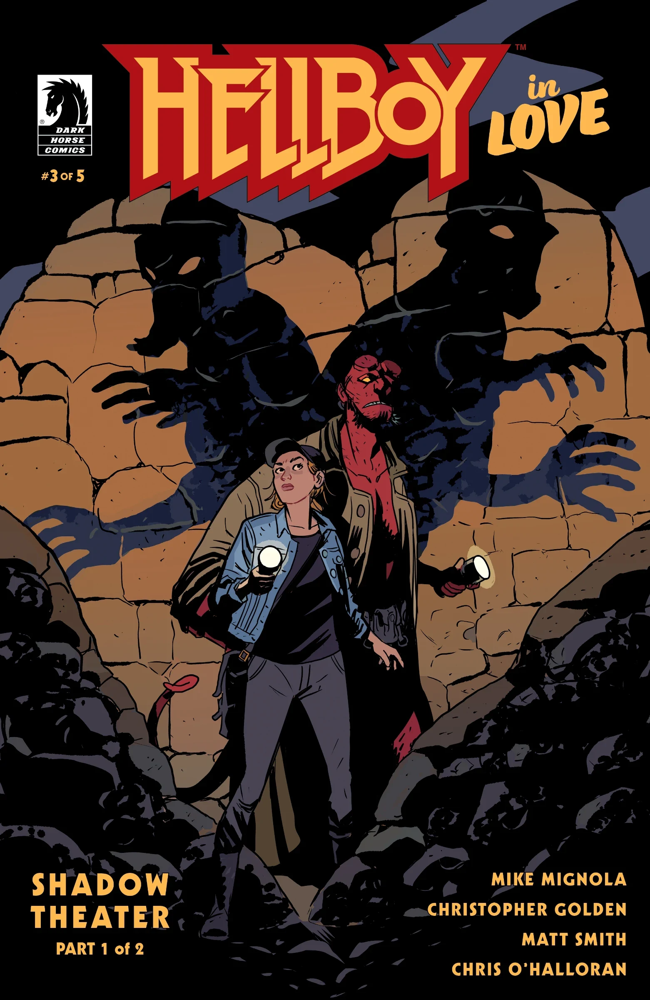

*《影子剧场》（Shadow Theater）（第 1 部分）

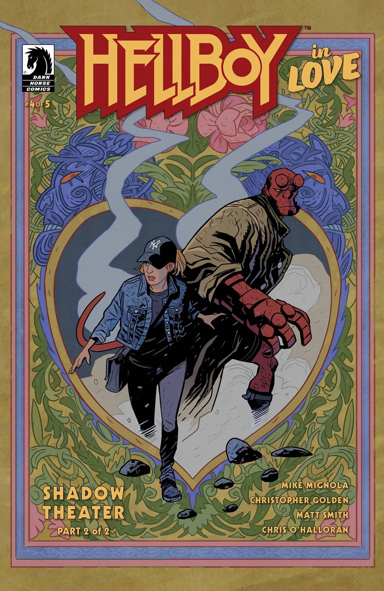

*《影子剧场》（Shadow Theater）（第 2 部分）

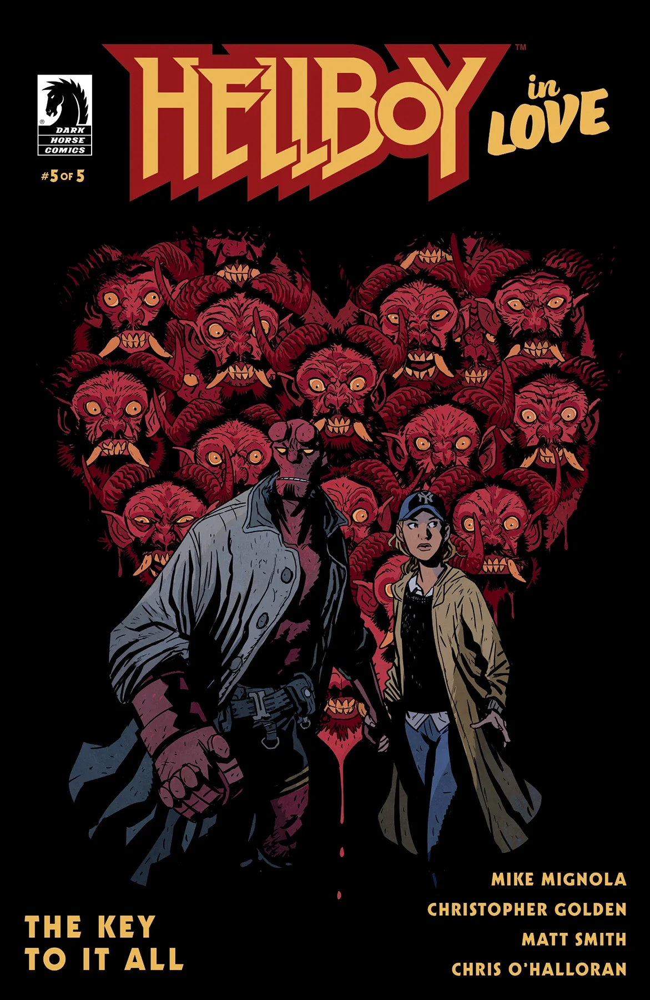

*《通往一切的钥匙》（The Key to It All）

## 外部链接

- [**维基百科：**Matt Smith](https://en.wikipedia.org/wiki/Matt_Smith_(illustrator))
