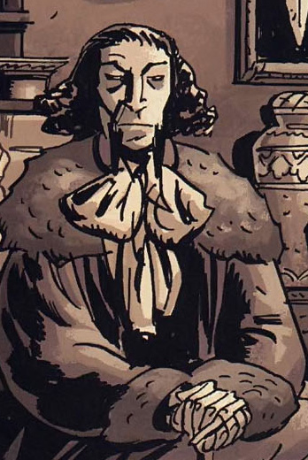
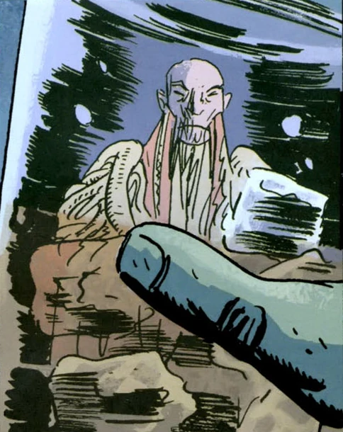
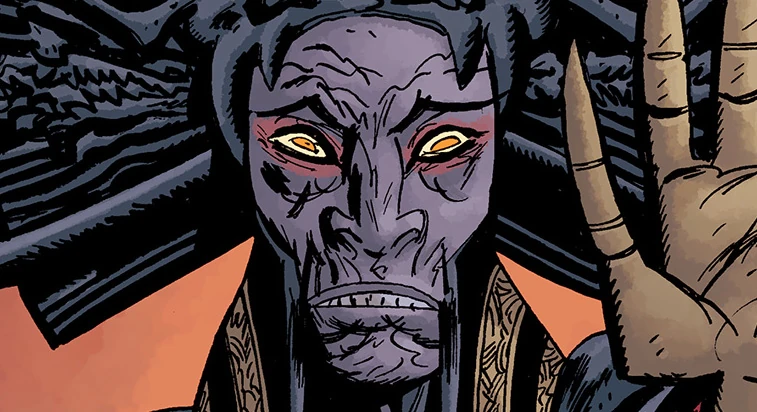

**姆姆南·萨（Memnan Saa）**，原名**Martin Gilfryd**，是一位神秘的术士，知晓世界隐秘的历史，包括[奥古·桀哈](/entry/Ogdru_Jahad)的存在。

## 历史

### 出身

19 世纪中叶，Martin Gilfryd 是大英博物馆埃及学部的首席策展人。后来，凭借其职位和与埃及学的关系，他与[Heliopic Brotherhood of Ra](/entry/Heliopic_Brotherhood_of_Ra)扯上了关系。然而，Gilfryd 身上一种野心勃勃的狂热使兄弟会对他疏远。

Martin Gilfryd

1859 年，活着的木乃伊[潘雅](/entry/Panya_%28character%29)被解开裹尸布后，Gilfryd 结识了她，并频繁追问她奇迹般复活的经过，而她总是不自在地拒绝回答。由于 Gilfryd 与潘雅的社交往来，兄弟会对他极为警惕，最终永久将他开除出组织。不久之后，Gilfryd 陷入一段潦倒时期，成为神秘学者[古斯塔夫·施特罗布尔](/entry/Gustav_Strobl)的弟子，从他那里学习黑魔法。但贪婪与狂热驱使 Gilfryd 杀死了恩师，随后他被伦敦当局抓获，于 1867 年 5 月 18 日被送入贝德兰姆皇家医院。1879 年，猎巫人[爱德华·格雷](/entry/Edward_Grey)爵士联系了 Gilfryd，他需要 Gilfryd 帮忙阻止一只复活的 Hyperborean 生物。怪物被杀之后，Gilfryd 试图逃跑，却惊悚地撞上古斯塔夫·施特罗布尔的鬼魂；鬼魂嘲讽地说，Gilfryd 根本驾驭不了他教给他的魔法。Gilfryd 在胁迫下昏厥过去，被送回牢房。

### 化身姆姆南·萨

漫长的刑期之后，由于治疗见效，Gilfryd 于 1890 年 7 月 17 日获释。在这个节奏飞快的新世界里，他对西方社会感到不满，于是启程前往亚洲寻求新的智慧，此后便从所有公开记录中消失。在北京，Gilfryd 得知 Agartha——一座与世隔绝、由僧侣居住的寺院——便前往那里，在那里学到了 Hyperborea 与[奥古·桀哈](/entry/Ogdru_Jahad)的隐秘历史，后来改名为姆姆南·萨。然而，他没待多久，因为他强烈反对僧侣们听任世界自然运转的消极信条。萨很快离开 Agartha，在一场暴风雪中迷失，直到被一个反对 Agartha 主张、崇拜[黑色女神](/entry/Hecate)的僧侣教派发现。他们把他视为预言中的领袖，认为他将让 Hyperborea 重现昔日荣光；用他们的话说："他将竖起古城，让它们焕然一新，并驯服火种以繁育巨龙。"他居住在隐秘之城 Thadrethes，在那里萨了解到更多世界隐秘历史，随后与他们最具智慧的僧侣交谈；僧侣让他预见了由奥古·桀哈造成的未来、[Vril](/entry/Vril)的力量，以及他自己的行动将拯救世界。不过，他在幻象中看到，注定执掌 Vril 之力、开创新纪元的人并不是他。

1913 年，萨协助一位蒙古军阀打赢了一场击溃俄国兵营的战斗。1937 年 6 月 14 日，姆姆南·萨第一次被确认现身于纽约市的一座军械库，爆炸发生前他被摄影机拍了下来。到了 11 月，他指挥一支 Chutt 战士军队绑架了[基里亚科斯·加拉加斯](/entry/Kyriakos_Gallaragas)教授和他的女儿[Helena](/entry/Helena_Gallaragas)，为的是夺取[重锤装甲](/entry/Vril_Energy_Suit)（V.E.S.，维利能量服）所拥有的动力源"阿努姆之叉"，用以打造一支被 Vril 赋予力量的巨龙军队、复兴 Hyperborean 帝国。然而，加拉加斯的助手[吉姆·萨克斯](/entry/Jim_Sacks)带着 V.E.S. 逃脱，并发现纳粹特工也在追踪这套装甲。姆姆南·萨抓到萨克斯和 V.E.S. 后，与[大螯虾](/entry/The_Lobster)发生冲突，萨警告他不要插手自己的事。夺到装甲后，姆姆南·萨杀死了加拉加斯，让追随者仿制出一个阿努姆之叉的原型复制品，并用在一名追随者身上，把他变成一条龙形生物，杀死了吉姆·萨克斯。然而，萨克斯在 Vril 之力的手中重生为拥有超能力的存在，挫败了姆姆南·萨的计划并杀死了他的追随者。姆姆南·萨是萨克斯攻击下唯一的幸存者，随后被大螯虾追赶并枪击。鉴于其神秘的本质，姆姆南·萨还是逃脱了，并就此成为大螯虾的敌人。

大螯虾和他的盟友四处追查姆姆南·萨。但他们关于姆姆南·萨的每一条线索都以悲剧告终，只剩下大螯虾和盟友[哈罗德·麦克泰尔](/entry/Harry_McTell)幸存。大螯虾因担心麦克泰尔遇害而放弃搜寻。麦克泰尔却要为朋友们的死复仇，结果赔上了自己的右腿。

### 现代

到 21 世纪初，姆姆南·萨发现[丽兹·舍曼](/entry/Liz_Sherman)有能力驾驭 Vril 之力，便在梦中与她相见，告诉她[超自然调查防御署（B.P.R.D.）](/entry/B.P.R.D.)对[青蛙怪物](/entry/frog_monster)的战争远比他们想象的可怕。这个警告后来被揭示与[卡塔-赫姆](/entry/Katha-Hem)——[奥格德鲁·赫姆](/entry/Ogdru_Hem)之一——有关。丽兹通过[约翰·克劳斯](/entry/Johann_Kraus)与姆姆南·萨交涉，要求他帮助她和她的队伍摧毁卡塔-赫姆。姆姆南·萨透露了一件由人造人[罗杰](/entry/Roger)发现的、能够消灭奥格德鲁·赫姆的神器，并指示她用这件神器释放 Vril 之力杀死卡塔-赫姆。然而，卡塔-赫姆之死并不意味着姆姆南·萨所说的后续事件就此终结，他不断纠缠丽兹，向她展示末日幻象、让她不信任自己的队伍——尤其是[本·达米奥](/entry/Ben_Daimio)被揭露为豹人之后——试图说服她加入自己对抗奥格德鲁·赫姆的事业。在萨向 B.P.R.D. 的要员们发送幻象、警告他们不要与他作对或寻找丽兹之后，丽兹最终同意让他把自己神秘地带走。

一支由[凯特·考瑞根](/entry/Kate_Corrigan)率领的 B.P.R.D. 武装远征队，依据哈罗德·麦克泰尔当年在亚洲从事情报工作时留下的一张精确路线图，前往 Thadrethes。抵达后，一名僧侣迎接他们，要求大部分部队留在城外，令所有人意外的是连约翰·克劳斯也不例外。随后僧侣带他们去见丽兹和姆姆南·萨，后者对他们无视警告、远道而来 Thadrethes 表示恼怒。当 Thadrethes 遭到青蛙怪物及其亚人 Hyperborean 盟友围攻时，萨展示了他对丽兹的控制——把青蛙怪物变成巨龙来抗击入侵者。萨最终向他们揭示了自己拯救人类的计划：完全不借助 B.P.R.D.，因为在他看来他们的事业从一开始就注定失败。

探员们对此无法接受。与此同时，约翰非法闯入城区，过程中杀死一名僧侣，并向萨发动攻击。萨把他猛砸到墙上，导致大螯虾显形并攻击他。这些攻击使谈判彻底破裂，萨与 B.P.R.D. 之间爆发战斗，最终丽兹从恍惚中醒来，把萨烧成灰烬，战斗才告结束。

尽管已经死去，萨的灵魂仍回来折磨丽兹：他向她展示了另一段末日幻象——B.P.R.D. 被彻底覆灭，而这一切都要归咎于她杀死了萨。

## 能力

姆姆南·萨曾师从神秘学者古斯塔夫·施特罗布尔，但这部分知识大部分被剥夺。后来他在 Agartha 修行，据信至少在那里打下了他日后能力的基础：念动力、星界投射、精神搏斗、力量感知等等。

## 画廊

