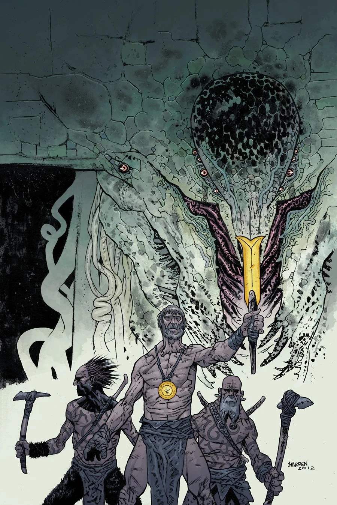

**梅拉-赫姆**（Mera-Hem）是三百六十九名[奥格德鲁·赫姆](/entry/Ogdru_Hem)之一，它们是[奥古·桀哈](/entry/Ogdru_Jahad)的后裔。

## [《时间深渊》](/entry/The_Abyss_of_Time)

[加尔·登纳尔](/entry/Gall_Dennar)（Gall Dennar）率领的史前部落在追踪一支[寒民](/entry/Vampire_(creature))（Cold People）氏族时遭遇了梅拉-赫姆。追逐将部落引入一座山谷，他们在那里发现了一座供奉[黑色女神](/entry/Hecate)的古老倾颓神庙。双方之间的大战爆发之前，一位寒民首领当众嘲弄了加尔·登纳尔和他的部落。史前侦察兵卡尔（Karr）在战斗初期便受了伤，流着血绊倒在神庙的地上。他的鲜血，加上战斗的惨烈与暴戾，将梅拉-赫姆的灵体召唤到了神庙；它开始袭击并屠戮穴居人和寒民。局势一度陷入绝望，直到加尔·登纳尔成功杀死寒民首领，梅拉-赫姆才随之消散在空气中。

## [《许珀耳玻瑞亚之剑》](/entry/The_Sword_of_Hyperborea_(story))

待定

## 画廊

|
