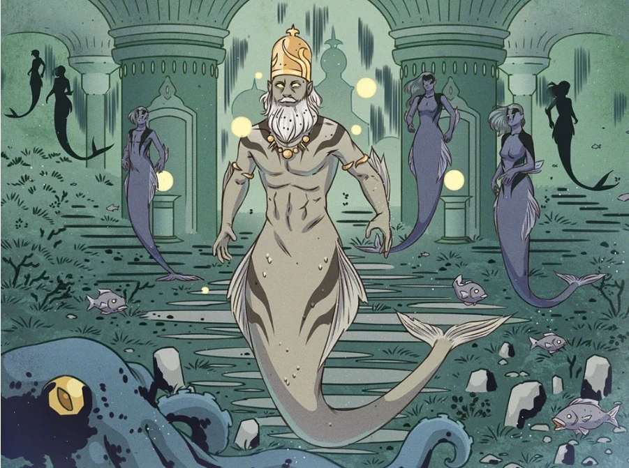

**人鱼（Merfolk）**是一个栖息于海底的水生类人种族。

## 背景

人鱼是来自亚特兰蒂斯城的[海伯利亚](/entry/Hyperboreans)帝国幸存者的后裔。凭借某种科学或魔法的奇迹，这座伟大城市的居民被变成了一个生有鱼尾的海洋种族。他们一直存活到现代，不过其文化已经退化回部落状态。

## 历史

1834 年，[奥安尼斯学会](/entry/Oannes_Society)（Oannes Society）的特工设法找回了一具冰冻的男性人鱼尸体。他们将标本运往拉脱维亚，但[拉神赫利奥皮斯兄弟会](/entry/Heliopic_Brotherhood_of_Ra)（Heliopic Brotherhood of Ra）的特工得知了此事，想要将其盗走。在随后的冲突中，尸体被毁，使其作为前人类物种的来历成了一个谜。

1956 年，[沃尔德王](/entry/King_Vold_(character))（King Vold）在一次狩猎中捕获了一条女性人鱼，当时[地狱男爵](/entry/Hellboy)正在照看他的一头狼。

被称为 [Bog Roosh](/entry/Bog_Roosh) 的海巫雇用了三条女性人鱼去捉拿在海上迷失方向的地狱男爵。她们把他带到她的领地，她则许诺可以实现她们的愿望。三条人鱼中有两条屈从于自私的愿望，被女巫的黑心所杀。第三条更聪明些，无私地只想要她父亲的战矛。她获准平安返回，但她父亲的灵魂对她的所作所为感到厌恶，说她取了一个未曾伤害她的人的性命，令他蒙羞，并将那人的灵魂打入了地狱。这条人鱼为自己的所作所为感到内疚，返回去救出了地狱男爵，地狱男爵随即杀死了 Bog Roosh，但这个老妖婆对人鱼降下诅咒，使她成为新的 Bog Roosh。她自愿放走了地狱男爵，让他返回海面，而她父亲的灵魂则安慰她，说他会永远陪伴着她。

当[奥古·桀哈](/entry/Ogdru_Jahad)之一挣脱牢笼、降临到北美洲的地球上时，人鱼早已在新 Bog Roosh 的指引下放弃了亚特兰蒂斯，向南迁徙以保全自身。
