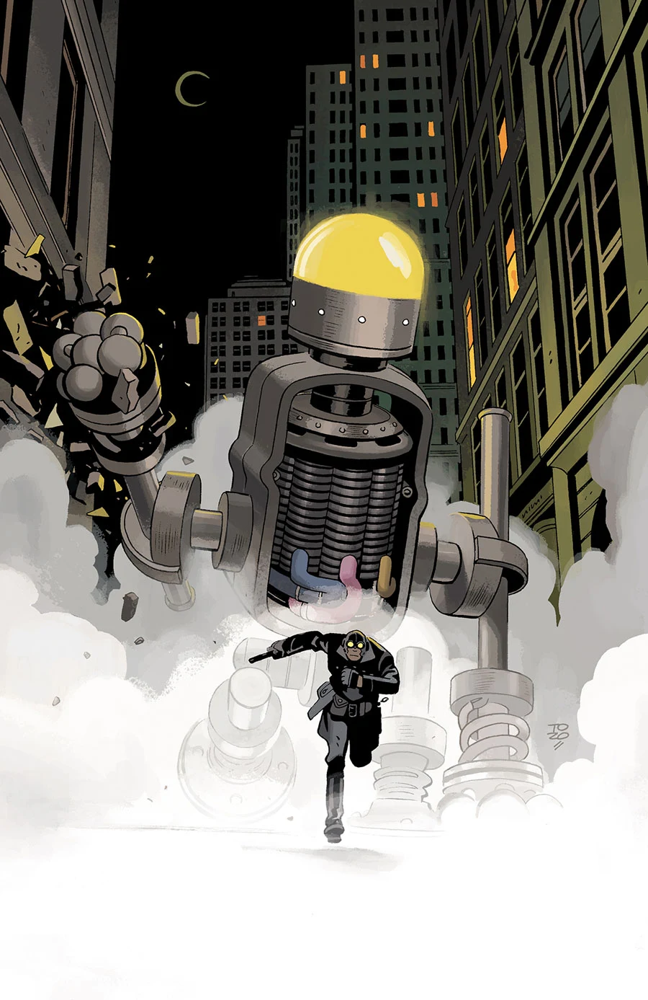

《**中城金属怪兽**》（Metal Monsters of Midtown）是一个发生在20世纪30年代[龙虾人](/entry/The_Lobster)作为打击犯罪者职业生涯中期的故事。

## 出版历史

这部共三期的迷你系列将于2016年5月至7月出版，封面与画作由 Tonči Zonjić 创作。

## 剧情简介

### 第一部

三台摩天大楼般高的机器人闯入曼哈顿的一家银行，给龙虾·约翰逊留下了两个待解之谜：这些巨型机器背后是什么，以及机器人为何实施抢劫却一分钱都不带走？

### 第二部

与巨型机器人的对峙仍在继续，龙虾·约翰逊的调查把他引向一名女子，她的故事揭示了这些机器闪亮外表背后的古老起源。

### 第三部

巨型机器人对纽约的入侵迎来决战，龙虾人必须进入一台机器的"脑袋"，把它驱离这座城市。

## 画廊

 \#1

 \#2

 \#3
