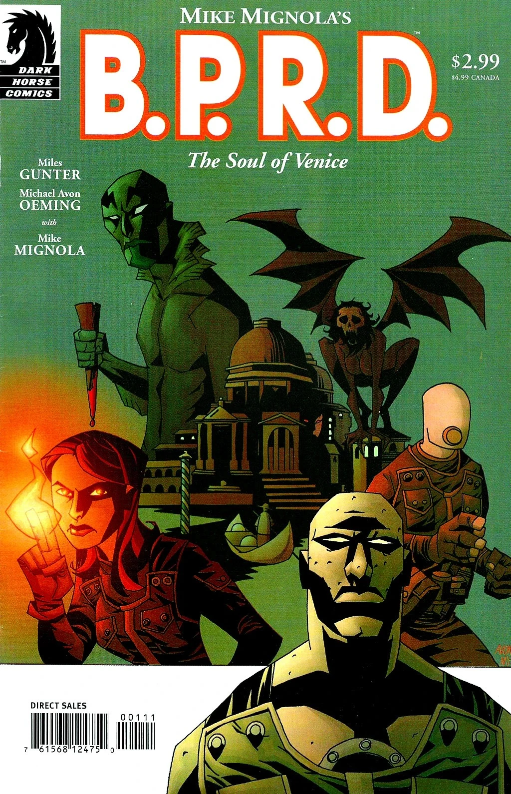
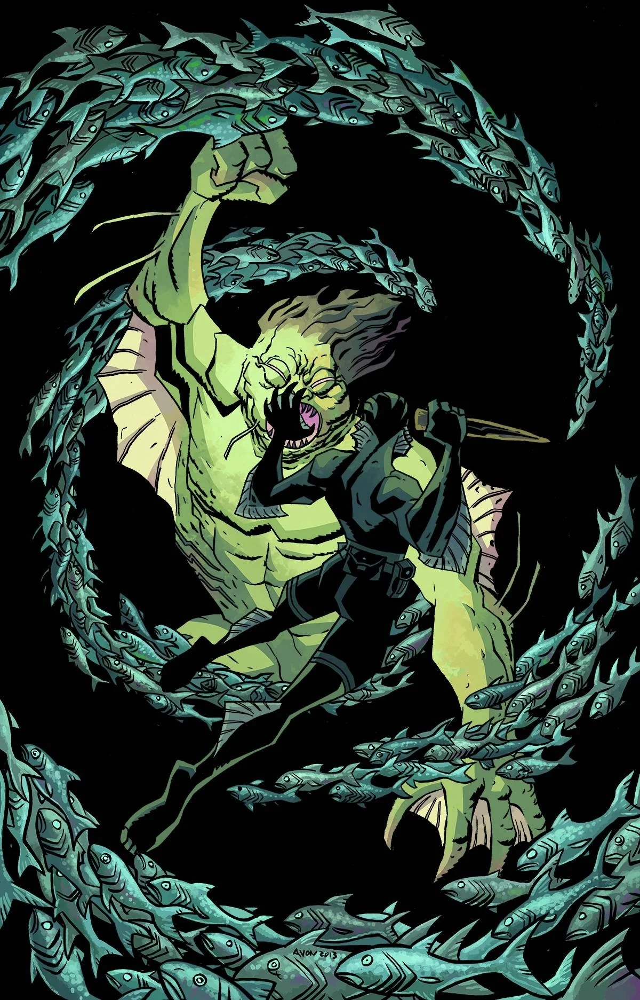

**Michael Avon Oeming** 是一位漫画画师兼编剧。2003 年 5 月，他以 *[《B.P.R.D.：威尼斯之魂》（B.P.R.D.: The Soul of Venice）](/entry/The_Soul_of_Venice)* 首次亮相地狱男爵宇宙。

## 内页美术

- *[《B.P.R.D.：威尼斯之魂》（B.P.R.D.: The Soul of Venice）](/entry/The_Soul_of_Venice)*
- *[《鱼人亚伯：亡者之地》（Abe Sapien: The Land of the Dead）](/entry/The_Land_of_the_Dead)*
- *[《情绪波动》（Mood Swings）](/entry/Mood_Swings)*
- *[《地狱男爵与 B.P.R.D.：1956》（Hellboy and the B.P.R.D.: 1956）](/entry/1956)*（与 [Yishan Li](/entry/Yishan_Li) 和 [Mike Norton](/entry/Mike_Norton) 合作）

## 编剧

- *[《B.P.R.D.：威尼斯之魂》（B.P.R.D.: The Soul of Venice）](/entry/The_Soul_of_Venice)*（与 [Miles Gunter](/entry/Miles_Gunter) 和 [Mike Mignola](/entry/Mike_Mignola) 合作）

## 封面美术

## 外部链接

- [**Comic Book DB：**Michael Avon Oeming](http://comicbookdb.com/creator.php?ID=937)

## 画廊

|The Soul of Venice

|The Land of the Dead (Variant)
