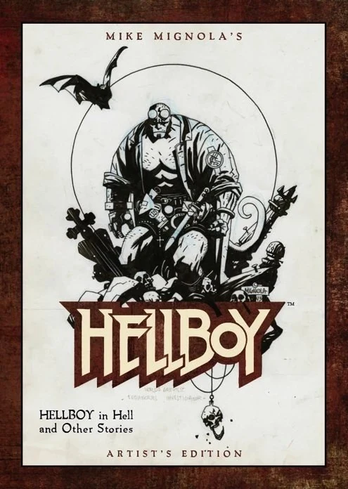
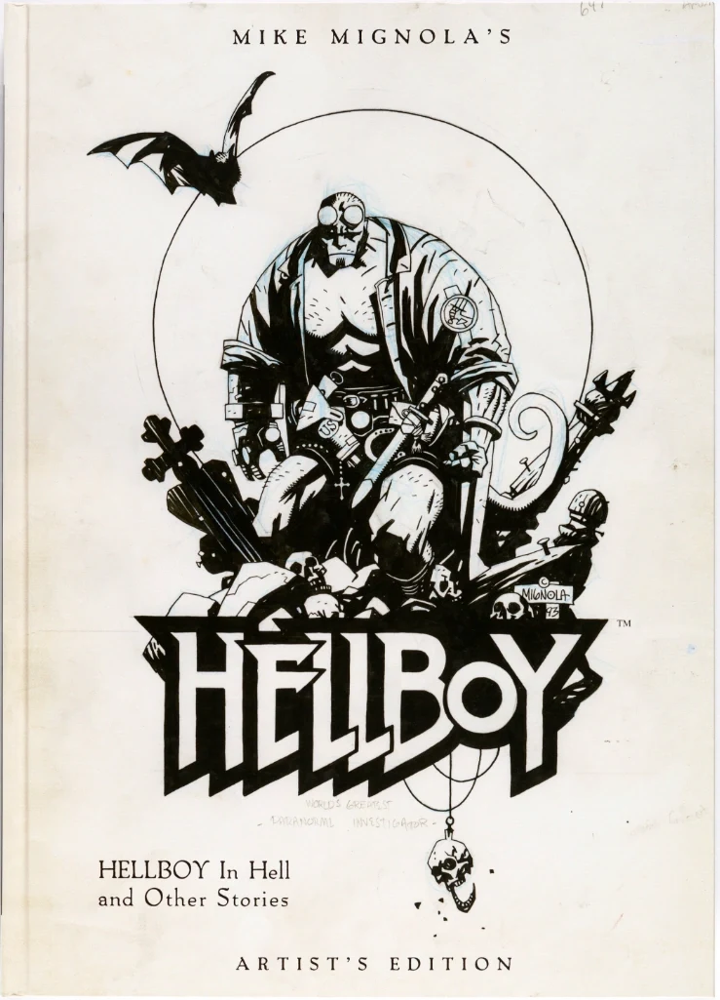
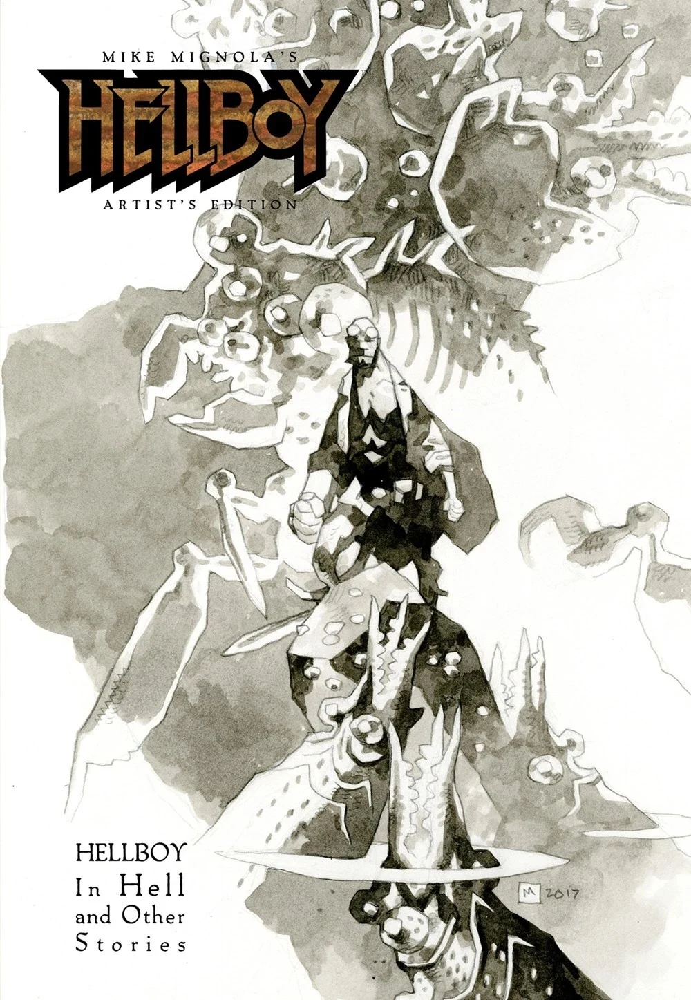

**《迈克·米格诺拉的〈地狱男爵〉艺术家版：〈地狱男爵在地狱〉及其他故事》**（Mike Mignola's *Hellboy Artist's Edition: Hellboy in Hell and Other Stories*）是由 [IDW](https://en.wikipedia.org/wiki/IDW_Publishing) 出版的超大开本精装艺术画册，是其 *Artist's Edition*（艺术家版）系列的第 23 号作品。书中收录了 *[《地狱男爵在地狱》（Hellboy in Hell）](/entry/Hellboy_in_Hell)* #1–5，以及一些最早出版的 *[《地狱男爵》（Hellboy）](/entry/Hellboy_%28series%29)* 故事。与 *Artist's Edition* 系列的所有图书一样，本书出版的目的是让读者获得尽可能接近观赏原稿的体验。

## 出版商内容简介

> **以前所未有的方式欣赏迈克·米格诺拉的画作——以 IDW 的 Artisan Edition（工匠版）形式呈现！**
>
> *迈克·米格诺拉一直是（而且至今仍然是！）过去数十年间最杰出的漫画创作者之一。早在《地狱男爵》问世之前，他就凭借在蝙蝠侠、金刚狼等角色上的出色创作，以及大量精美的封面等作品，稳稳奠定了自己的事业地位……然后，地狱男爵来了。米格诺拉这一标志性的创作从一开始就在粉丝中激起了流星般的共鸣，自该角色首次登场以来的 25 年多时间里，这种热度从未减退。*
>
> *本 Artisan Edition 收录了《地狱男爵在地狱》的前五期，以及大量具有历史意义的补充资料：最早的三个地狱男爵故事——最初为宣传目的而创作的两个四页短篇，以及出自约翰·伯恩（John Byrne）《Nextmen》#21 的十页故事——再加上《尸体》（The Corpse），以及米格诺拉亲自挑选收录的另外两个故事。几乎每一页都是从米格诺拉的原稿扫描而来，尽可能贴近实物页面地展示这位艺术家华丽的作品——这是一本献给热爱精彩叙事的读者和漫画技艺学习者的书。*
>
> *Artisan Edition 致力于尽可能逼真地模拟观赏实际原稿的体验——例如修改痕迹、蓝色铅笔线、贴改，以及所有让原稿独一无二的细微之处。除非你亲手捧着迈克的原稿，否则没有任何方式能比这更好地体验他的原作。*

## 出版历史

 第一版于 2014 年 7 月由 IDW 出版。与此同时，还出版了 250 册的限定变体版。所有变体版均由 [迈克·米格诺拉](/entry/Mike_Mignola) 亲笔签名、绘制 remarque 小素描并手写编号。变体版还采用了与标准第一版不同的封面。

2014 年晚些时候，IDW 又进行了一次限量印刷。这一版仅在当年的圣迭戈国际动漫展（SDCC）独家发售。SDCC 限定版沿用了变体版的封面画作，但这次采用全出血印刷，去掉了变体版和第一版上都有的边框。

2017 年 11 月，即第一版发行三年多一点之后，IDW 出版了第二版。除了新封面外，该书内容与第一版完全相同。

### Artisan Edition（工匠版）

2022 年 5 月，该书发行了较小开本的平装版。这个平装版的书名略有不同，名为 **《迈克·米格诺拉的〈地狱男爵〉Artisian 版：〈地狱男爵在地狱〉及其他故事》**（Mike Mignola's *Hellboy Artisian Edition: Hellboy in Hell and Other Stories*）。此外，它采用了 [米格诺拉](/entry/Mike_Mignola) 绘制的新封面。书的内容没有变化。''

## 目录

本书收录：

- [*《地狱男爵在地狱》* #1-4](/entry/Hellboy_in_Hell_%28first_story_arc%29)
- [*《地狱男爵在地狱：三条金鞭》（The Three Gold Whips）*](/entry/The_Three_Gold_Whips)
- [迈克·米格诺拉的 *《地狱男爵》*](/entry/World%27s_Greatest_Paranormal_Investigator_%28SDCC%29)
- [迈克·米格诺拉的 *《地狱男爵：世界上最伟大的超自然调查员》*](/entry/World%27s_Greatest_Paranormal_Investigator_%28CBG%29)
- 《信念》（*Faith*），节选自约翰·伯恩的 [*《Next Men》* #21](/entry/Next_Men__Faith_%E2%80%93_Part_3)
- *[《尸体》（The Corpse）](/entry/The_Corpse)*
- [*《食尸鬼》（The Ghoul），又名《关于死亡与蠕虫之诗的沉思》*](/entry/The_Ghoul)
- [*《巨魔女巫》（The Troll-Witch）*](/entry/The_Troll_Witch)

这些故事呈现时，除三页外全部由原稿扫描而成，黑白页以彩色印刷，以尽可能贴近地模拟观赏实际原稿的体验。每一页都按实际绘制尺寸等大印刷，所选纸张也尽可能接近原始画板用纸。

本卷中有三页原稿无法扫描，分别是《地狱男爵在地狱》#2 的第 16 页，以及《尸体》的第 7 页和第 19 页。它们以未上色的黑白扫描稿呈现。

《地狱男爵在地狱》各故事没有收录排字，因为这些故事的文字排印是通过数字方式完成的。

## 封面画廊

|Variant Edition

|2014 San Diego Comic Con Exclusive Edition

|2nd Edition
## 包装

 [IDW](https://en.wikipedia.org/wiki/IDW_Publishing) *Artist's Edition* 系列的所有图书都装在专门设计的纸板盒中，盒上贴有贴纸，贴纸上是该书封面的黑白、略带栅格化效果的图像。这些盒子与图书配对后，本身也成了收藏品。在在线拍卖中，带原盒的图书通常比同品相但无盒的图书拍出更高的价格。变体版的包装上还标注了该书在限量印数中的编号。圣迭戈动漫展限定版的包装封面上没有贴纸。
