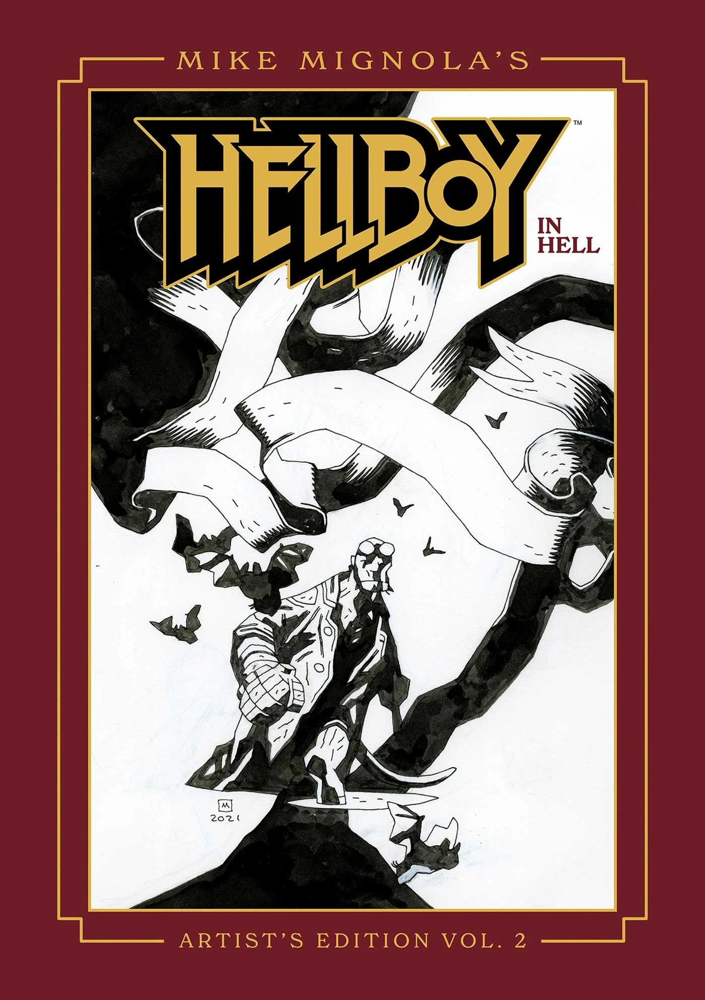

**《迈克·米格诺拉〈地狱男爵：在地狱〉艺术家典藏版——第二卷》（Mike Mignola's *Hellboy in Hell Artist's Edition – Volume 2*）**是由 Image Comics 出版的一部超大开本精装画集，由 Scott Dunbier 监制。该系列的上一卷是 IDW 出版的[《迈克·米格诺拉〈地狱男爵〉艺术家典藏版：地狱男爵在地狱及其他故事》](/entry/Mike_Mignola's_Hellboy_Artist's_Edition%3A_Hellboy_in_Hell_and_Other_Stories)。

## 出版商简介

> 迈克·米格诺拉是深受喜爱的恶魔英雄地狱男爵的创作者，备受评论界赞誉！
>
> 迈克·米格诺拉始终是过去数十年来最杰出的漫画创作者之一。早在地狱男爵问世之前，他就凭借蝙蝠侠、金刚狼等角色以及大量精美封面等出色作品牢牢奠定了自己的事业地位……然后地狱男爵登场了。米格诺拉这一标志性的创作从一开始便如流星般击中了粉丝的心弦，自该角色首次亮相以来的三十余年间，其热度从未消减。
>
> 本艺术家典藏版收录了《地狱男爵：在地狱》的最后五期，即第 \#6–10 期，以及大量封面与插画。
>
> 尽管看起来是黑白呈现，书中所有画作均以彩色扫描，使读者得以尽可能贴近原作地欣赏这些作品——墨水的渐变、蓝色铅笔底稿，以及令原稿如此独特的所有细微之处——都清晰可见，并以与原稿绘制时相同的尺寸印刷。
>
> 这本迈克·米格诺拉作品的艺术家典藏版，是一本伪装成漫画合集的艺术画册。想要比看这本书更好地欣赏这些画页，唯一的办法就是站在米格诺拉的绘图板旁、越过他的肩头去看。

## 封面画廊

初版

直销市场独家版

|Direct Market Exclusive Edition
