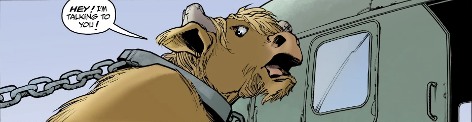

**弥诺陶洛斯（Minotaur）** 是来自希腊的怪物，外形如同一只直立行走、长着蹄子的公牛。

## 历史

1962 年，在希腊的色萨利，[地狱男爵](/entry/Hellboy_(character))与一头弥诺陶洛斯交战并将其击败，折断了它的双角。当[超自然调查防御署](/entry/Bureau_for_Paranormal_Research_and_Defense)用直升机把它押运回雅典关押时，弥诺陶洛斯向一脸漫不经心的地狱男爵抱怨自己失去了角。等怪物飞出视线后，地狱男爵把自己掰下的那对弥诺陶洛斯的角交给了德律阿得斯探员，并说等这怪物守规矩了就把角还给它。

## 来源

1.  [↑](#cite_ref-1) [《库克罗普斯之夜》](/entry/Night_of_the_Cyclops)
