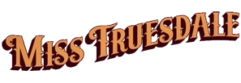

***《特鲁兹代尔小姐》***（Miss Truesdale）是一系列漫画，围绕角色[玛格丽特·特鲁兹代尔](/entry/Margaret_Truesdale)（Margaret Truesdale）——一位与拉神赫利奥皮斯兄弟会（Heliopic Brotherhood of Ra）有所牵连的维多利亚时代女性——以及[阿努姆·亚萨](/entry/Anum_Yassa)（Anum Yassa）——一名许珀耳玻瑞亚角斗士——展开，讲述他们两人的命运如何交织在一起。它是*[《地狱男爵》](/entry/Hellboy_(series))*系列的衍生作品，探寻地狱男爵宇宙的历史。

该系列的所有故事均由[迈克·米格诺拉](/entry/Mike_Mignola)编剧，[Jesse Lonergan](/entry/Jesse_Lonergan) 作画，于2023年5月17日首次推出。

## 收录故事

- *[《特鲁兹代尔小姐与许珀耳玻瑞亚的陷落》](/entry/Miss_Truesdale_and_the_Fall_of_Hyperborea) \#1-4（2023年5月—8月）*
- [《特鲁兹代尔小姐与一个男人的崛起》](/entry/Miss_Truesdale_and_the_Rise_of_Man) \#1-4（2025年12月—2026年3月）

## 合订本

*另见[**《特鲁兹代尔小姐》**平装合订本](/entry/Trade_Collections)*  
*另见**《特鲁兹代尔小姐》**故事列表*

*《特鲁兹代尔小姐》*以一系列精装本形式结集出版。
