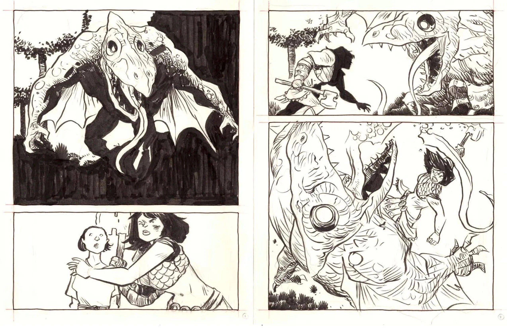
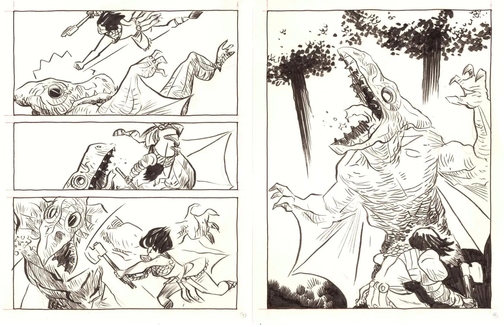
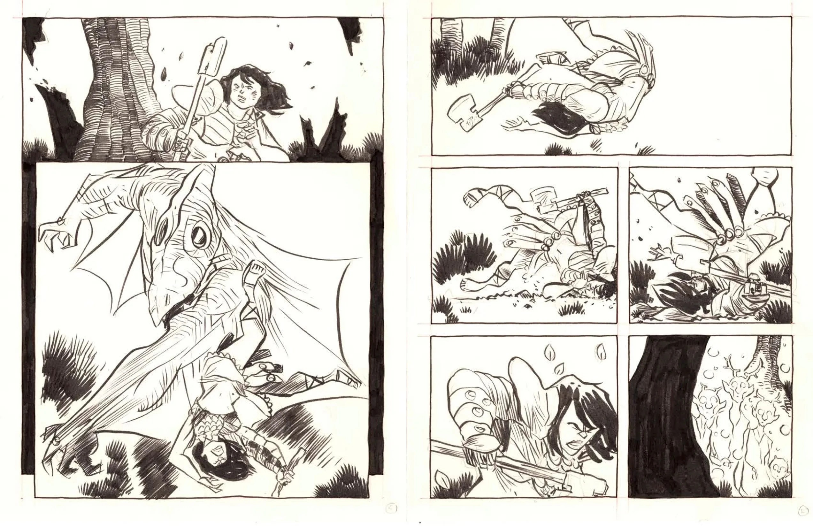
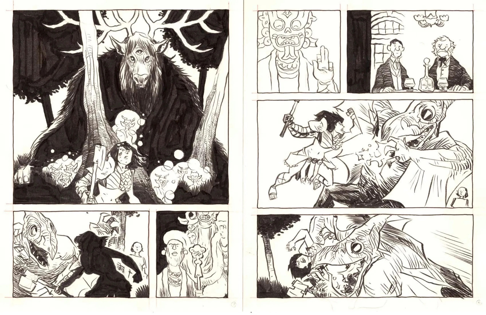
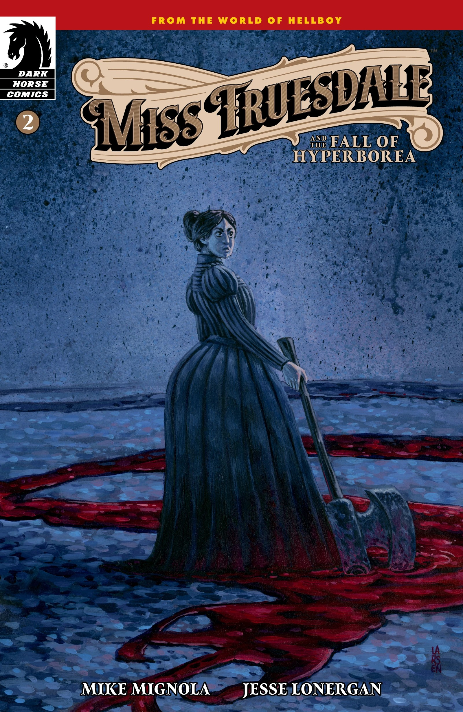
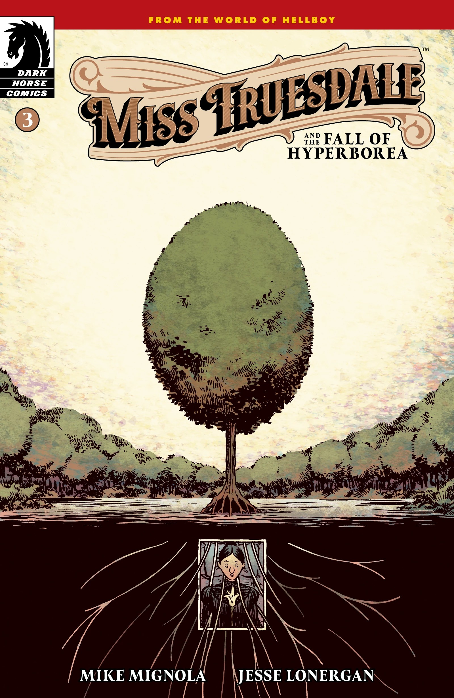
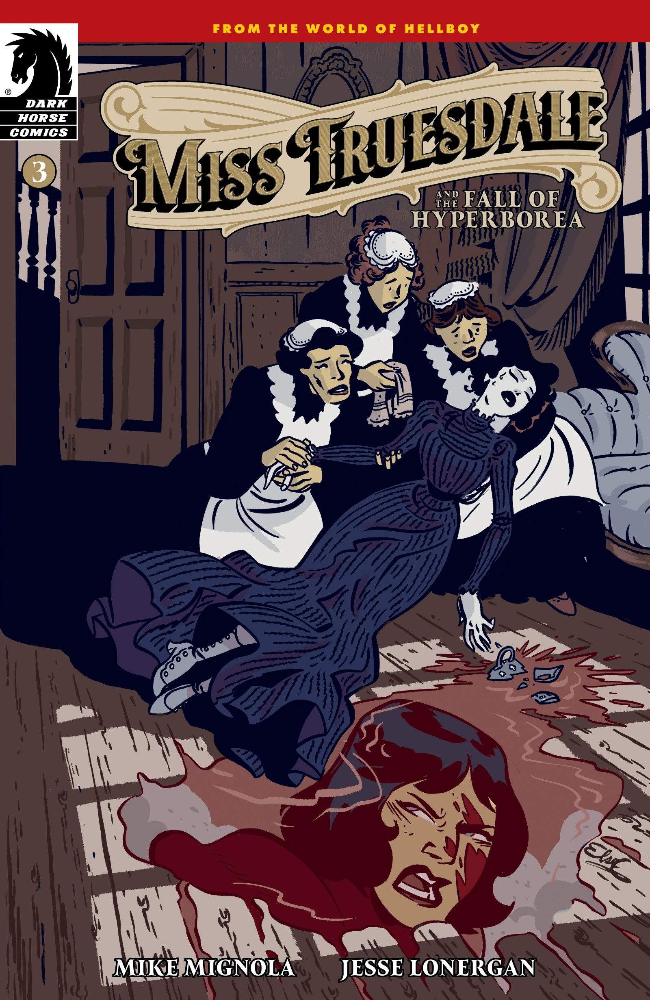
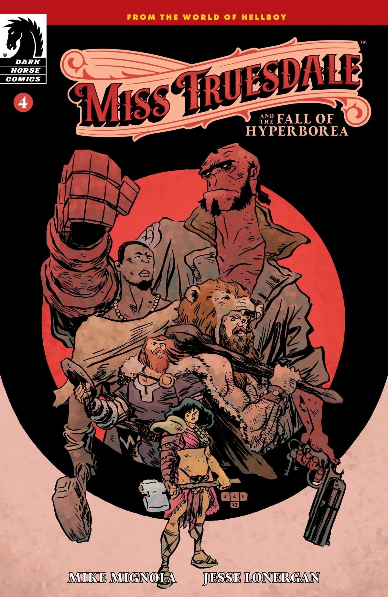
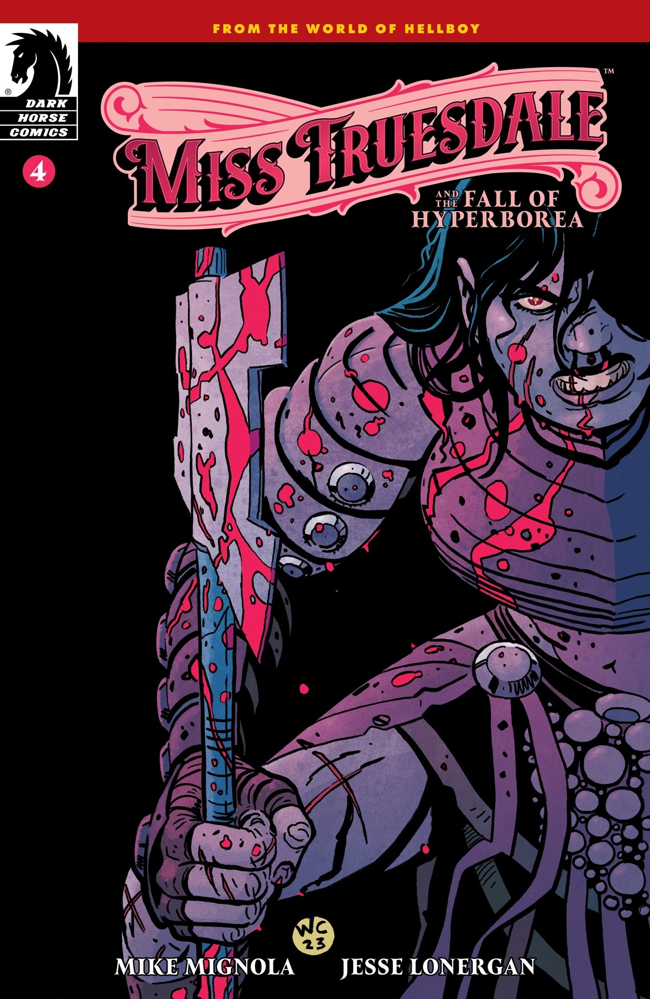

***《特鲁斯代尔小姐与海伯利亚的陨落》*** 是一部四期限定迷你连载，由 [Mike Mignola](/entry/Mike_Mignola) 编剧、[Jesse Lonergan](/entry/Jesse_Lonergan) 作画。这是 Lonergan 在地狱男爵宇宙中的首次亮相，也是 [*《特鲁斯代尔小姐》*系列](/entry/Miss_Truesdale_(series))的第一个故事弧。故事围绕生活在维多利亚时代伦敦的[特鲁斯代尔小姐](/entry/Margaret_Truesdale)，以及她的前世——海伯利亚帝国末年角斗士[阿努姆·亚萨](/entry/Anum_Yassa)展开。

## 出版历史

*《特鲁斯代尔小姐与海伯利亚的陨落》* 于 2023 年 2 月公布。Mignola 在剧本上写得相当宽松，好让 Lonergan 更充分地发挥自己的节奏掌控力——这正是 Mignola 欣赏其作品的原因之一。

## 剧情简介

### 第一部分

特鲁斯代尔小姐是日薄西山的赫利奥皮克拉神兄弟会（Heliopic Brotherhood of Ra）最后的追随者之一，这位不起眼的女性成了兄弟会领袖泰夫努特·特里奥努斯（Tefnut Trionus）最后一段幻象的接收者。幻象将她在维多利亚时代伦敦的生活，与古海伯利亚一名年轻角斗士的命运联结在一起。特鲁斯代尔发现，自己如今有机会通过改变早已逝去的过去，来改变未来。

### 第二部分

在发现了一个把自己与古海伯利亚某位角斗士联系起来的惊人真相后，生性怯懦的维多利亚时代女性特鲁斯代尔小姐被迫直面潜藏在那段一度只觉遥远的古史之中、令人毛骨悚然的邪恶与谜团……

### 第三部分

海伯利亚陷入火海，被第一位天使的狂怒撕成两半。随着城市陷落，阿努姆·亚萨与特鲁斯代尔小姐的命运交织在一起，二人被牵引着去面对各自的宿命与众神的愤怒。

### 第四部分

特鲁斯代尔小姐的过去、现在与未来在一场对抗可怖生物的战斗中猛烈碰撞。维多利亚时代的特鲁斯代尔小姐能否夺回属于自己的力量，还是注定要被自己的过去吞噬？

## 测试页

为了给 *《特鲁斯代尔小姐》* 的创作热身，Jesse Lonergan 画了一段阿努姆·亚萨与怪物搏斗的戏。Lonergan 这样做，一方面是为了熟悉角色的画法，另一方面也是为了研究 Mike Mignola 拆解打斗场面的方式——这几页测试稿正是围绕 Mignola 在 [*《地狱男爵：圣奥古斯丁之狼》*](/entry/The_Wolves_of_Saint_August) 中[地狱男爵](/entry/Hellboy_(character))大战[狼人威廉·格雷尼尔](/entry/William_Grenier)的那段打斗来构建和构图的。

## 封面画廊

标准版封面作者：[Jesse Lonergan](/entry/Jesse_Lonergan)。

第 \#1 期

第 \#1 期变体封面  
作者：Mike Mignola  
与 Dave Stewart

第 \#2 期

第 \#2 期变体封面  
作者：Christine Larsen

第 \#3 期

第 \#3 期变体封面  
作者：Elsa Charretier

第 \#4 期

第 \#4 期变体封面  
作者：Wes Craig  
与 Chris O'Halloran

|

|

|

|

|Issue #2 variant cover by Christine Larsen

|第 #3 期

|Issue #3 variant cover by Elsa Charretier

|第 #4 期

|Issue #4 variant cover by Wes Craig with Chris O'Halloran
