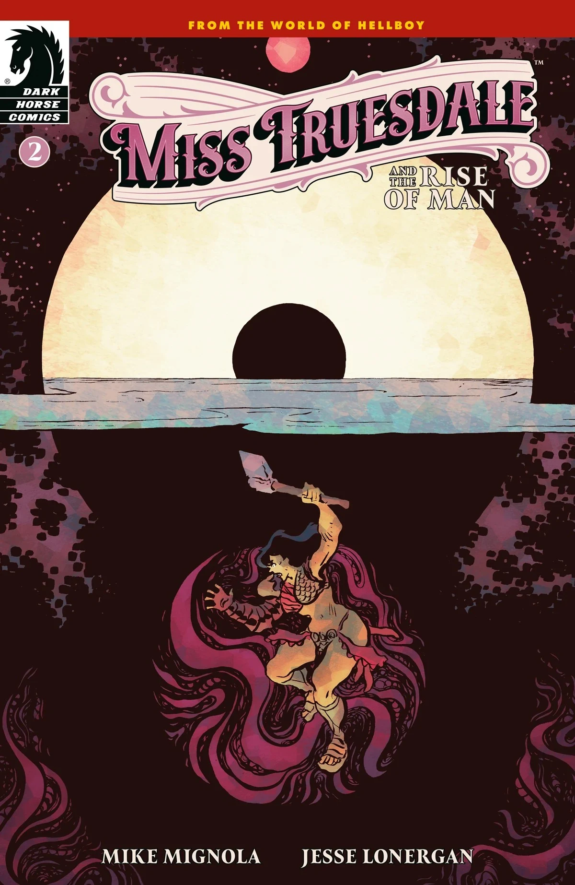
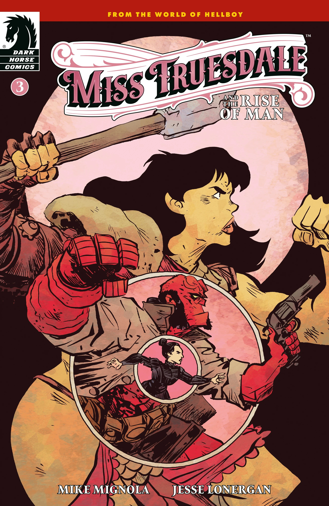
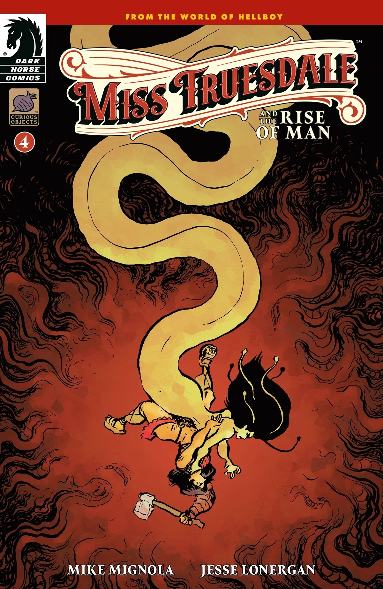
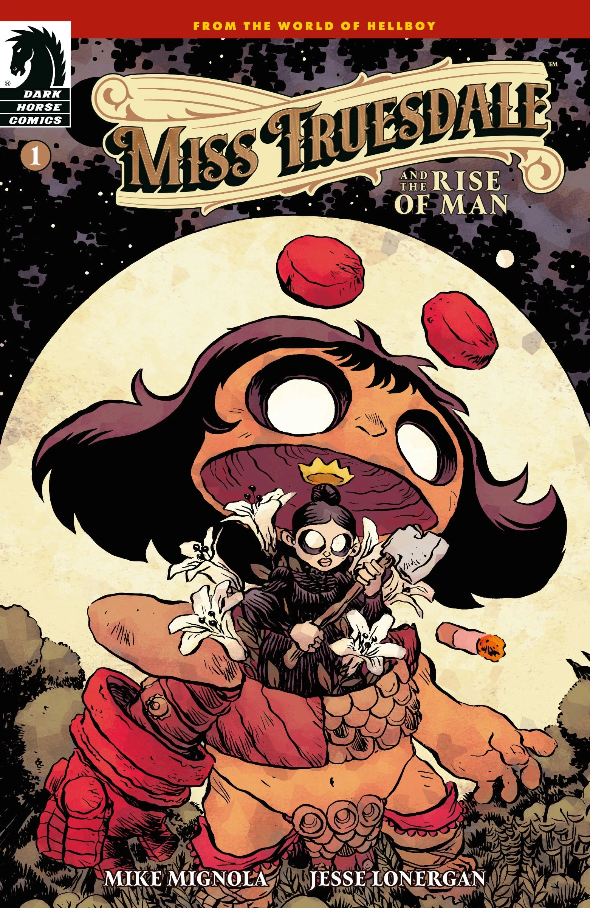
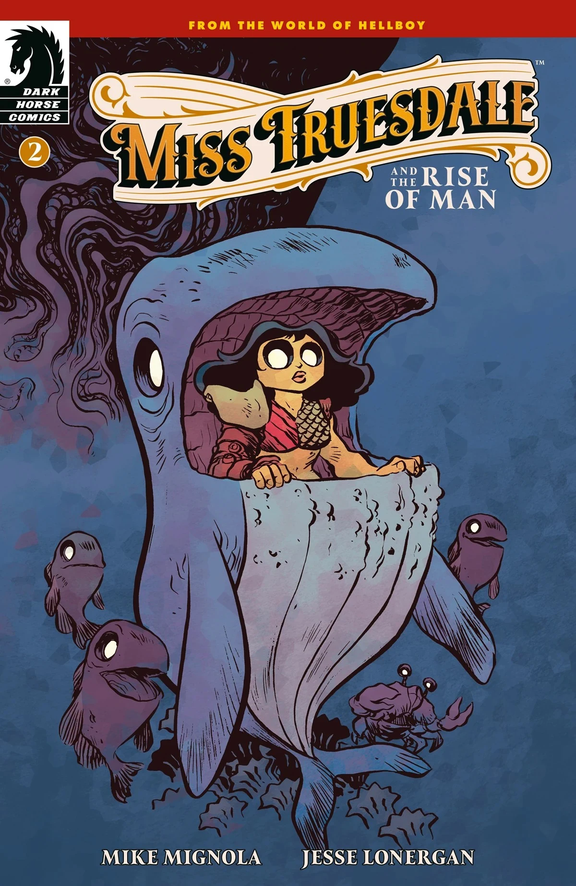
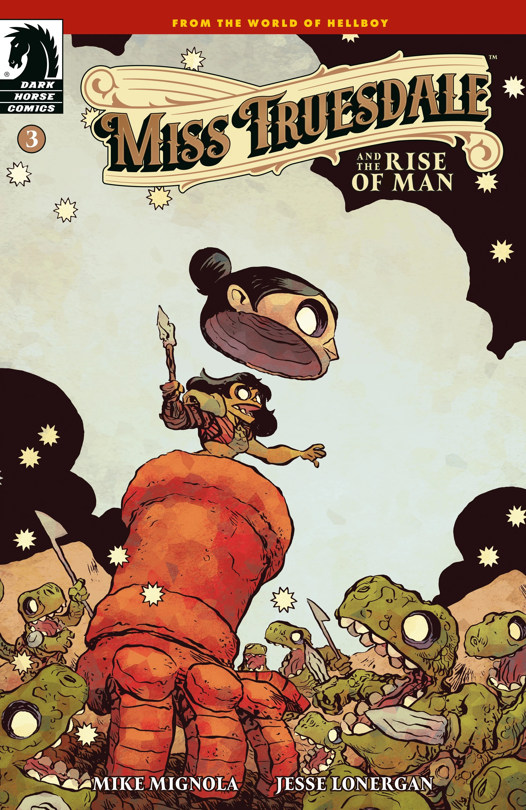
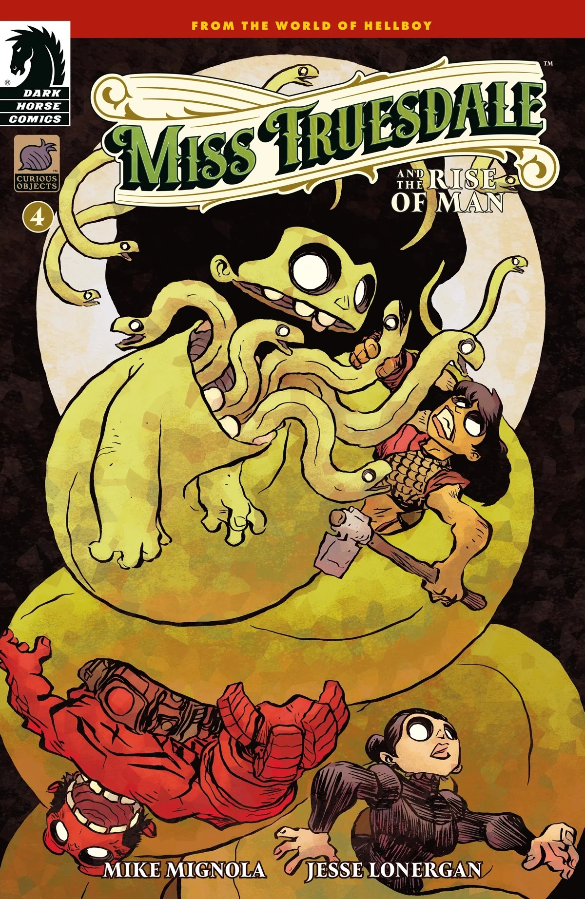

***《特鲁兹代尔小姐与人类的崛起》（Miss Truesdale and the Rise of Man）*** 是一部四期迷你连载，编剧 [Mike Mignola](/entry/Mike_Mignola)，作画 [Jesse Lonergan](/entry/Jesse_Lonergan)。它是[《*特鲁兹代尔小姐*》系列](/entry/Miss_Truesdale_(series))的第二个故事线。

## 出版历史

*《特鲁兹代尔小姐与人类的崛起》* 于2025年8月公布。Mike Mignola 表示，这个构想源于他自[《*B.P.R.D.*》系列](/entry/B.P.R.D._(series))完结以来，对地狱男爵宇宙起源日益增长的兴趣。

## 剧情简介

### 第一部分

角斗士阿努姆·亚萨（Anum Yassa）穿行于森林之中，探寻自己的前世、今生与来世。但她并非所有人眼中的英雄，因为一个更黑暗的存在将不断追杀她，直到她被阻止——而人类的命运也将随她一同被阻止。

### 第二部分

阿努姆·亚萨一度逃过败亡，但这只维持到另一个存在试图插手她的命运为止。

### 第三部分

在遭到一大群怪物袭击后，阿努姆·亚萨被拖到它们的国王面前，这位国王背负着一段比她所能想象的更为黑暗的遗产。

### 第四部分

角斗士阿努姆·亚萨与那个一直试图击败她的存在正面相对，这场最终决战将决定人类的命运。

## 封面画廊

封面由 [Jesse Lonergan](/entry/Jesse_Lonergan) 绘制。

第 \#1 期

第 \#2 期

第 \#3 期

第 \#4 期

|第 #2 期

|第 #3 期

|第 #4 期

|Issue #1 variant cover

|Issue #2 variant cover

|Issue #3 variant cover

|Issue #4 variant cover
### 变体封面

第 \#1 期变体封面

第 \#2 期变体封面

第 \#3 期变体封面

第 \#4 期变体封面
