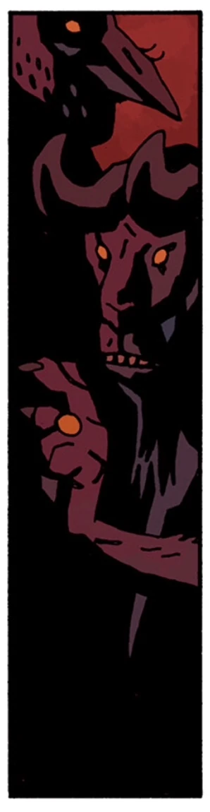

**摩洛克（Moloch/Molech/Molek）**曾是一个[恶魔](/entry/Demon)，也是[地狱](/entry/Hell)的一位亲王。

## 历史

### 惩罚阿扎尔

[阿扎尔](/entry/Azzael)把[毁灭之右手](/entry/Right_Hand_of_Doom)安到了[他的儿子](/entry/Hellboy_(character))身上，地狱的众多亲王为此震怒，摩洛克便是其中之一，他们派[毁灭天使](/entry/Angels_of_Destruction)去摧毁他的城堡。

### [《在摩洛克礼拜堂中》](/entry/In_the_Chapel_of_Moloch)

[地狱男爵](/entry/Hellboy_(character))将摩洛克描述为*“古老的中东神怪之一”*，《圣经》中曾几次提到他。古代迦南人和腓尼基人把摩洛克当作太阳神来崇拜，以献祭孩童来取悦他，这种行径为以色列人所深恶痛绝。

中世纪时，一个邪教在葡萄牙南部塔维拉（Tavira）为摩洛克修建了一座礼拜堂，后来他们被[圣哈根骑士团](/entry/Order_of_the_Knights_of_Saint_Hagan)肃清。骑士们屠杀了邪教徒，摧毁了他们的偶像，但是，正如地狱男爵也说过的：*“很多时候，那些**真正**邪恶的东西……并不会彻底消失。”*

1992 年，地狱男爵接到一位艺术品经纪人的求助：对方的朋友——一个名叫杰里（Jerry）、苦苦挣扎的画家——租下了附属于礼拜堂的房子，并把礼拜堂改成了画室。地狱男爵发现，在一个从地板下的洞中钻出来的低级[恶魔](/entry/Demon)的影响下，杰里塑出了一尊巨大的摩洛克泥塑，泥塑中心放着一颗真正跳动的心脏。地狱男爵摧毁了塑像，把恶魔赶回地下，并建议杰里和那位经纪人让房东拆掉礼拜堂——或者，至少把地板上的洞堵上。

### [《地狱男爵在地狱》](/entry/Hellboy_in_Hell_(series))（[《西班牙新娘》](/entry/The_Spanish_Bride)）

[撒旦](/entry/Satan)死于地狱男爵之手，大公爵[阿斯塔罗斯](/entry/Astaroth)也随之死去，此后[地狱](/entry/Hell)陷入混乱，众多奴隶恶魔奋起反抗不计其数的地狱亲王和公爵。摩洛克与[沙克斯](/entry/Shax)、乌西尔（Usiel）、劳姆（Raum）、塞姆亚扎（Semyaza）、彼列（Belial）和大衮（Dagon）都在这些起义中被杀。

## 非正典故事

### [《地狱男爵：在人间如在地狱》](/entry/Hellboy__On_Earth_as_it_is_in_Hell)

***注意：**以下信息不属于正典。*

关于摩洛克，人们所知（或自以为所知）的大部分内容，来自后世试图理解圣经时代文本中对它的种种提及，其中一些“研究”的水准从可疑一直到纯属耸人听闻。例如，法国小说家古斯塔夫·福楼拜（Gustave Flaubert）写过一本畅销小说《萨朗波》（Salammbô），故事发生在古迦太基（腓尼基人的文化后裔），书中描写了用一尊腹内设火坑的机械雕像献祭婴儿的场面。

据[凯特·考瑞根](/entry/Katherine_Corrigan)所说，摩洛克长着牛头的这一大众形象主要应归咎于福楼拜的小说，因为福楼拜正是这样描述那尊雕像的。

有案可查的最后一次摩洛克崇拜，是一个名为 *Der Horn Ordern*（号角教团）的邪教，由第一次世界大战老兵出身的神秘学者马蒂亚斯·赫尔佐格（Matthias Herzog）在魏玛共和国时期的德国创立。在图勒协会以及[格里高利·拉斯普廷](/entry/Grigori_Rasputin)领导的、召唤出[地狱男爵](/entry/Hellboy_(character))的秘密集团崛起之前，该邪教便突然消失得无影无踪，但目击者的说法表明赫尔佐格曾拥有多达 870 名信徒。

后来，[超自然调查防御署](/entry/Bureau_for_Paranormal_Research_and_Defense)查明摩洛克是一桩阴谋的主谋：有人企图窃取**马萨达卷轴**（Masada Scroll）——梵蒂冈档案中一份备受争议的文件，据说可以证明耶稣基督在被钉上十字架之后实际上又活了几十年。摩洛克计划利用它挑起一场圣战，最终在地球上造成如此多的流血与仇恨，以至于地狱男爵*“看见地狱之门正在大大敞开。”*地狱男爵取回了卷轴，并摧毁了赫尔佐格及其追随者为摩洛克修建的神庙。

## 背景信息

摩洛克（或 Molech）出现在《圣经》中，与孩童献祭有关。例如《利未记》18:21：*“你不可让你的任何后裔经火归于摩洛，也不可亵渎你神的名：我是耶和华。”*

漫画中呈现的摩洛克形象，源自中世纪后期人们试图理解圣经文本而衍生出的种种传统。现代学术界仍在争论这一形象的确切身份及其历史真实性。有些人甚至提出，这个词指的并不是一位神祇，而是一种献祭方式。

## 外部链接

- 维基百科上的摩洛克
