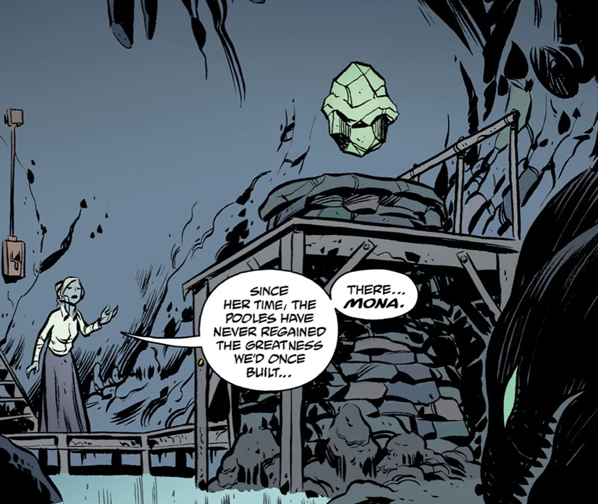

**莫娜（Mona）**是一枚受昂兰人崇拜的水晶卵。借助它的力量，这件器物能够控制哈勒姆霍尔特（Hallam Halt）周围的水域。只有昂兰人的邪教首领"米尔"（the Mere）才获准接触莫娜。后来真相揭开，它其实是[奥格德鲁·赫姆](/entry/Ogdru_Hem)之一[Istra-Hem](/entry/Istra-Hem)的容器。

## 历史

1881 年，昂兰人曾试图利用莫娜淹没哈勒姆霍尔特，以报复英国人侵占他们的土地。

2004 年，亚伯拉罕·塞皮恩被派去再次与昂兰人谈判。米尔看出他的水生体质，便带他去见莫娜。亚伯发现它与当初改变自己的那个存在相似，感觉到彼此之间存在某种联系；但他还没来得及进一步查看，[莫娜的守护者——黄鳗](/entry/Guardians_of_Mona)就袭击了他。它们宣称他是莫娜的威胁，是末日的先兆。安放莫娜的洞穴随后被水淹没，亚伯带着更多的疑问离开了，仍未得到答案。
