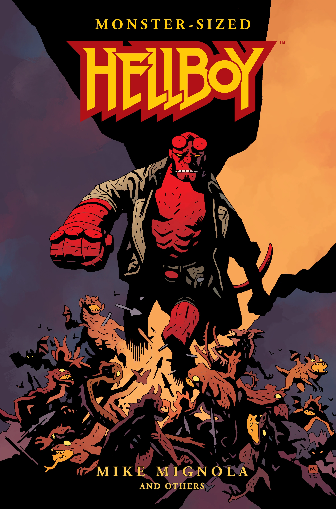

*本条目是一篇小作品（stub）。你可以帮助扩充地狱男爵维基。*

《怪物版地狱男爵》（Monster-Sized Hellboy）是一本超大开本精装书，收录了四部带编号的[地狱男爵](/entry/Hellboy_(series))[作品全集（Omnibus）](/entry/Omnibus_Editions)的内容（《毁灭之芽》《奇异之地》《狂猎》和《地狱男爵在地狱》）。本书不包括补充资料（速写本部分），也不收录[《毁灭之芽》](/entry/Seed_of_Destruction)之前发生的任何地狱男爵故事，即不含[《短篇故事全集》](/entry/Omnibus_Editions)各卷的内容，以及两则无标题的"世界头号超自然调查员"宣传故事——它们分别出自[圣迭戈漫展](/entry/World's_Greatest_Paranormal_Investigator_(SDCC))和 [《漫画买家指南》](/entry/Trade_Collections)（通常与《毁灭之芽》合订收录）。本书于 2023 年 11 月 1 日发行。

## 内容

- [《毁灭之芽》](/entry/Seed_of_Destruction)
- [《圣奥古斯丁之狼》](/entry/The_Wolves_of_Saint_August)
- [《铁链棺》](/entry/The_Chained_Coffin)
- [《唤醒恶魔》](/entry/Wake_the_Devil)
- [《近乎巨像》](/entry/Almost_Colossus)
- [《毁灭之右手》](/entry/Right_Hand_of_Doom)
- [《邪恶之盒》](/entry/Box_Full_of_Evil)
- [《生而为人》](/entry/Being_Human)
- [《征服之虫》](/entry/Conqueror_Worm_(story))
- [《第三个愿望》](/entry/The_Third_Wish)
- [《岛屿》](/entry/The_Island)
- [《驶入寂静之海》](/entry/Into_the_Silent_Sea)
- [《鼹鼠》](/entry/The_Mole)
- [《黑暗召唤》](/entry/Darkness_Calls)
- [《狂猎》](/entry/The_Wild_Hunt)
- [《风暴》](/entry/The_Storm)与[《狂怒》](/entry/The_Fury)
- [《地狱男爵在地狱》第 1 至 4 章](/entry/Hellboy_in_Hell_(first_story_arc))（"降临"、"群魔殿"、"家族纽带"和"骑象的死神"）
- [《三条金鞭》](/entry/The_Three_Gold_Whips)
- [《死亡牌》](/entry/The_Death_Card)（不含[平装合订本](/entry/Trade_Collections)中的序章）
- [《冥府猎犬》](/entry/The_Hounds_of_Pluto)（第一章更名为"霍夫曼博士的审判"，与其他合订本一致）
- [《西班牙新娘》](/entry/The_Spanish_Bride)
- [《丧钟为谁而鸣》](/entry/For_Whom_the_Bell_Tolls)
- [《沃尔斯克的驱魔人》](/entry/The_Exorcist_of_Vorsk)
- [《魔术师与蛇》](/entry/The_Magician_and_the_Snake)
