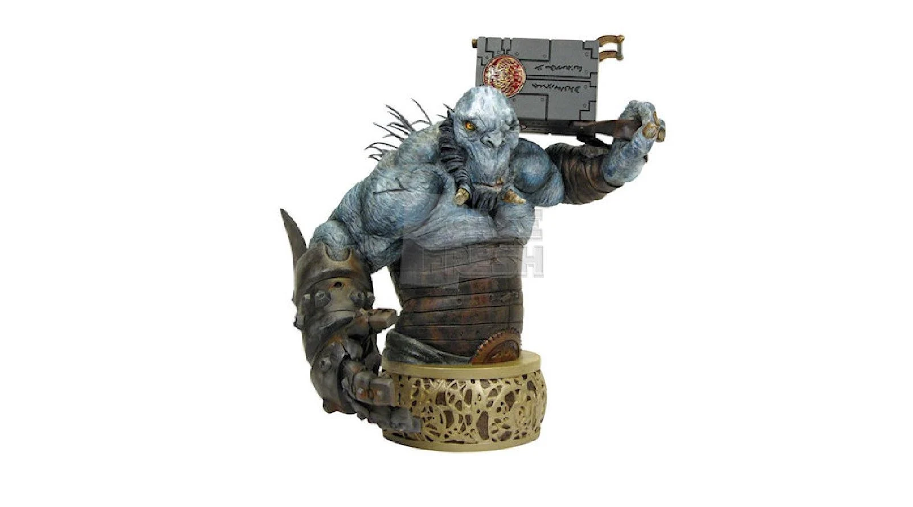
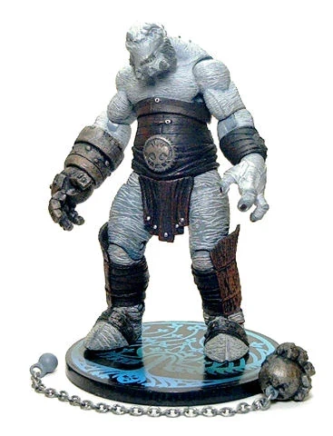

**温克先生（Mr. Wink）** 是一只[洞穴巨怪（Cave Troll）](/entry/Cave_Troll)，也是 [弩阿达](/entry/Nuada) 王子最好的朋友和手下。

他的主要武器是一只机械拳，可以从右臂上发射出去、由一条长链拴住，用以攻击远处的敌人。机械拳会被收回底座，常常是自己爬回主人身边。他身上有一块金属护甲，坚硬到连地狱男爵的拳头都打不碎。温克先生拥有可观的蛮力，能把真人大小的对手扔出几十英尺远。

数千年前，温克先生参加过对抗人类的战争，在其中一场战斗中失去了右手，后来被替换成这只能发射的机械拳。弩阿达王子拒绝遵守与人类的和平条约、自我流放时，他也陪同前往。

## 在[《地狱男爵2：黄金军团》](/entry/Hellboy_II__The_Golden_Army)中

温克先生首次登场时，[弩阿达](/entry/Nuada) 王子正在曼哈顿桥下用长矛练习格斗。

不久后，他们实施了一个计划：袭击一家拍卖行，盗取 Bethmora 王冠三块碎片中的一块——三块碎片重聚后，佩戴者只要拥有王室血统，就能统率一支被称为黄金军团的发条战士大军。他们袭击拍卖行，放出数千只饥饿的[牙仙](/entry/Tooth_Fairy)，牙仙吃掉了拍卖行里的所有人，随后又袭击前来调查的 [BPRD](/entry/Bureau_for_Paranormal_Research_and_Defense)探员。

后来，[弩阿达](/entry/Nuada) 推翻并杀死父亲 [巴洛尔国王](/entry/King_Balor)时，温克也在场。

[BPRD](/entry/Bureau_for_Paranormal_Research_and_Defense) 得知这一阴谋后，循着牙仙的购买线索追踪到近乎神话般的[巨怪市场](/entry/Troll_Market)——人类当局从未找到过这个地方。[地狱男爵](/entry/Hellboy_%282004%E2%80%932008_film_character%29)、[亚伯·塞皮恩](/entry/Abe_Sapien)和新队员[约翰·克劳斯](/entry/Johann_Kraus)成功潜入市场。在市场搜查期间，亚伯遇到了 [弩阿拉公主](/entry/Nuala) 公主——[弩阿达](/entry/Nuada) 的孪生妹妹、第三块王冠碎片的持有者。

亚伯尾随她来到附近一家店铺，很快遭到温克先生袭击。他躲过大部分攻击，勉强支撑到地狱男爵赶来。亚伯带着公主逃走，温克与地狱男爵展开搏斗；起初温克占据上风，对地狱男爵的拳头像刀枪不入。然而，地狱男爵用毁灭右手重创了温克的机械拳，疼得这巨怪像婴儿一样哭叫。地狱男爵乘胜追击，看似赢得了战斗。温克又爬起来，在地狱男爵把一颗掉落的牙齿扔向他之后，试图发射受损的拳头。地狱男爵想警告他不要发射，但温克先生不听，还是发射了。结果机械拳卡在一台垃圾破碎机带刺的滚筒之间。温克先生仍被链子连着，被拖进机器碾碎而死。

## 画廊

 与牙仙们在一起。

## 趣闻

- 温克机械臂的设计改编自漫画角色 [非人](/entry/Unmensch)。
