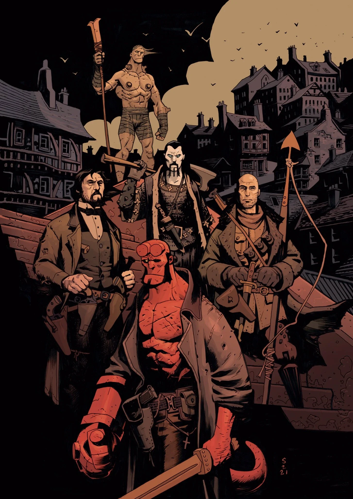

***《弗兰肯斯坦：新世界》***是一部四期限定迷你系列，由 [Mike Mignola](/entry/Mike_Mignola)、[Christopher Golden](/entry/Christopher_Golden) 与 [Thomas Sniegoski](/entry/Thomas_E._Sniegoski) 编剧，[Peter Bergting](/entry/Peter_Bergting) 作画。它是[《弗兰肯斯坦：新世界》故事周期](/entry/New_World_(Frankenstein_story_cycle))中的第一个故事弧。

## 出版历史

《弗兰肯斯坦：新世界》于 2022 年 5 月 17 日公布。这个故事最初的灵感来自 [Ben Stenbeck](/entry/Ben_Stenbeck) 为纪录片《迈克·米格诺拉：绘制怪物》（Mike Mignola: Drawing Monsters）的 Kickstarter 众筹达成的一个追加目标所画的一幅画，画面中 Frankenstein 手持固定在长杖上的海伯利亚之刃。

## 剧情简介

### 第一部分

在拉格纳·洛克之后，人类幸存于空心地球之中；聪慧早熟的少女莉尔雅（Lilja）被妥善安置在这里，却不断收到幻象，看到一股新的黑暗正在地表扎根。莉尔雅不顾长者们的反对，唤醒了那位永恒的神谕者——曾以 Frankenstein 之名为人所知的存在——请他调查这些警示，或许，还可以去探索上方的新世界。

### 第二部分

正当莉尔雅和 Frankenstein 探索周围这个生机勃勃的世界时，他们救下了一个人，此人为他们引见了新的人类种族。但他们不知道，邪恶正潜伏在阴影之中，一边追踪着我们的英雄，一边播撒死亡与毁灭的种子。

### 第三部分

与新世界一些神秘居民取得接触后，弗兰克和莉尔雅继续寻找“星女”（Star Lady）。但他们试图阻止的危险已经真真切切地嗅到了他们的气味，如今这是一场关乎重生世界命运的赛跑。

### 第四部分

莉尔雅和 Frankenstein 对地表世界的探索急转直下——在异化的人和真正的怪物之间，并非所有人都能活下来。

## 画廊

除特别注明外，全部封面由 [Peter Bergting](/entry/Peter_Bergting) 绘制。

第 \#1 期

第 \#1 期变体封面，作者 Mike Mignola 与 Dave Stewart

第 \#2 期

第 \#2 期变体封面，作者 David Hitchcock

第 \#3 期

第 \#3 期变体封面，作者 Laurence Campbell 与 Quinton Winter

第 \#4 期

第 \#4 期变体封面，作者 Ben Stenbeck
