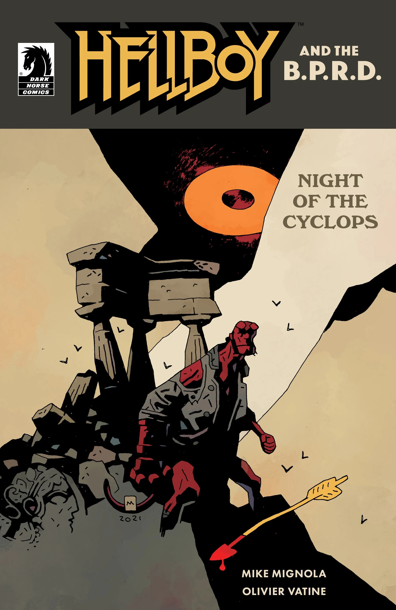

***《独眼巨人之夜》***是 *[《地狱男爵与超自然调查防御署》](/entry/Hellboy_and_the_B.P.R.D.)* 的一个单篇故事线，由 Mike Mignola 和 Olivier Vatine 编剧，Vatine 同时负责作画。

## 剧情简介

就在地狱男爵于希腊完成一项工作之际，他却被……一只山羊？引入了另一场冒险。跟随地狱男爵踏入一片充满背叛与托加袍的奇异隐秘之地，看他如何承受一位嫉妒之神的怒火。

## 画廊

*《地狱男爵与超自然调查防御署：  
独眼巨人之夜》  
Olivier Vatine 作*

*《地狱男爵与超自然调查防御署：  
独眼巨人之夜》  
Mike Mignola 与 Dave Stewart 作*

|Hellboy and the B.P.R.D.: Night of the Cyclops by Mike Mignola and Dave Stewart
## 内容

### 角色

#### 超自然调查防御署

- [地狱男爵](/entry/Hellboy_(character))
- 德律阿得斯特工（Agent Dryades）

#### 希腊神话

- 受诅咒的萨堤罗斯
  - [埃莉塔](/entry/%C3%86lita)（Ælita）
  - 西比尔（Sibyl）
- 希腊怪物
  - [弥诺陶洛斯](/entry/Minotaur)（客串）
  - 独眼巨人
- 希腊神祇
  - [阿佛洛狄忒](/entry/Aphrodite)
  - 厄洛斯（Eros）

### 地点

- 希腊
  - 色萨利（Thessaly）
