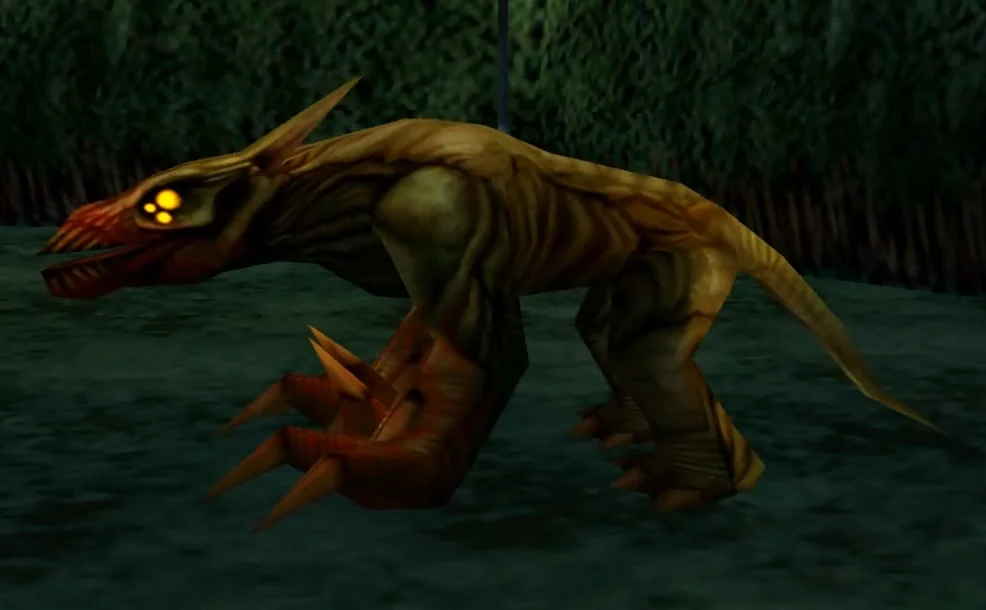

**诺霍克斯·卡尼斯（Nohox Kanis）**是游戏 *[《地狱男爵：夜之犬》](/entry/Hellboy__Dogs_of_the_Night)* 中的恶魔。

## 背景

这些远古恶魔据说“比上帝还要古老”，它们蛰伏在现实的边缘，等待着邪恶颠覆现存秩序。外形上，它们形似巨犬，长有凶狠的爪牙。它们能化身为多种形态，但普遍被视为潜伏着的、威胁人类的巨大祸患之一。

约 700 年前，诺霍克斯·卡尼斯曾试图进入我们的世界，带来永恒的黑夜。那时，一位名叫[卡林（Kalin）](/entry/Kalin)的修士接纳了诺霍克斯·卡尼斯的远古邪恶，并与它们结盟，要在地狱与人间之间开辟一道传送门。它们最终被卡林的兄弟[米特里（Mitri）](/entry/Mitri)击败。

后来，一次迫在眉睫的月食为诺霍克斯·卡尼斯提供了进入我们世界的又一次机会。最终，[地狱男爵](/entry/Hellboy_(character))击败了卡林与诺霍克斯·卡尼斯。

## 画廊

|
