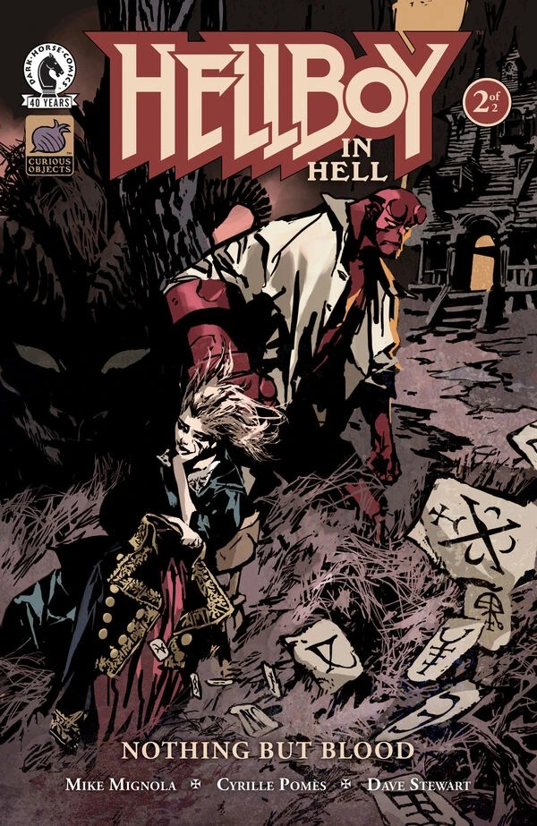

***《唯有鲜血》***是一部两期满篇连载，由 [Mike Mignola](/entry/Mike_Mignola) 编剧，[Cyrille Pomès](/entry/Cyrille_Pom%C3%A9s) 绘制，这也是他在地狱男爵宇宙中的首次亮相。故事发生在[*《地狱男爵在地狱》* \#8](/entry/The_Hounds_of_Pluto)与[\#9](/entry/The_Spanish_Bride)之间。

## 剧情简介

### 第一部分

在地狱深处，一场针对最强大恶魔的起义正在进行，地狱男爵出手救下一名被有翼野兽追猎的年轻女子。但一切——以及每一个人——都并非表面看上去的那样。

### 第二部分

在拯救一名无辜者的途中，地狱男爵误与一个恶魔为伍；此后他发现自己置身于地狱中心，正值撒旦遇刺的余波之中。

## 画廊

*《地狱男爵在地狱：唯有鲜血》* \#1
Cyrille Pomès 绘

*《地狱男爵在地狱：唯有鲜血》* \#1
变体封面，Mike Mignola 与 Dave Stewart 合作

*《地狱男爵在地狱：唯有鲜血》* \#2
Cyrille Pomès 绘

*《地狱男爵在地狱：唯有鲜血》* \#2
变体封面，Marc Riou 绘

|Hellboy in Hell: Nothing But Blood #2 variant by Marc Riou
