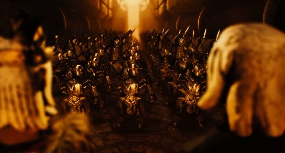
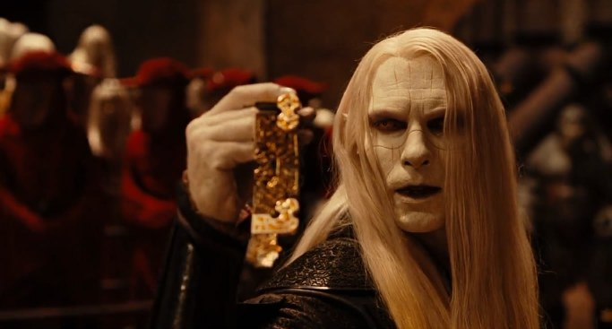
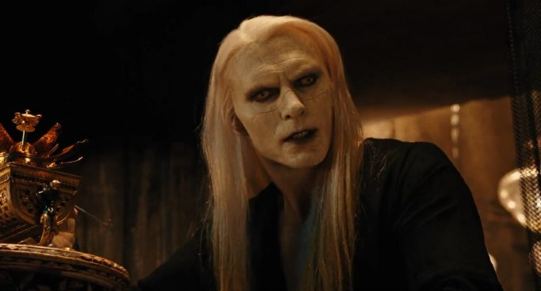
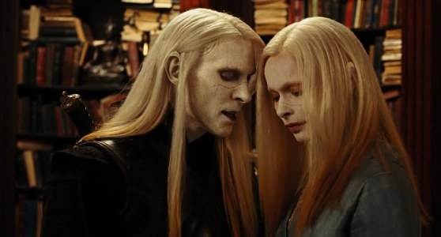
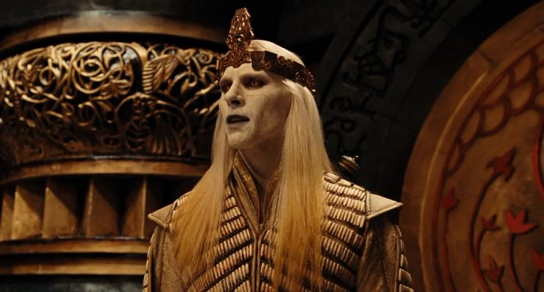

**弩阿达（Nuada Silverlance）**是 Bethmoora 部族的王储（该部族与其他魔法种族合称为"大地之子"），也是第二部《地狱男爵》电影[《Hellboy II: The Golden Army》](/entry/Hellboy_II__The_Golden_Army)中的主要反派，精灵族最后的战士。他是国王[巴洛尔](/entry/Balor)的独子，[弩阿拉公主](/entry/Nuala)的孪生哥哥。他曾出席[黄金军团](/entry/Golden_Army)的诞生与受阅仪式。弩阿达持反人类立场，一心只想保全自己的同族和其他非人生命、毁灭所有人类，但他并非绝对邪恶的存在；更确切地说，他把生命中的一切不幸都归咎于人类，认为毁灭人类将有益于非人种族。

## 生平

### 对人类的战争

按照魔法界的信仰，人类与精灵、哥布林、食人魔、仙子、巨魔及其他生物的种族曾一度和谐共处。然而人类的贪婪使他们燃起强烈的征服欲，向林中的神秘生物开战。统治精灵与诸魔法种族的巴洛尔国王（弩阿达王子之父）眼睁睁看着自己的子民遭人类屠戮。弩阿达很可能参加了那些战斗——正如《Hellboy II: The Golden Army》影片开头所见，为保护同族而战的他在背部和肩头留下了累累伤疤。

新诞生的军团

一天，一位哥布林锻造大师前来觐见巴洛尔国王，提出为他打造一支机械军队——[黄金军团](/entry/the_Golden_Army)。弩阿达劝说父亲接受了这个提议。黄金军团随即对人类展开屠杀，不分战士还是无辜者、不分男女、不分成人与孩童。巴洛尔意识到，这场毁灭已超过了人类对他们的所作所为。国王被这场屠杀震惊，于是封印了黄金军团，并与人类宣布停战：把那顶控制军团的[魔法王冠](/entry/Crown_of_Bethmora)分为三块，王冠控制着[这支军团](/entry/The_Golden_Army)；精灵保留两块，一块交给人类。

弩阿达被此举激怒：他不仅认为人类不可信任，也相信自己能更有效地指挥这支军团。他自我放逐，发誓将在族人最需要他的那一天归来。陪伴在他身边的是他的伙伴——一只独眼、单獠牙的洞穴[巨魔](/entry/troll)，名叫[温克先生](/entry/Mr._Wink)；他为自己再度崛起的那一天做着准备。

### 归来

弩阿达行走在大地上，思索自己的人生，旁观人类与魔法生物的生活。王子看到人类以贪婪之名自相残杀，也眼看着其他所有魔法种族渐渐湮没无闻。他下定决心，必须终结魔法世界这种无声的毁灭，并感觉到这颗星球正走到一个通向毁灭的十字路口（在电影小说版中，弩阿达提到更有智慧的人类也已察觉到必须采取行动，这或许是在评论他了解环保运动，但这并不足以让他觉得人类值得拯救）。他决定夺回黄金军团，去做几个世纪前就该做的事。

弩阿达表明自己的意图

王子追踪王冠，数世纪后一路追进一家拍卖行将它盗走。随后他放出一群[牙仙](/entry/Tooth_Fairies)，杀死了拍卖会上的所有在场者，并留下两处标记，向人类象征他已宣战。他来到父王的宫殿，表明要重新唤醒黄金军团、向人类世界开战的意图。他痛陈人类对世界的商业化、征服与"蹂躏"。他知道魔法种族终将凋零，并指出他们已经生活在肮脏污秽之中、无处可去。此时，那位多年前便甘愿听天由命、后来迁往美洲的国王下令处死自己的儿子。弩阿达心碎欲裂（他知道父亲此举也等于在杀死自己无辜的孪生妹妹弩阿拉公主），随即杀光了殿内所有卫兵，然后将父亲刺穿。他短暂地落泪，取走父王那块王冠碎片，转身时却发现妹妹已连同最后一块王冠碎片不见踪影。

弩阿达得知温克先生的死讯

弩阿达正在一个机械托架中培育一枚奇异的生命种子（他显然精通哥布林机械，爱敲敲打打），一个双头生物来报，说他的仆人[温克先生](/entry/Mr._Wink)被地狱男爵击败。弩阿达怒上心头，来到地面要杀死地狱男爵，并把那枚种子放入一位森林之神体内，让它清除这片区域的人类及其建筑。当地狱男爵打算摧毁这位"森林之神"（或称森林元素）时，弩阿达嘲讽他：要么放过这棵参天巨树，要么杀了它，因为它是同类中的最后一个。他说地狱男爵与魔法生物的共同点比与人类更多。森林之灵最终被杀，弩阿达也消失不见；他的妹妹仍带着自己那块王冠碎片，决心阻止哥哥得逞，便一路跟随地狱男爵及其身边的 BPRD 探员，尤其是[亚伯·塞皮恩](/entry/Abraham_Sapien)。

弩阿达找到了妹妹

弩阿达追踪妹妹来到[BPRD](/entry/Bureau_for_Paranormal_Research_and_Defense)总部。她试图烧掉那张通往 Bethmoora、能暴露黄金军团秘密位置的地图。然而弩阿达揭示，真正的地图在她拿到的那个罐子上，而非她以为的纸质地图。地狱男爵试图与这位好战的王子交手，却被狡诈的弩阿达彻底击溃、受了致命伤。他用自己那根魔法银矛的一块碎片刺伤了这个恶魔（这显然是他在电影里"银矛"称号的由来）。他带走妹妹，并向亚伯·塞皮恩索要最后一块王冠碎片——弩阿拉公主已对亚伯倾心、温柔相待，而碎片一直藏在 BPRD 的图书馆里。

### 最终对决

接受挑战

他带着弩阿拉公主消失，前往黄金军团的[安息之地](/entry/Bethmora)。由于担心弩阿拉公主的性命，亚伯等人一路追到爱尔兰，地狱男爵在那里被治愈。令其他人沮丧的是，亚伯竟带来了最后一块王冠碎片，并心甘情愿地把它交给弩阿达。地狱男爵本人也算是一位王子，便以决斗向弩阿达对王冠的权利提出挑战（弩阿拉公主提醒哥哥，这个恶魔在冥界 Sheol 被视为王族）。

一番恶斗之后，地狱男爵赢得了胜利，却没有取弩阿达的性命；但王子不愿如此屈辱地苟活。他趁地狱男爵转身之际企图偷袭，他的妹妹却选择结束自己的生命来终结他——用匕首刺进了自己的身体。临死之际，弩阿达警告地狱男爵：他的位置不在人类之中，人类永远不会接纳他。他哀恸地说，这个世界将因失去他和他的妹妹而更加贫瘠。随后弩阿达走向妹妹正躺在亚伯怀中的那个阳台。他说出最后一句话"弩阿拉公主，我的妹妹"，随即化为石像，双膝跪地，碎裂成齑粉。

## 性格

弩阿达是一个复杂的角色。他想让自己族人以及其他魔法种族过上更好生活的愿望绝非邪恶，但他为实现这一目标制定的计划，以及他对全人类的仇恨，则要恶毒得多。弩阿达是一位勇猛无畏的战士，为自己的血统而自豪。他对人类的仇恨源于人类与他的种族之间那场毁灭性的战争，也源于人类对这颗星球的破坏。尽管他的动机高尚，弩阿达仍不惜采取极端手段达成目标：他对杀死可能数以百万计的人类——其中许多人是无辜的，或对他族人所受的罪行一无所知——毫无心理负担，对杀死任何挡路者也同样如此。他甚至愿意杀死自己口口声声所爱的父亲，并把自己深爱的妹妹纳入计划，任什么都无法阻止他。

弩阿达相当聪明，也颇为狡诈、善于操纵，并把这些特质发挥得淋漓尽致。他复仇心重、固执得无可救药，并且真心相信自己的行为会带来一个更美好的世界，似乎秉持着"为达目的可以不择手段"的观点。弩阿拉公主是弩阿达在世上似乎最爱的人——当他自己的伤势波及她时，他显得由衷担忧，对她关怀备至。当弩阿拉公主——在他眼中——最终背叛了他时，他显得震惊而受伤，最后一句话是"弩阿拉公主，我的妹妹"。整部影片都暗示（饰演他的演员 Luke Goss 也明确说过）弩阿达对弩阿拉公主的感情超越了兄妹之爱，他实际上对她怀有一种乱伦的浪漫爱慕（弩阿拉公主并未回应——至少在影片所讲述的这段时间里没有；不过她对他说话的语气确实与对别人不同，包括对亚伯·塞皮恩）。这一点从两人同框时他与她过度贴近的距离，以及他对她与亚伯·塞皮恩之间日渐萌生的情愫的反应中可以看出——有人觉得那种反应更接近一个嫉妒的情人，而非一个过度保护的兄长。

尽管有种种缺点，弩阿达也确有良善的一面。他对其他种族（人类除外）似乎非常包容、接纳，显然深爱自己的妹妹，对追随者也关怀真挚，尤其是温克先生。他试图说服地狱男爵认同自己的想法，相信人类永远不会接纳他们，而地狱男爵与他的共同点比与人类更多。影片还暗示他不伤害动物：他杀死了 BPRD 大楼外的卫兵，却饶过了卫兵的狗。然而，他在人类问题上的短视——把所有人都看作毫无理性与宽容可言的怪物——对复仇的执迷，以及无法放下愤怒与怨恨，最终使他成了一个反派角色，并导致了他的覆灭。

## 关于弩阿达王子的其他资料

### 武器

弩阿达携带着一柄以魔法白银锻造的剑和矛（或称长枪）。长矛还可伸缩，特殊的矛尖甚至能对不朽生物造成致命伤。这根矛的致命之处还在于：刺入生物血肉后，使用者可凭意念让矛尖以魔法方式脱落，并重新长出新的矛尖。脱落的矛尖无法以常规手段取出，因为对它最轻微的扰动都会使矛尖向受害者的心脏逼近。他的剑形制特殊，剑身中央开有一道凹槽，可卡住并击飞敌人的兵刃。

### 爱好与兴趣

弩阿达对其他魔法种族的欣赏与他大多数同族截然不同。他似乎乐于与巨魔、哥布林、食人魔及其他仙子种族相处（却不知为何认定人类是可憎的生物）。他还对哥布林机械有着浓厚的兴趣。因此可以把弩阿达看作一个魔法版的"技术极客"，喜爱亲手制作和修理东西（影片中展示了他拥有的一系列工具，包括一座铁砧）。电影观众和小说读者可以推断，他那名武装亲随温克的机械手也是他造的。

### 年龄

弩阿达以精灵的标准看已近中年，但在力量与专注力上仍相当年轻。普遍认为他相当于所饰演员（出演时 40 岁的 Luke Goss）的人类年龄，而以人类标准衡量，他可能已在四千到八千岁之间。他的孪生妹妹有时看起来要年轻得多，但这被归因于她相比之下阅历不足。

### 纹记

弩阿达身上带有精灵统治阶层人人皆有的标志性"王族之疤"（详见弩阿拉公主词条），但也有着自己与其他同族之间的显著区别。弩阿达的眼部和唇部颜色极深，随光线与健康状况呈现为深邃的蓝色或黑色。电影、小说版或漫画中都没有解释弩阿达这些奇异纹记的由来，但已有不少人尝试给出解释。演员本人及一些粉丝认为，这些深色纹记是吞噬其心智与灵魂的黑暗在肉体上的具象化。另一些粉丝推测那是一道咒语、巨魔之间的某种成年仪式，或是一种个人喜好，用以增强其外表的凶悍程度，并提升他在黑暗中视物与行动的能力。

小说版提到，在大多数同族眼中，弩阿拉公主和弩阿达都显得古怪、算不上好看（相比之下其他精灵"如瓷器般无瑕"）；但人类的普遍看法是，王子和公主都因其与众不同的纹记而极具魅力。小说版还说弩阿达觉得妹妹的王族之疤（对女性而言似乎不同寻常）相当迷人，而大多数女性粉丝（都是人类）则觉得弩阿达深黑的眼睛和嘴唇既略带骇人，又有种吸血鬼般的诱惑感。

### 地位与权力

弩阿达是王位继承人，但除了想要净化大地、夺回族人的安宁与生而具有的权利之外，他并未提出更多权力诉求。弩阿达寻求王冠主要是为了主导毁灭人类，而非取代父亲进行统治。作为巴洛尔国王的独子，若宫廷认为国王不再为他们的最大利益行事（依照凯尔特传统），弩阿达有权向父王索要王冠——尤其考虑到王子作为战士的卓越武艺。

### 手足

弩阿拉公主是他唯一的手足（孪生，且截然相反），一度似乎也是他最亲密的朋友。两人之间有一种超自然的联结，在精神、心智和（受到重伤时的）肉体上将他们绑在一起。这种联结既可以帮助两人"分担彼此的重担"，也能帮助一方定位另一方，知晓对方正处于危险、安全之中，还是行为反常。两人距离很近时，这种联结似乎最为强烈。

### 生活方式

弩阿达自幼被作为战士和王室成员训练（这是旧世界王室的惯例）。他住在宫殿里，在对人类的战争中既上阵厮杀也参与谋划。在与父亲发生一场重大争执之后（真正的起因似乎已无人知晓——他在书中说"驱使我离开宫廷的事已经过去了……"，王子也没有提醒父亲这正是他当初离开的原因），弩阿达离开 Bethmoora 宫廷，与一个巨魔伙伴一起像游牧者一样漫游大地。当父亲的宫廷迁移时，王子在好几个地方住过，观察人类（甚至学会了说流利的英语）。多年之后，他在巨魔市场找到了固定居所，既保留着作为被精心培养的王室成员的生活痕迹，又维持着流浪者的生存方式。弩阿达似乎并不适应森林生活，而森林生活恰与他追求的东西截然相反。

### 角色原型

弩阿达大致取材于爱尔兰神话人物弩阿达（在爱尔兰三大主要方言中发音为 Nuadha 或 Noo-ah，差异很小）Airgetlám（Airgeadlámh），学者们认为这一全名可译为"使用/获得一只银手/银臂者"。巴洛尔（Fomorians 一族的领袖，在一系列战役及巴洛尔最终战死后，Fomorians 屈服并加入 Tuatha Dé Danann）在影片中被描绘为弩阿达的独臂父亲，但在神话中他其实是弩阿达国王的死敌，并砍断了他的左臂。Dian Ciacht 为弩阿达打造了一只银臂，使他得以继续为王。最终，巴洛尔在战斗中斩下弩阿达的头颅，但他幸存的外甥（巴洛尔的外孙）——著名的"Lugh"——为他报了仇。Lughnasadh（读作 Loon-ahsa）在 8 月 15 日（有时为 16 日）举行，庆祝 Lugh 的胜利、纪念弩阿达的故事，也被称为 Lammas 节。饰演弩阿达的 Luke Goss 还曾在《One Night With the King》中饰演一个力图超越父亲、并直面亲密关系问题的王室角色，其语调和举止与他对弩阿达的演绎颇为相似。Goss 评论说，他喜欢饰演"体格强健而情感脆弱"的角色。

## 画廊

820b722c1736bc2135ccb1479190516f-d5ee6l7.jpg BethmooraChristmas.jpg D8.jpg D9.jpg FaceBookCover2.jpg FaceBookCover8.jpg FaceBookCover8b.jpg FB2.jpg FB41.jpg fb-cover-m1.jpg Hellboy_II\_\_\_Prince_Nuada_by_Verdego.jpg news.jpg Nuada 10.PNG Nuada capture 2.PNG Nuada capture 3.PNG Nuada capture 4.PNG Nuada capture 5.PNG Nuada capture 6.PNG Nuada capture 7.PNG Nuada capture 8.PNG Nuada capture 9.PNG Nuada capture 10.PNG nuada_silverlance\_\_\_wallpaper_by_emmyxogats-d3j5kgi.jpg nuada-21.jpg PNP15-300x240.jpg prince_nuada\_\_\_moonlight_pass_by_gabhmoleithsceal-d5hb1dj.jpg Prince-Nuada-Maneuvers.jpg wall1.jpg wall2.jpg wall3.jpg wall4.jpg wall6.jpg wall9.jpg wall10.jpg wall11.jpg wall12.jpg
